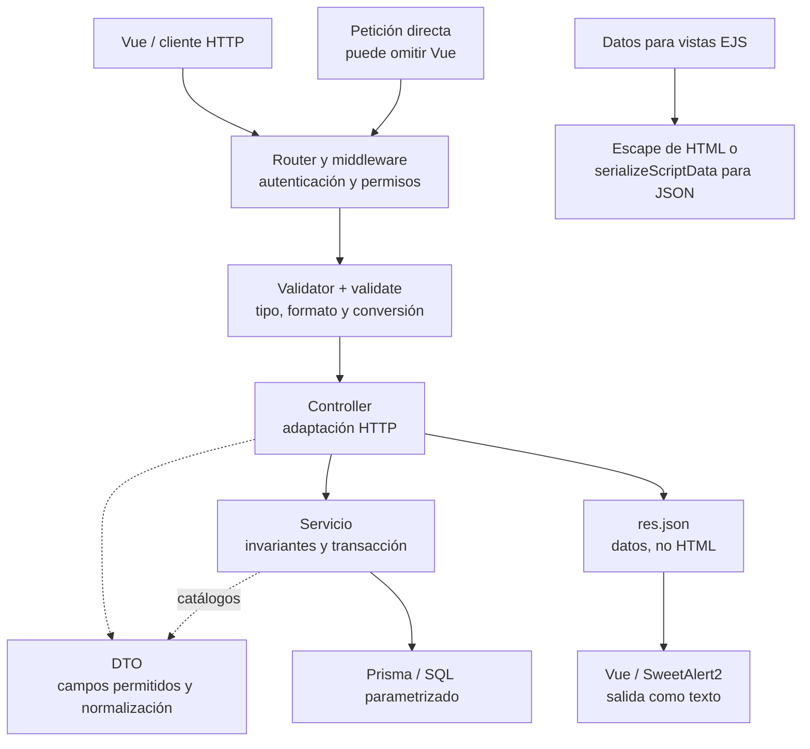

# 9. Errores, seguridad, auditoría y logging

- Se reutilizan `AppError` y los errores de dominio existentes. No se arrojan strings ni
  se responde con una forma de error exclusiva de un endpoint.
- Las reglas de `express-validator` entregan códigos declarados en `errorMap`; no
  incluyen mensajes visibles literales en `withMessage`. Todo código nuevo que deba
  mostrarse se registra también en `public/js/constants/apiMessages.js` para conservar
  una sola traducción de servidor a interfaz.
- Los mensajes para el cliente no exponen stack traces, SQL, credenciales ni detalles
  internos.
- Autenticación y autorización permanecen en middleware y servidor. Ocultar un control
  en la interfaz no sustituye verificar el permiso.
- Todo JavaScript entregado al navegador, incluido `/shared`, es público y el usuario
  puede modificar su copia. La seguridad de una escritura debe mantenerse ante una
  solicitud directa que omita el formulario o altere sus campos.
- El servidor calcula los importes y demás resultados derivados que guarda a partir
  de entradas validadas y datos autorizados. Los DTOs y servicios descartan o rechazan
  los resultados que el cliente intente imponer, conforme al contrato del recurso.
  Un costo de compra capturado por un operador autorizado es una entrada del proceso;
  el impuesto y el total derivados de ese costo se calculan en el servidor.
- Distinguir confidencialidad e integridad: fórmulas generales usadas para una vista
  previa pueden ser públicas; fórmulas propietarias clasificadas como confidenciales
  se ejecutan exclusivamente en el backend. Minificar, ofuscar o renombrar un archivo
  no convierte en privado el código entregado al navegador.
- Contraseñas, tokens, cookies, secretos y datos sensibles no se registran en logs.
- El logger estructurado recibe contexto estable de operación; no se usa `console.log`
  en código de aplicación.
- Una auditoría se registra después de confirmar el efecto que describe o dentro de la
  misma transacción cuando su atomicidad sea parte del contrato.
- Las consultas usan Prisma o parámetros; nunca interpolan entrada del usuario en SQL.

## Entradas, normalización y salida

Los validators comprueban tipo, formato y límites antes del controller. Normalizan
textos mediante `trim` y convierten booleanos, números y fechas sólo después de
validarlos. Las contraseñas se conservan exactamente como fueron capturadas. Los
DTOs seleccionan campos permitidos; no se entrega el body completo a Prisma ni se
aceptan versiones, claves internas o resultados derivados fuera del contrato.

`TEXT_INPUT_PATTERN` es una regla compartida de texto plano: rechaza delimitadores
de marcado y controles no imprimibles, incluido NUL; conserva tabulaciones y saltos
de línea para observaciones. Cada campo puede aplicar una regla más específica.
`sanitizeEmptyStrings` sólo cambia cadenas vacías de primer nivel a `null`: su nombre
histórico no representa un filtro XSS ni una validación recursiva.

El escape pertenece al contexto de salida. Vue interpola texto de forma segura; no
se introduce `v-html` para nombres, observaciones o errores del servidor. EJS usa
`<%=` para texto y atributos. Para datos JSON dentro de `` cierre la etiqueta. No se guardan entidades
HTML en la base para intentar resolver el escape de todas las salidas.

### Qué significa sanitizar en este proyecto

Se distinguen cuatro operaciones: **normalizar** adapta una representación admitida,
**validar** acepta o rechaza el contrato, **escapar** representa texto en una salida
concreta y **sanitizar HTML** elimina construcciones no permitidas cuando el producto
necesita mostrar HTML escrito por usuarios. Los formularios actuales son de texto
plano; no requieren un sanitizador de HTML. Una expresión regular o un interceptor
Axios que borre etiquetas no sustituye ninguno de esos controles.

| Contrato / destino | Regla aplicada y propietario |
| --- | --- |
| Nombres y observaciones | Tipo string antes de `trim`; longitud Unicode y regla del campo en `fieldsValidator` y reglas públicas. Se preservan apóstrofos, acentos y ampersands admitidos; se rechaza el formato inválido, sin quitar caracteres hasta hacerlo válido. |
| Número de proyecto | `PROJECT_NUMBER_PATTERN` admite signos dentro de 10 caracteres, sin controles internos. No usa la restricción de signos de los nombres. Front/back comparten el patrón y el código `PROJECT_NUMBER_INVALID_FORMAT`; no se cambia una captura con NUL en otra referencia. |
| Contraseña de acceso | Sin `trim`, cambio de mayúsculas, escape HTML ni normalización Unicode. El contrato de login conserva compatibilidad histórica; la política de alta es distinta. |
| Booleanos, números, fechas y detalles | Validar tipo, rango, precisión, calendario e items antes de convertir; no usar `parseInt`, `Boolean` o `Number` para decidir por sí solos que una captura es válida. |
| Identificadores y campos adicionales | El DTO admite sólo los campos del caso. El servicio resuelve existencia, pertenencia, estado y versión; un UUID válido no concede autorización. `findManagedCatalog` sólo resuelve propiedades propias del registro. |
| SQL | Prisma o parámetros de consulta. Los dos `$executeRawUnsafe` de costos usan SQL fijo con placeholders y valores separados; no se insertan nombres o capturas en el texto SQL. El escape HTML no protege una consulta. |
| HTML EJS / JSON en script | `<%=` para texto y atributos entre comillas; `<%-` sólo para composición confiable o JSON producido por `serializeScriptData`. Ese helper se limita a datos JSON, no permite insertar funciones ni código. |
| Vue y avisos | Interpolación y props de texto; SweetAlert2 usa `titleText`/`text`. El frontend no usa `v-html`, `innerHTML` ni HTML procedente de un error. La guía de [seguridad de Vue del proyecto](../../../../front/docs/architecture/04-input-security.md) concreta sus consumidores. |

`TEXT_INPUT_PATTERN` conserva restricciones históricas de captura; su exclusión de
ciertos signos **no es una defensa XSS**. El texto guardado o recibido también se
escapa al mostrarlo, aunque proceda de otra aplicación o de registros antiguos.
No se aplica NFC/NFKC globalmente: una política de equivalencia Unicode para nombres
o claves debe revisar comparación, unicidad e históricos antes de adoptarse.

### Fronteras de una escritura de formulario

**Identificador:** `DIA-SEC-FRO-001`. **Pregunta:** ¿dónde se verifica cada dato y
dónde se adapta la salida? **Fuente:** routers API, validators, DTOs, servicios,
`catalogDTO`, Prisma y serializador EJS. Es un recorrido de responsabilidades;
el orden de autenticación, permiso y validación se conserva en cada router.

Los DTOs usados desde el controller entregan su resultado al servicio; el DTO de
catálogos se llama desde el servicio después de resolver la configuración permitida.
El dibujo no convierte todas las escrituras en una transacción ni representa el
orden temporal de cada operación. Las secuencias del recurso conservan ese detalle.

### Ampliaciones que requieren otro contrato

Si aparece un editor de contenido enriquecido, definir etiquetas, atributos y
protocolos permitidos y utilizar una biblioteca mantenida como DOMPurify en la
frontera que publica ese HTML. La validación del servidor sigue siendo necesaria;
un `v-html` futuro necesita revisión explícita y una política verificable. No se
incorpora esa dependencia mientras no exista un consumidor de HTML enriquecido.
Las URL capturadas requieren validar protocolo y destino en el servidor antes de
guardarlas o redirigir; codificar un segmento con `encodeURIComponent` no valida
una URL completa. El escape de atributos no convierte `javascript:` en un enlace seguro.

La evidencia actual está en `formValidationParityTest`, `scriptDataTest`,
`catalogControllersDbTest` y `apiWriteValidationDbTest`; los recorridos Vue están
en su [guía de pruebas](../../../../front/docs/testing/01-test-design.md#seguridad-de-texto-y-avisos).

Las notificaciones de inventario se emiten después de completar la operación
correspondiente. Un error posterior al commit no debe presentarse como un rollback
de datos ya confirmados; los contratos y pruebas distinguen ambos resultados.

La auditoría actual posterior a la respuesta no garantiza atomicidad con la escritura.
Si el caso exige esa garantía, su registro debe incorporarse a la transacción; las
limitaciones vigentes se mantienen en [Identidad, acceso y auditoría](../views/logical/02-identity-access-and-audit.md).

Estas reglas siguen las recomendaciones de
[OWASP sobre lógica de negocio](https://cheatsheetseries.owasp.org/cheatsheets/Business_Logic_Security_Cheat_Sheet.html#always-re-derive-security-relevant-values-server-side),
[protección del frontend](https://cheatsheetseries.owasp.org/cheatsheets/Web_Frontend_Security_Cheat_Sheet.html#never-transmit-secrets-to-the-client)
y [CWE-602](https://cwe.mitre.org/data/definitions/602.html). Las distinciones de entrada y
salida se contrastan con [validación de OWASP](https://cheatsheetseries.owasp.org/cheatsheets/Input_Validation_Cheat_Sheet.html),
[prevención XSS de OWASP](https://cheatsheetseries.owasp.org/cheatsheets/Cross_Site_Scripting_Prevention_Cheat_Sheet.html)
y [seguridad de Vue](https://vuejs.org/guide/best-practices/security.html).
