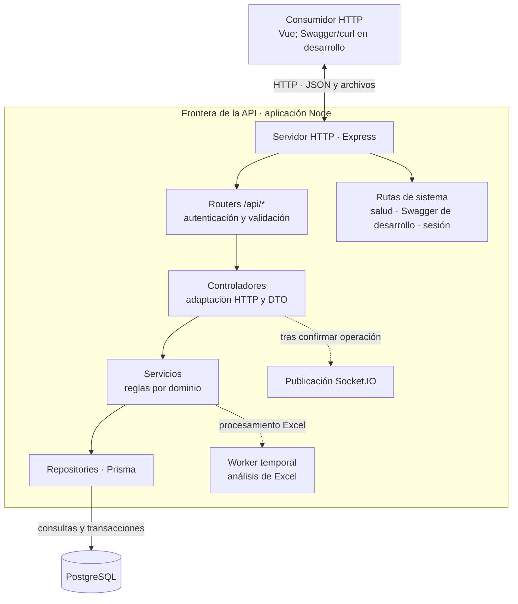

# Arquitectura de la API

## Datos generales del documento

| Versión documental | Versión del sistema | Estado | Fecha | Responsable |
| --- | --- | --- | --- | --- |
| 1.14 | 1.0.0 | En revisión | 2026-11-17 | Equipo Nexus |

La API expone operaciones HTTP desde Express. Las rutas aplican middleware y delegan
en controladores; los servicios coordinan reglas por dominio y transacciones. Prisma
y repositories acceden a PostgreSQL. El frontend Vue es su consumidor web; la API no
sirve la SPA ni renderiza sus páginas.

El [diagrama general aplicado](../../../front/docs/architecture/views/overview.md#arquitectura-general-aplicada)
concentra cliente-servidor y las capas de frontend y backend. Esta documentación
detalla la API desde sus vistas lógica, de procesos, desarrollo y despliegue. Usa
ISO/IEC/IEEE 42010 como referencia; la
[organización de vistas](views/index.md) identifica alcance y notaciones.

## Arquitectura aplicada a la API

La API sigue un estilo cliente-servidor de solicitud-respuesta HTTP y una estructura
de monolito modular por dominio y capas. Las rutas públicas se agrupan bajo `/api`;
salud, Swagger de desarrollo y cierre de sesión tienen rutas de sistema. Las capas
corren en el mismo proceso Node y no son servicios independientes.

OpenAPI define las operaciones HTTP y sus esquemas; el componente `socket` es un
canal complementario del mismo servidor y Vue actualmente no se suscribe. El worker
se crea dentro del backend para una operación, no es otro servicio. La
[vista lógica](views/logical/01-components-and-reuse.md) detalla dependencias y capas;
la [vista física](views/physical/01-system-runtime-and-deployment.md) se limita a
ejecución, conexiones y despliegue de la API. El contexto de Vue y del sistema completo
está en el [diagrama general](../../../front/docs/architecture/views/overview.md#arquitectura-general-aplicada).

| Pregunta | Documento |
| --- | --- |
| ¿Qué contratos HTTP expone la API? | [OpenAPI](openapi/index.md) |
| ¿Qué middleware, controladores y servicios atienden cada operación? | [Vista lógica](views/logical/index.md) y [secuencias](views/processes/index.md) |
| ¿Dónde se confirma una escritura y cómo responde un fallo? | [Procesos](views/processes/index.md) y [errores HTTP](openapi/api-contract.md) |
| ¿Cómo accede la API a PostgreSQL? | [Persistencia](views/logical/data-and-persistence/index.md) |
| ¿Cómo se construye, inicia y despliega el proceso API? | [Vista física](views/physical/index.md) y [Desarrollo backend](../development/index.md) |
| ¿Dónde viven los módulos y patrones de implementación? | [Vista de desarrollo](views/development/index.md) |
| ¿Qué convenciones sigue el código de la API? | [Estándares de código](coding-standards/index.md) |

Los flujos de pantalla se documentan en la [arquitectura Vue](../../../front/docs/architecture/index.md);
los comandos y la preparación del entorno de la API, en [Desarrollo backend](../development/index.md).
