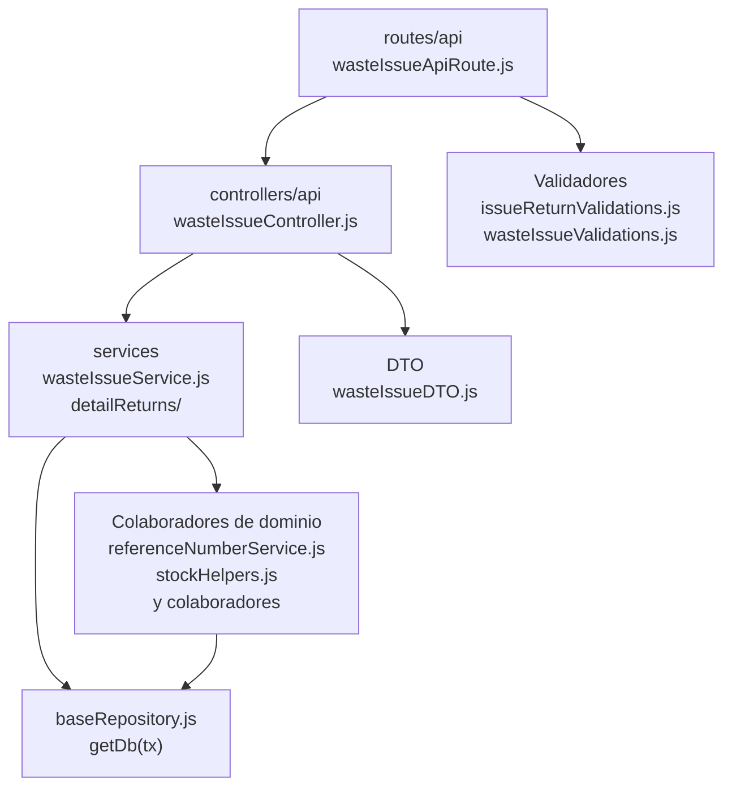

# 14. Salidas de mermas: estructura de código

**Identificador:** `DIA-BE-MOD-WIS-001`.
**Alcance:** grupos de implementación del módulo y sus dependencias directas.
**Fuente:** imports de los archivos de la tabla.

| Grupo del mapa | Archivos que lo componen |
| --- | --- |
| routes/api · wasteIssueApiRoute.js | `src/routes/api/warehouse/` `wasteIssueApiRoute.js` |
| controllers/api · wasteIssueController.js | `src/controllers/api/warehouse/` `wasteIssueController.js` |
| services · wasteIssueReturnService.js · wasteIssueFulfillmentService.js · y colaboradores | `src/services/warehouse/wasteIssues/` `detailReturns/wasteIssueReturnService.js` `src/services/warehouse/wasteIssues/` `wasteIssueFulfillmentService.js` `src/services/warehouse/wasteIssues/` `wasteIssueDetailService.js` `src/services/warehouse/wasteIssues/` `wasteIssueService.js` |
| DTO · wasteIssueDTO.js | `src/dtos/wasteIssueDTO.js` |
| Colaboradores de dominio · referenceNumberService.js · stockHelpers.js · y colaboradores | `src/services/document/` `referenceNumberService.js` `src/services/inventory/stockHelpers.js` `src/services/warehouse/` `fulfillmentStatusService.js` `src/services/warehouse/issues/` `issueFulfillmentRules.js` `src/services/warehouse/issues/` `issueHeaderService.js` `src/services/warehouse/wastes/` `wasteMovementService.js` |
| Validadores · issueReturnValidations.js · wasteIssueValidations.js | `src/validators/forms/` `issueReturnValidations.js` `src/validators/forms/` `wasteIssueValidations.js` |
| baseRepository.js · getDb(tx) | `src/repository/baseRepository.js` |

## Contratos de implementación

`wasteIssueDetailService.js` coordina el surtido; `wasteIssueFulfillmentService.js`
resuelve únicamente identificadores de estados. `issueDetailRepository.js` persiste
los detalles solicitados en una actualización parametrizada por lote, compartida con
materiales. `wasteIssueHelpers.js` conserva la preparación de detalles, la selección
de relaciones y la adaptación de respuesta compartidas con el CRUD. Las operaciones
de edición, surtido y devolución conservan el bloqueo de la salida durante su `tx`.

Los conflictos de estado, merma duplicada y merma no disponible se distinguen mediante
códigos de `errorMap.wasteIssue`, traducidos en `apiMessages.js`. La ausencia de estados
configurados devuelve HTTP 500; no se atribuye ese fallo a los datos del usuario.

### Datos, resultados y efectos del módulo

| Capacidad | Entrada y retorno | Reglas, errores y persistencia |
| --- | --- | --- |
| Salidas de mermas: `wasteIssueController.js`, `wasteIssues/wasteIssueService.js`, `wasteIssueDetailService.js` y reglas compartidas de `issues` | Lista, alta, edición, encabezado y detalles retornan documento actualizado. | Reutiliza reglas de encabezado/cumplimiento, aplica movimiento de merma y conserva documento, detalle e inventario en un `tx`. |
| Devolución de merma: `wasteIssueController.registerWasteIssueDetailReturn` y `detailReturns/wasteIssueReturnService.js` | Identificadores y cantidad retornan la salida de merma actualizada. | Valida devolución, revierte inventario de merma y recalcula cumplimiento de manera atómica. |

| Archivo bajo `src/` | Símbolos públicos y puntos de configuración |
| --- | --- |
| `controllers/api/warehouse/` `wasteIssueController.js` | `getAllWasteIssues` `registerWasteIssue` `editWasteIssue` `editWasteIssueHeader` `editWasteIssueDetails` `registerWasteIssueDetailReturn` |

### Normalización de datos

| Archivo bajo `src/` | Símbolos públicos y puntos de configuración |
| --- | --- |
| `dtos/wasteIssueDTO.js` | `createWasteIssueDtoForRegister` `createWasteIssueDtoForEdit` `createWasteIssueHeaderDtoForEdit` `createWasteIssueDetailsDtoForEdit` `createWasteIssueDtoForReturn` |

## Variantes y límites de reutilización

wasteIssueController usa wasteIssueDTO y servicios propios de salida/devolución. Comparte encabezado/cumplimiento con goodsIssues, pero conserva movimientos e inventario de merma.

Los reportes y la infraestructura transversal se localizan en el
[capítulo 3](03-shared-code-and-coverage.md); el orden de llamadas está en
[procesos](../../processes/backend-code-sequences/index.md).

