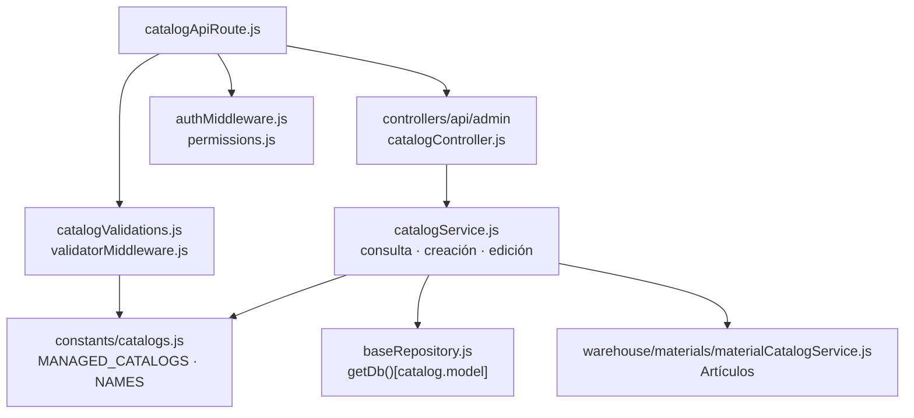

# 16. Catálogos auxiliares: administración y lecturas operativas

## Alcance y clasificación

El módulo administrativo gestiona seis catálogos auxiliares y el catálogo de artículos.
Artículos usa el mismo endpoint, con validaciones y persistencia propias; sus existencias
y relaciones con proveedores pertenecen a los módulos operativos de Almacén.
Clientes, proveedores, consumibles y mermas conservan sus módulos y permisos.
El contrato funcional de Artículos y de las altas de existencias está en
[`RF-CAT-030/031`](../../../../../../front/docs/requirements/requirements-specification/catalog/02-catalogs-operational-and-commercial.md#criterios-de-alta-de-artículos).

## Archivos del módulo administrativo

**Identificador:** `DIA-BE-MOD-CAT-001`. **Pregunta:** ¿qué archivos construyen la
administración y qué configuración limita su persistencia? **Fuente:** imports de
routers, controllers, servicio y validators. **Leyenda:** flechas = import entre grupos de archivos, no un orden HTTP.

| Responsabilidad | Archivos bajo `src/` |
| --- | --- |
| Registro permitido | `constants/catalogs.js` |
| Transporte API | `routes/api/admin/catalogApiRoute.js` |
| Contrato JSON | `controllers/api/admin/` `catalogController.js` |
| Selección y normalización de campos | `dtos/catalogDTO.js` |
| Resolución, invariantes y persistencia | `services/admin/catalogService.js` `repository/baseRepository.js` |
| Validación y acceso | `validators/forms/catalogValidations.js` `middleware/validatorMiddleware.js` `middleware/authMiddleware.js` `constants/permissions.js` |

## Catálogos auxiliares

Fuente: `src/constants/catalogs.js`. `model` es el delegado del cliente Prisma;
la correspondencia con el modelo está definida en `prisma/schema.prisma`.
Estos seis registros admiten `isActive` booleano, además de los campos indicados.

| Clave de página y API | Etiqueta | Delegado / modelo Prisma | Texto permitido y longitud máxima |
| --- | --- | --- | --- |
| `departments` | Áreas | `department` / `Department` | `name`: 50 |
| `roles` | Roles | `role` / `Role` | `name`: 50 |
| `presentations` | Presentaciones | `presentation` / `Presentation` | `name`: 50 |
| `unit-measures` | Unidades de medida | `unitMeasure` / `UnitMeasure` | `name`: 20; `symbol`: 10 |
| `reasons` | Motivos de ajuste | `stockAdjustmentReason` / `StockAdjustmentReason` | `name`: 100 |
| `fulfillment-statuses` | Estados de cumplimiento | `fulfillmentStatus` / `FulfillmentStatus` | `name`: 50 |

## Catálogo de artículos

La clave `materials` también usa `MANAGED_CATALOGS`. Su etiqueta visible es **Artículos**;
el registro almacena `name`, `type`, `presentationId`, `unitMeasureId`, `base`, `height`
del artículo. `materialCatalogService.js` combina nombre, tipo, presentación y
unidad de medida en la consulta paginada.
La validación de escritura se delega a `materialCatalogValidation` y
`materialCatalogEditValidation`, y las operaciones al servicio de materiales. No usa
`isActive` ni la validación CRUD genérica de los catálogos auxiliares.

El validator resuelve cada clave con `findManagedCatalog` y aplica
los límites del catálogo; el servicio vuelve a resolver la clave y usa `catalogDTO`
para conservar campos propios permitidos y recortar textos. Comprueba tipos y
longitudes antes de persistir. El cliente no
elige un modelo Prisma ni define campos persistibles mediante el body.
La resolución exige una propiedad propia del registro: nombres heredados como
`constructor` o `__proto__` son catálogos inexistentes, con el mismo 404 seguro.
Los límites de texto se cuentan por caracteres Unicode tanto en el validator como
en el servicio, sin confundirlos con unidades UTF-16.

## Contratos y límites implementados

| Frontera | Contrato verificable |
| --- | --- |
| Administración | El registro API monta `/api/admin/catalogs`; el router ofrece GET `/:catalog`, POST `/:catalog` y PUT `/:catalog/:id`. Exige token. Los catálogos auxiliares requieren `catalogs:manage`; Artículos acepta `catalogs:manage` o `material-catalogs:manage`. Este último también autoriza GET de presentaciones y unidades para los selectores. No declara DELETE. |
| Listado | El controller obtiene paginación/búsqueda; `findAllCatalogEntries` ordena por nombre y devuelve `data`, `recordsTotal` y `recordsFiltered`. Incluye activos e inactivos. |
| Escrituras | Devuelven `data` y código de éxito. Desactivar/reactivar es editar `isActive`; el servicio no implementa borrado físico ni una operación separada de desactivación. |
| Errores | `CatalogNotFound` rechaza claves ajenas al registro; `CatalogValidationError` rechaza datos inválidos. En edición, `P2025` y `P2023` se traducen a `CatalogEntryNotFound`; otros errores se propagan. |
| Interfaz | Vue obtiene las etiquetas y campos de `PUBLIC_CATALOGS`, compartido desde `src/shared/constants/catalogs.js`, y consulta `/api/admin/catalogs/:catalog`. `catalogs:manage` administra los catálogos auxiliares; Artículos usa `material-catalogs:manage`. |

Los nombres de roles y áreas participan en `constants/permissions.js`; crear o renombrar
un registro no modifica esas políticas. Los nombres de estados se usan mediante
`shared/constants/fulfillmentStatuses.js`, `shared/constants/goodsReceiptStatuses.js`
y consultas de cumplimiento: administrar filas tampoco
crea transiciones nuevas. El módulo común no aplica una regla específica que proteja
esos nombres de edición. Son dependencias de código que deben revisarse al mantener
estos catálogos, no capacidades de configuración dinámica de permisos o estados.

## Lecturas operativas de los mismos datos

La administración y las consultas operativas usan los mismos modelos mediante módulos
separados. Las rutas operativas tienen permisos propios y filtran `isActive: true` para
opciones. Vue las consulta desde los servicios de cada módulo mediante `RemoteSelect`.
Desactivar conserva la fila; el filtro de opciones no elimina referencias históricas ni
implica que toda consulta interna filtre activos.

| Catálogo | Ruta de lectura bajo `/api` | Servicio bajo `src/services` |
| --- | --- | --- |
| Áreas | `/admin/departments` | `admin/departmentService.js` |
| Roles | `/admin/roles` | `admin/roleService.js` |
| Presentaciones | `/warehouse/presentations` | `warehouse/presentationService.js` |
| Unidades | `/warehouse/unit-measures` | `warehouse/unitMeasureService.js` |
| Motivos | `/warehouse/reasons` | `warehouse/reasonService.js` |
| Cumplimiento | `/warehouse/fulfillment-statuses` | `warehouse/fulfillmentStatusService.js` |
| Artículos | `/warehouse/materials` | `warehouse/materials/materialCatalogService.js` |

El [mapa de lecturas operativas](03-shared-code-and-coverage.md#lecturas-operativas-y-reportes)
posee sus imports. El [patrón del registro](../design-and-construction-patterns/08-catalog-registry-and-allowlist.md)
justifica la configuración compartida; las [secuencias de catálogos](../../processes/backend-code-sequences/catalogs/index.md)
son propietarias del orden de ejecución. La evidencia automatizada incluye
`tests/unit/services/admin/catalogServiceTest.js`, `tests/unit/validators/catalogValidationTest.js`
y `tests/integration/controllers/catalogControllersDbTest.js`.
