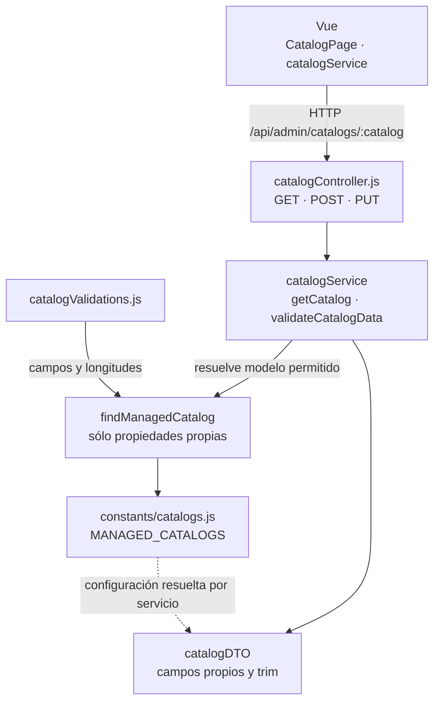

# 8. Registro de catálogos con lista blanca

`MANAGED_CATALOGS` declara los seis catálogos auxiliares y Artículos. El servicio acepta
sólo esas claves; para Artículos delega la validación y persistencia al módulo de
materiales. Los detalles están en las [referencias de backend](../backend-technical-documentation/16-catalogs-code.md)
y en el [módulo Vue de catálogos](../../../../../../front/docs/architecture/views/development/code-structure.md).

### Diagrama del patrón de catálogos administrables

**Identificador:** `DIA-ARQ-CAT-001`. **Pregunta:** ¿cómo limita el registro las
operaciones administrativas? **Fuente:** `constants/catalogs.js`, `catalogService.js`,
`catalogValidations.js` y `catalogController.js`. **Leyenda:** flechas = dependencia;
los nodos de función/campo son partes de archivos existentes, no nuevos módulos.

El controller adapta HTTP; `catalogService` vuelve a resolver la clave y valida la
entrada. Las rutas exigen permisos antes de llegar al servicio.

## Mecanismos reutilizados y fronteras

| Mecanismo | Implementación y referencia |
| --- | --- |
| Lista blanca del servidor | El registro fija modelos, campos y longitudes. Validator y servicio usan `findManagedCatalog`; el validator omite un catálogo desconocido y el servicio devuelve `CATALOG_NOT_FOUND`. Nombres heredados como `constructor` no son entradas del registro. [Backend](../backend-technical-documentation/16-catalogs-code.md#contratos-y-límites-implementados). |
| Interfaz común | Vue usa `CatalogPage.vue`, `catalogService.ts` y la definición pública de cada catálogo. [Estructura Vue](../../../../../../front/docs/architecture/views/development/code-structure.md). |
| Lecturas operativas | Las opciones activas se consultan mediante rutas y servicios de cada dominio. [Lecturas backend](../backend-technical-documentation/16-catalogs-code.md#lecturas-operativas-de-los-mismos-datos). |

## Límites y extensión

Los catálogos auxiliares requieren `catalogs:manage`; Artículos acepta además
`material-catalogs:manage`. Este permiso también habilita la lectura de presentaciones
y unidades de medida para los selectores. El parámetro `catalog` selecciona una clave
permitida; ocultar navegación o validar en el navegador no reemplaza el control del
servidor. Desactivar es editar `isActive`, no eliminar. El registro no administra
permisos ni define las transiciones de cumplimiento.

Las rutas de administración son `GET /:catalog`, `POST /:catalog` y `PUT /:catalog/:id`.
El flujo completo y los campos por catálogo están en las
[secuencias](../../processes/backend-code-sequences/catalogs/index.md) y en la
[referencia técnica](../backend-technical-documentation/16-catalogs-code.md).
