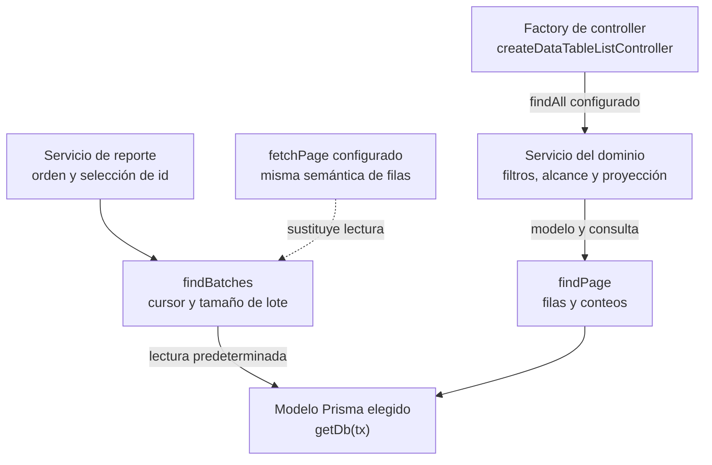

# 16. Principios SOLID en funciones y módulos

SOLID orienta dependencias y contratos; no es un patrón adicional ni una norma de
carpetas. Se aplica a este monolito funcional y a Vue por composición. No exige
introducir clases, herencia, un contenedor de inyección o un repository por entidad.

## Aplicación comprobada y límites

| Principio | Evidencia en backend | Aplicación y límite |
| --- | --- | --- |
| S — Responsabilidad única | Validators, DTOs, controllers, servicios, repositories y serializador de salida tienen propietarios distintos. `catalogDTO` selecciona y recorta campos; `catalogService` conserva resolución e invariantes. | Separar motivos de cambio. Una función que delega varias colaboraciones puede tener una sola responsabilidad: coordinar el caso. No dividir sólo por cantidad de líneas. |
| O — Abierto/cerrado | `createDataTableListController`, `MANAGED_CATALOGS`, `findPage` y `findBatches` reciben configuración o colaboradores. | Extender un contrato estable sin copiar el núcleo. Un catálogo con reglas ajenas al registro sigue en su módulo; modificar ese contrato común exige revisar consumidores. |
| L — Sustitución de Liskov | `fetchPage` de `findBatches` permite una lectura concreta bajo el mismo contrato: filas ordenadas, id seleccionado, límite y avance de cursor. | La sustitución incluye comportamiento, errores y efectos; no basta la firma. No se declara conformidad general: los casos actuales comprueban contratos concretos. `QueuedPrismaPg` debe conservar resultados, commit y rollback del adaptador que extiende. |
| I — Segregación de interfaces | La factory de listados recibe `findAll` y opciones de respuesta; los repositories reciben el modelo y `tx` que necesitan. | Evitar exigir operaciones de escritura a un consumidor de lectura. Las formas de objetos y callbacks también son interfaces aunque JavaScript no declare `interface`. |
| D — Inversión de dependencias | La factory recibe la operación; `findPage` recibe un modelo; `findBatches` recibe `fetchPage` y permite su implementación predeterminada. | Aplicación parcial: se inyectan colaboradores donde existe variación real. Los servicios todavía usan Prisma mediante `getDb(tx)`; no hay independencia completa de persistencia ni arquitectura hexagonal implementada. |

En Vue, páginas y composables componen contratos de props, eventos y callbacks;
la evidencia y figura propietarias están en [patrones del frontend](../../../../../../front/docs/patterns/01-applicability-and-principles.md).

## Colaboradores de lectura y contrato de sustitución

**Identificador:** `DIA-SOLID-LECT-001`. **Pregunta:** ¿qué decide el dominio y qué
recibe el núcleo reutilizable? **Fuente:** `createDataTableListController`,
`paginationRepository` y servicios de listado/reporte. Flechas continuas representan
colaboración; la discontinua representa una alternativa de configuración existente,
no otra capa de persistencia ni una secuencia de la misma petición.

La operación del reporte debe conservar un orden estable con id como desempate.
El núcleo detecta tamaño inválido, id ausente y cursor sin avance. No certifica que
cualquier callback arbitrario respete el contrato ni valida todo el contenido de
un reporte. `paginationRepositoryTest` cubre el avance y las integraciones XLSX
comprueban filas reales, orden y conservación al cruzar lotes.

## Patrones que realizan esos principios

El [catálogo confirmado](02-confirmed-patterns.md) sigue siendo el inventario de
patrones: pipeline de middleware, DTO funcional, factory, registro con lista blanca,
contexto transaccional, publicación de eventos y composición visual. SOLID explica
por qué se conservan sus límites; no renombra todo el código como un patrón GoF.
La [frontera de datos](../../../coding-standards/09-errors-security-audit-and-logging.md#fronteras-de-una-escritura-de-formulario)
ubica validación, normalización, autorización, persistencia y escape de salida.

## Criterios para la próxima extracción

- Identificar cambios independientes y consumidores reales antes de extraer.
- Mantener parámetros y resultados pequeños, errores estables y cancelación cuando aplique.
- Inyectar la operación variable; conservar sus reglas específicas en el módulo.
- Preservar transacciones, `expectedVersion`, `operationId` y emisión posterior al commit.
- No convertir helpers triviales en capas ni trasladar política de negocio al componente visual.

El objetivo es reducir acoplamiento con contratos verificables. Esta revisión no
afirma que toda la aplicación cumpla los cinco principios de manera completa.

Referencia conceptual: [Robert C. Martin, Solid Relevance](https://blog.cleancoder.com/uncle-bob/2020/10/18/Solid-Relevance.html).
La aplicación al código anterior es una evaluación del proyecto, no una exigencia
del framework ni una certificación de diseño.
