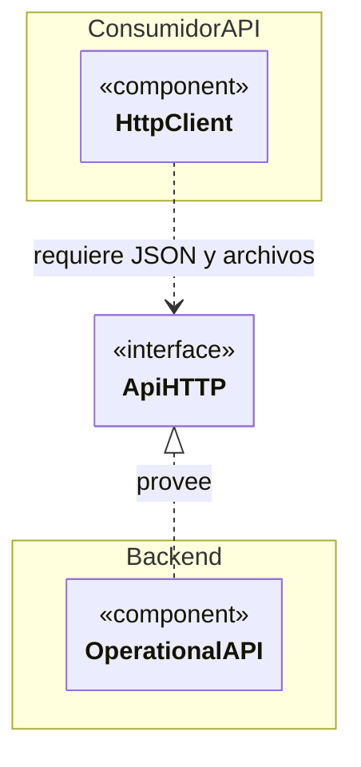
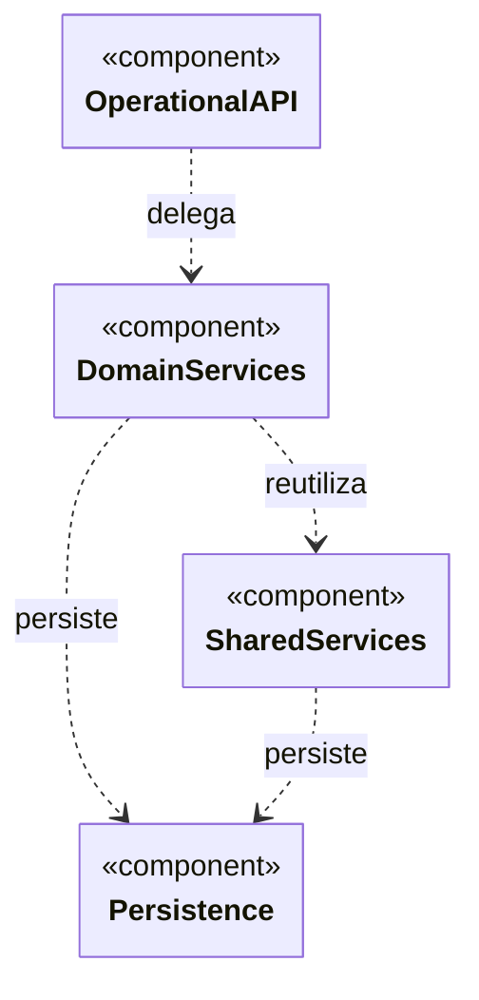
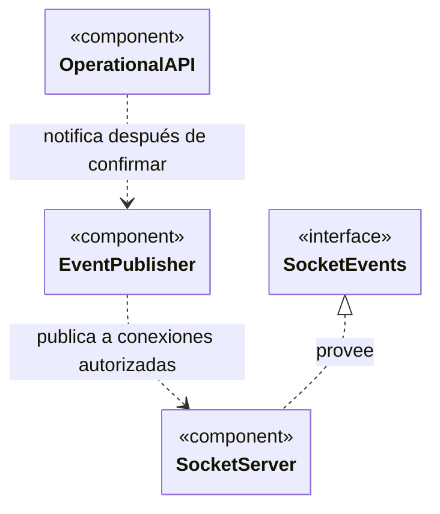

# 1. Componentes y contratos de la API

La vista muestra componentes y dependencias. El orden de las peticiones pertenece a
la [vista de procesos](../processes/index.md).

## Componentes y dependencias

**Componentes y contratos con clasificadores UML en Mermaid:** `DIA-ARQ-CMP-001`.

### Consumidor y contrato HTTP

### Colaboración interna del backend

`OperationalAPI` corresponde al proveedor de la interfaz HTTP de la figura anterior.

### Canal de eventos

Esta figura separa Socket.IO de las peticiones HTTP para conservar legibilidad.
`OperationalAPI` es el mismo componente de la figura anterior. El servidor expone
Socket.IO; el cliente Vue actual no implementa una suscripción a ese canal.

`<<component>>` identifica componentes y `<<interface>>` contratos. `<|..` indica
realización y `..>` dependencia. Mermaid aproxima esta vista con clasificadores;
no dibuja puertos ni conectores de componente UML nativos. El cliente Vue actual
consume el contrato HTTP; su alojamiento y composición visual quedan fuera del
proceso Express.

| Componente | Responsabilidad |
| --- | --- |
| `HttpClient` | Cliente Axios de Vue; consume la API y gestiona renovación de sesión y reintento ante 401. |
| `OperationalAPI` | Express registra rutas HTTP, aplica middleware y entrega JSON y descargas; no renderiza las pantallas Vue. |
| `DomainServices`, `SharedServices` | Aplican reglas del dominio y colaboraciones reutilizables; las escrituras compuestas conservan una transacción. |
| `Persistence` | Repositories y Prisma; la estructura de tablas pertenece al modelo persistente. |
| `EventPublisher`, `SocketServer` | `socketUtils.js` autentica conexiones y revalida identidad/permisos antes de publicar avisos. |

Las fuentes son `src/app.js`, `src/routes/api/index.js`, `src/routes/system/index.js`,
`src/server.js` y `src/utils/socketUtils.js`; Vue usa `front/src/shared/http/apiClient.ts`.

HTTP y Socket.IO son contratos separados de la misma aplicación. Los avisos se emiten
tras completar la operación correspondiente; no sustituyen la respuesta HTTP ni la
consulta de datos del listado.

## Reutilización y mantenimiento

Las factories y consumidores de servicios se detallan en los
[diagramas de reutilización](../development/reuse-and-refactoring/index.md).
Las [colaboraciones por dominio](../development/code-structure/03-backend-domains-and-dependencies.md)
amplían las dependencias y [OpenAPI](../../openapi/openapi.json) define los contratos HTTP.

La edición de nombre y mínimo no vuelve a resolver presentación ni unidad si
la identidad se conserva. Al vincular por ID se reutiliza la presentación activa
leída en la transacción; una opción inactiva se rechaza.

Al extender un componente, reutilizar el flujo compartido y mantener las reglas
específicas en su dominio. Actualizar esta vista sólo si cambia la estructura; imports
y rutas se comprueban en el [mapa generado](../development/code-map.md).

## Movimientos y peso de merma

Movimientos contiene tres accesos con una implementación visual compartida.
Materiales y consumibles comparten almacenamiento y consulta interna; sus rutas
fijan la clasificación. Merma conserva sus tablas de historial. Los Excel son
acciones de cada consulta, aunque sus routers estén agrupados por dominio en
`admin/reports`; no existe un dominio de negocio adicional de reportes.

La persistencia y el recorrido del peso se consultan en
[datos de merma](data-and-persistence/index.md#peso-unitario-de-merma-de-rollo).

La autenticación y autorización del canal de avisos se definen en
[identidad y acceso](02-identity-access-and-audit.md#cookies-y-canal-de-notificaciones).
El [publicador de inventario](../development/design-and-construction-patterns/10-publication-of-events-of-inventory.md)
explica la selección por permiso, su ejecución asíncrona y sus límites de entrega.
