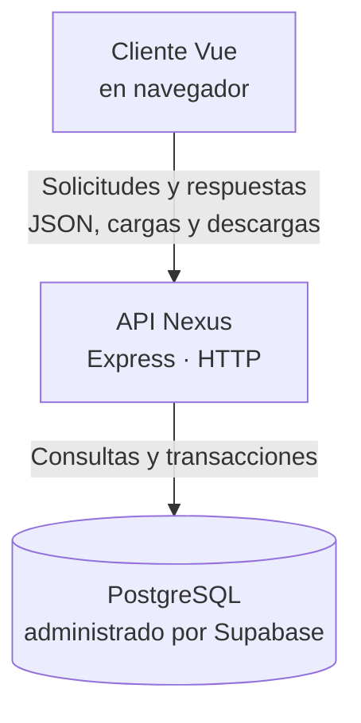
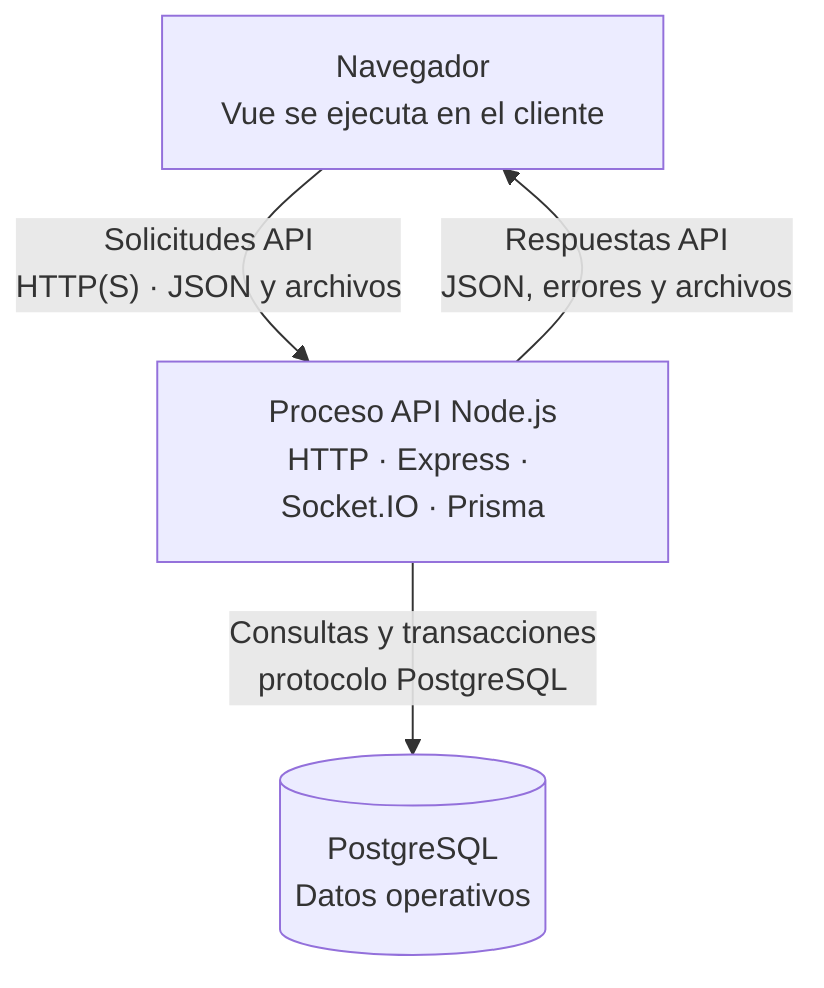
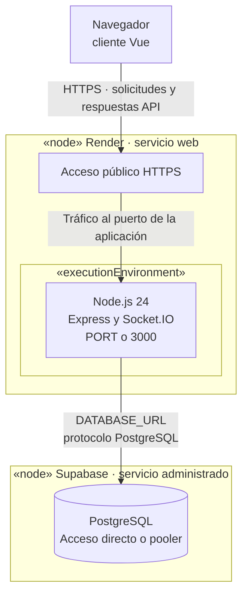
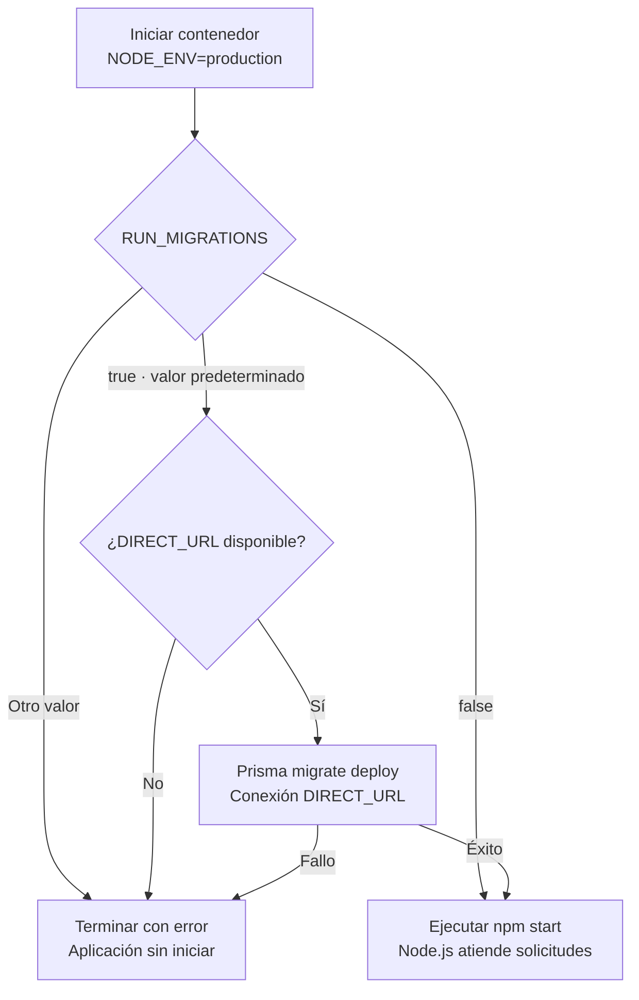
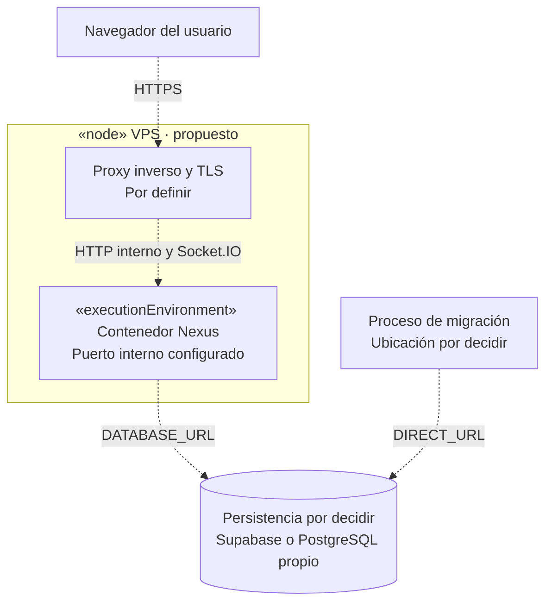

# 1. Ejecución y despliegue de la API

Ejecuta `docker compose` desde la raíz del repositorio. El contexto de construcción
es esa raíz y el Dockerfile copia la aplicación de `back/` a `/app`. En el host,
los comandos npm y Prisma se ejecutan desde `back/`; dentro de la imagen, desde `/app`.

## Alcance y fuentes

Esta vista describe el proceso que expone la API, sus consumidores y sus dependencias
de infraestructura. El servidor de archivos Vue queda fuera de esta frontera; el
cliente sólo aparece para mostrar el protocolo y el límite HTTP. Las capas se describen
en la [vista lógica](../logical/01-components-and-reuse.md).

| Aspecto | Fuente | Qué permite afirmar |
| --- | --- | --- |
| Render y Supabase | Decisión operativa registrada en el `README.md` | Es la topología vigente documentada; el repositorio no verifica la configuración activa del proveedor. |
| Imagen de aplicación | `../Dockerfile` (raíz del repositorio) | Node.js 24, generación de Prisma durante la construcción y ejecución con el usuario `node`. |
| Arranque del contenedor | `docker-entrypoint.sh` | Fuerza producción y, por defecto, aplica migraciones antes de iniciar la aplicación. |
| Servidor y puerto | `src/server.js`; fábrica Express en `src/app.js` | Express y Socket.IO comparten un servidor HTTP que escucha en `0.0.0.0`, con `PORT` o 3000 por defecto. |
| Conexiones a PostgreSQL | `src/lib/prisma.js`, `src/lib/databaseUrl.js` y `prisma.config.ts` | La aplicación usa `DATABASE_URL`; el CLI prefiere `DIRECT_URL`. |
| Ejecución en un host | `../docker-compose.yml` (raíz del repositorio) | Reproduce el contenedor de aplicación; no crea PostgreSQL ni configura Render. |

## Contexto de la API

El cliente Vue consume la interfaz HTTP; los usuarios interactúan con la aplicación,
no directamente con Express. La API autentica y autoriza las solicitudes. Supabase es
una dependencia de persistencia y Render se incorpora en la vista de despliegue.

Swagger UI y `curl` pueden consumir el contrato en desarrollo; la aplicación Vue es
el consumidor web vigente. No se documentan integraciones externas activas.

## Contenedores de ejecución

«Contenedor» identifica aquí una unidad que ejecuta o almacena información. Sólo la
aplicación se empaqueta como imagen Docker; el navegador y PostgreSQL son unidades
externas a esa imagen. Express, Socket.IO y Prisma colaboran en la misma
aplicación y no son servicios desplegados por separado.

| Unidad | Responsabilidad y límite |
| --- | --- |
| Cliente | Ejecuta Vue y llama la API; los assets y su alojamiento son externos al proceso Express. |
| Proceso API | Recibe HTTP, aplica autenticación, autorización y reglas, responde con JSON o archivos y coordina transacciones mediante Prisma. Socket.IO comparte el servidor, pero Vue no está suscrito actualmente. |
| PostgreSQL | Persiste los datos operativos; las cuentas de base de datos son identidades de infraestructura y no roles de la API. |

La API es quien posee este proceso y escucha HTTP y Socket.IO. La figura no atribuye
al backend la entrega de los assets de Vue ni presupone un servicio de mensajería separado.

## Despliegue actual: Render y Supabase

Render publica el servicio web de la API y aloja su contenedor. Supabase administra
PostgreSQL. Las flechas de esta figura son canales de comunicación; el orden de
arranque se representa por separado. Las credenciales se suministran como variables
de entorno, sin mostrarlas en los diagramas.

`PORT` determina el puerto real; `EXPOSE 3000` declara el valor convencional de la
imagen y no configura por sí solo el enrutamiento de Render. HTTPS representa el
acceso público documentado. Las opciones de cifrado, pooler y red de la conexión a
PostgreSQL dependen de las URLs y de la configuración del proveedor, que debe
comprobarse en el entorno desplegado.

### Configurar el servicio API en Render

Conserva el servicio existente si apunta a este repositorio y su despliegue está
sano. Publicar Vue no requiere cambiar sus rutas, secretos ni base de datos.

| Campo | Configuración de esta imagen |
| --- | --- |
| Runtime | Docker. |
| Root Directory | Vacío. |
| Dockerfile Path | `./Dockerfile`. |
| Docker Build Context Directory | `.`. |
| Docker Command | Sin sobrescribir; ejecuta el entrypoint y `npm start`. |
| Rama | La elegida para publicar; debe contener la versión de API compatible con el contrato consumido por Vue. |
| Build Filters, si se usan | `back/**`, `Dockerfile` y `.dockerignore`. |
| Health Check Path | Vacío usa la comprobación TCP de Render. `/api/auth/me` puede responder 401 y no sirve como health check. |

La imagen usa el `PORT` de Render y fuerza `NODE_ENV=production`. Mantén
`DATABASE_URL`, `DIRECT_URL`, `JWT_SECRET_ACCESS` y `JWT_SECRET_REFRESH` en las
variables del servicio. Cambiar los secretos JWT invalida sesiones; no es un paso
necesario para conectar Vue.

Esta imagen usa Node 24. Si conservas un servicio con runtime Node, configura
`NODE_VERSION=24.19.0` o una versión compatible con `back/package.json`; Node 22
no ejecuta el motor SheetKit. Instalar Node localmente no modifica Render.

El entrypoint aplica migraciones con `DIRECT_URL` por defecto. Si Render ya tiene
un **Pre-Deploy Command** para migrar, utiliza una sola fase de migración y arranca
con `RUN_MIGRATIONS=false` después de su éxito. No ejecutes migraciones durante
la construcción de la imagen. El [arranque](#arranque-y-migraciones) y las
[cuentas PostgreSQL](02-postgresql-runtime-and-migration-roles.md) precisan el flujo.

En Supabase, comprueba la compatibilidad IPv4 desde Render. Un host directo que
sólo resuelve IPv6 puede fallar aunque funcione localmente. Para `DIRECT_URL`,
utiliza una conexión directa accesible o el pooler en modo **sesión**, puerto 5432;
el pooler transaccional no sustituye la conexión de migración. Mantén ambos destinos
en la misma base. Véase [Render y Supabase](https://render.com/articles/how-to-connect-a-render-service-to-supabase-postgres).

El alojamiento estático y el proxy del cliente Vue se configuran en la
[guía del frontend](../../../../../front/docs/development/03-build-and-deployment.md#render-conservar-la-api-y-publicar-vue).

## Arranque y migraciones

El contenedor ejecuta `docker-entrypoint.sh` con `NODE_ENV=production`. Si
`RUN_MIGRATIONS` no se indica, adopta `true`. Migrar y atender solicitudes son fases
del mismo contenedor, no dos servicios permanentes.

La fase de migración conecta con la misma base objetivo mediante `DIRECT_URL`; la
fase de aplicación usa `DATABASE_URL`. Un fallo no inicia Node.js y debe revisarse
en los registros de despliegue. Desactivar las migraciones sólo omite esa fase:
no garantiza que el esquema ya sea compatible con la versión que se inicia.

Con la configuración predeterminada, el contenedor recibe ambas URLs. Separarlas
permite usar cuentas con distintos privilegios, pero no elimina la credencial de
migración del contenedor. Para aislarla se necesita un proceso de despliegue separado
que migre antes de arrancar la aplicación con `RUN_MIGRATIONS=false`; esa alternativa
y su aprovisionamiento se explican en el [capítulo de cuentas PostgreSQL](02-postgresql-runtime-and-migration-roles.md).

## Alternativa reproducible en un host

`docker-compose.yml`, en la raíz del repositorio, construye la imagen, carga `back/.env`, activa migraciones y publica
`3000:3000`. Declara el usuario `node`, el sistema de archivos de sólo lectura, un
espacio temporal en `/tmp` y restricciones de capacidades. Esas opciones pertenecen
a Compose; no se deben atribuir automáticamente al servicio administrado de Render.
Si se cambia el puerto interno, también debe revisarse el mapeo de Compose.

Los reportes XLSX usan ese directorio temporal durante la generación y la descarga.
Compose limita `/tmp` a 256 MiB mediante tmpfs; su uso puede contabilizarse como memoria
del contenedor aunque no aparezca en el RSS de Node.js. SheetKit utiliza XML temporal
sin comprimir además del XLSX terminado. Ambos se eliminan al terminar, fallar o
cancelar la petición. El dimensionamiento debe considerar datos y descargas simultáneas, conforme a la
[guía de rendimiento](../../../testing/backend-performance.md).

Este archivo no crea una base local, no termina TLS y no configura copias de
seguridad. La persistencia debe estar disponible mediante las URLs suministradas.

## Despliegue objetivo: aplicación en un VPS

El traslado de la aplicación a un VPS es una propuesta. Las líneas discontinuas
indican conexiones previstas; no evidencian infraestructura ya instalada. Se mantiene
separada la conexión de aplicación de la ruta que emplearía el proceso de migración.

| Decisión pendiente | Qué debe quedar definido antes del traslado |
| --- | --- |
| Publicación del servicio | Dominio, certificados, proxy inverso, puerto interno y soporte de Socket.IO. |
| Persistencia | Continuidad en Supabase o administración propia de PostgreSQL, conectividad y cifrado. |
| Despliegue y migraciones | Construcción de la imagen, suministro de secretos, orden de migración y arranque, y recuperación ante fallos. |
| Operación | Copias de seguridad y restauración comprobada, registros, monitoreo y recuperación del servicio. |

Las figuras de despliegue son aproximaciones con `flowchart` y estereotipos UML;
Mermaid no representa aquí conectores y puertos UML nativos. No especifican cantidad
de réplicas, alta disponibilidad, redes privadas ni un mecanismo de despliegue que
no esté documentado. Una configuración versionada o una verificación del proveedor
es necesaria para convertir la topología objetivo en vigente.

## Disponibilidad y ciclo de vida

`src/server.js` es el punto de entrada de npm y de la imagen Docker (Node directo).
`createApp()` construye Express sin escuchar ni crear Socket.IO. Las rutas públicas
`/health/live` y `/health/ready`, registradas por el router web de salud, comprueban
respectivamente el proceso y la disponibilidad de PostgreSQL. Readiness usa `SELECT 1`,
espera hasta dos segundos y comparte una consulta pendiente para evitar acumulación.
No comprueba migraciones ni garantiza la disponibilidad de todas las operaciones.
Ambas respuestas evitan caché y no revelan detalles internos; readiness devuelve 503
cuando la base no responde o el proceso está cerrando.

SIGTERM/SIGINT inician un cierre idempotente: retirar disponibilidad, cerrar la escucha
y Socket.IO, drenar HTTP y desconectar Prisma. El límite de diez segundos fuerza
salida con código 1 si no termina; Compose concede quince segundos. Las conexiones
de tiempo real deben reconectar después de un despliegue. La configuración remota
del proveedor debe apuntar su health check a `/health/ready`; no se cambia desde aquí.

Los avisos de inventario dejan de ser globales: se autentica la cookie de acceso al
conectar y se consulta nuevamente la cuenta y sus permisos antes de emitir a cada
socket local. Inventario exige el permiso de lectura de su contexto y movimientos
exige `movements:read`. Un fallo de notificación se registra sin convertir una
escritura confirmada en error. Esta distribución es de una sola instancia y añade
una lectura de permisos por conexión y aviso; debe medirse antes de escalar.

## Logs técnicos hacia Grafana Cloud

El destino es el endpoint público de ingestión de Loki del stack. Copia el host
y el ID de instancia de Loki desde **Grafana Cloud Portal → Loki → Details**.

La API emite JSON Pino por stdout. En producción, el nivel predeterminado es
`info` para conservar el arranque, el cierre y los resúmenes de importación.
El perfil HTTP de producción omite éxitos rutinarios y conserva errores
inesperados, eventos de seguridad y respuestas exitosas excepcionalmente lentas.

| Variable de la API | Valor y efecto |
| --- | --- |
| `LOG_LEVEL` | `info` en producción y `warn` en los demás ambientes. Configura el nivel mínimo de Pino. |
| `LOG_SLOW_HTTP_MS` | Umbral positivo en milisegundos. El valor predeterminado es 1000. |
| `LOG_HTTP_ROUTINE` | En producción, `true` habilita temporalmente los accesos rutinarios. Se registran a nivel `info`, o `debug` para rechazos esperados. En desarrollo, `false` los omite. |

### VPS con Docker y systemd

`compose.logs.yml` es una sobreescritura para un host Linux con systemd y Docker.
Valida la combinación desde la raíz con `docker compose -f docker-compose.yml
-f compose.logs.yml config --quiet`, usando la configuración del ambiente.
Aplica ambos archivos en el siguiente arranque autorizado o recreación de la API.
Docker etiqueta sus entradas del journal con `CONTAINER_TAG=nexus-api`.
Configura en journald límites de espacio y retención acordes a los demás servicios
del host. Usa este perfil para un solo ambiente de Nexus por host y journal.

Instala Grafana Alloy como servicio con acceso de lectura al journal de
Docker, sin grupo `docker` ni acceso al socket. Copia los archivos de
`ops/alloy/` a un directorio dedicado (por ejemplo `/etc/alloy/nexus/`) y apunta
el servicio de Alloy a ese directorio. Deja su interfaz HTTP en loopback.
Configura estas variables en el entorno de Alloy. Si usas systemd, puedes leerlas
desde un `EnvironmentFile` exclusivo de Alloy con permisos restringidos.
Para el servicio de Alloy configura sólo una de las dos opciones de token.

| Variable de Alloy | Contenido |
| --- | --- |
| `NEXUS_LOG_ENVIRONMENT` | Nombre estable del ambiente, por ejemplo `staging`. |
| `GRAFANA_LOKI_HOST` | Host de escritura de Loki que muestra Grafana Cloud, sin protocolo ni ruta. Alloy forma la URL HTTPS y añade `/loki/api/v1/push`. |
| `GRAFANA_LOKI_USERNAME` | Identificador de usuario de Loki del stack. |
| `GRAFANA_LOKI_TOKEN` | Token `logs:write` cargado desde el entorno. |
| `GRAFANA_LOKI_TOKEN_FILE` | Ruta absoluta de un archivo con el token `logs:write`, legible sólo por Alloy y el administrador. |

Antes de iniciar Alloy, ejecuta `alloy validate /etc/alloy/nexus` con las
variables del servicio. Alloy filtra la etiqueta Docker y acepta sólo el esquema
Pino `nexus.v1` y eventos de hasta 16 KB. El primer arranque limita la lectura del
journal a una hora. En Grafana Explore selecciona Loki y consulta
`{job="nexus-api",environment="staging"} | json | event="server_started"` después de
un arranque de ensayo. Si no aparece, compara con
`journalctl CONTAINER_TAG=nexus-api --since "15 min ago"` y revisa los logs de
Alloy, sus permisos de lectura y la respuesta del destino. `requestId` es un campo
del JSON que se puede consultar en Explore. Las etiquetas identifican el servicio
y el ambiente. La auditoría y el historial de movimientos se consultan en PostgreSQL.

### Render

Activa el recolector sólo en el servicio Docker de la API. El sitio estático Vue
mantiene su configuración. Configura las variables anteriores y
`NEXUS_ALLOY_ENABLED=true` en el servicio Docker. Guarda el token de escritura
Loki como archivo secreto `nexus-loki-token`. El proceso usa
`/etc/secrets/nexus-loki-token` si se omite `GRAFANA_LOKI_TOKEN_FILE`. El usuario
`node` de la imagen debe poder leer ese archivo. El token queda fuera de las
capas de la imagen y del contexto de build.

Con la opción activada, el entrypoint inicia Alloy y la API dentro de la misma
instancia. La API mantiene su salida stdout para Render. El recolector recibe
sólo líneas JSON de hasta 16 KB por syslog UDP en loopback y comparte con el
VPS el filtro Pino y la configuración de escritura TLS. El envío local tiene
una cola acotada y puede perder eventos si Alloy está caído o el buffer se
satura. Render conserva stdout como fuente operativa en esos casos. Alloy no
es parte de la comprobación de disponibilidad de la API. Para una reversión
operativa se puede desactivar la opción y volver a desplegar la API.

Comprueba la presencia de `server_started` en Explore con el ambiente configurado
y revisa el consumo de memoria de la instancia antes de mantener esta opción
activa. El nombre del archivo, el ID de Loki y el host se configuran en la API,
aunque los logs se consulten desde el panel de Grafana. Conserva el esquema y el
flujo de migraciones existentes al cambiar la telemetría.
