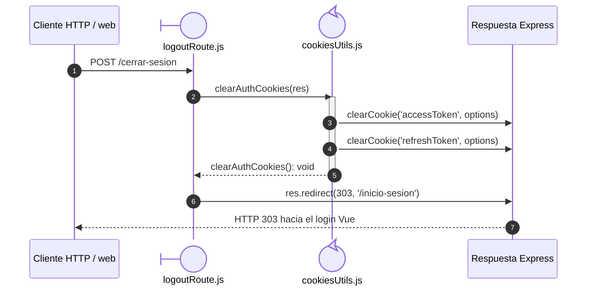

# `CU-AUT-02` — Cerrar sesión

**Patrones:** `BE-P08`.

## Participantes y trazabilidad

| Alias | Rol visual | Archivo de implementación |
| --- | --- | --- |
| `Route` | boundary | [`logoutRoute.js`](../../../../../../src/routes/system/logoutRoute.js) |
| `Cookies` | control | [`cookiesUtils.js`](../../../../../../src/utils/cookiesUtils.js) |

## Secuencia de implementación

El formulario de navegación Vue envía el POST al mismo origen. El proxy conserva
la respuesta y las cookies; Vue Router resuelve el destino después de la redirección.
