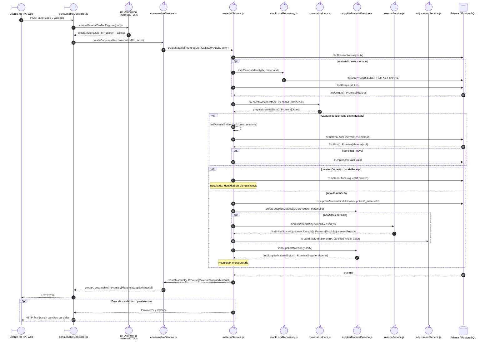

# `CU-ALM-18` — Crear consumible

**Patrones:** `BE-P01`, `BE-P03`, `BE-P04`.

## Participantes y trazabilidad

| Alias | Rol visual | Archivo de implementación |
| --- | --- | --- |
| `Controller` | control | [API](../../../../../../src/controllers/api/warehouse/consumableController.js) |
| `Dto` | control | [materialDTO.js](../../../../../../src/dtos/materialDTO.js) |
| `Domain` | control | [materialService.js](../../../../../../src/services/warehouse/materials/materialService.js) |
| `Lock` | control | [stockLockRepository.js](../../../../../../src/repository/warehouse/stockLockRepository.js) |
| `Helpers` | control | [materialHelpers.js](../../../../../../src/services/warehouse/materials/materialHelpers.js) |
| `Offer` | control | [supplierMaterialService.js](../../../../../../src/services/warehouse/materials/supplierMaterialService.js) |
| `Reason` | control | [reasonService.js](../../../../../../src/services/warehouse/reasonService.js) |
| `Adjustment` | control | [adjustmentService.js](../../../../../../src/services/warehouse/adjustmentService.js) |
| `Consumable` | control | [consumableService.js](../../../../../../src/services/warehouse/consumables/consumableService.js) |
