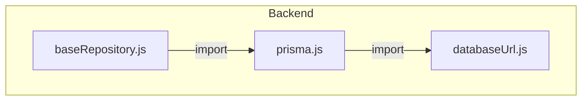
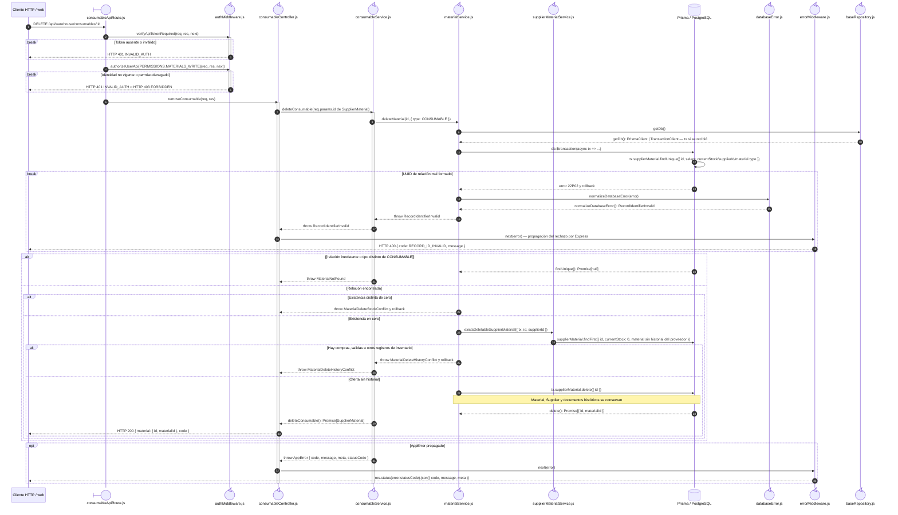

# `CU-ALM-20` — Retirar oferta de consumible

**Patrones:** `[BE-P01](../../../development/design-and-construction-patterns/03-patterns-in-code.md#pipeline-dto-y-políticas-declarativas)`, `[BE-P03](../../../development/design-and-construction-patterns/03-patterns-in-code.md#transacción-eventos-y-auditoría)`, `[BE-P04](../../../development/design-and-construction-patterns/03-patterns-in-code.md#transacción-eventos-y-auditoría)`.

## Participantes y trazabilidad

Cada línea de vida técnica corresponde a un único archivo de implementación, indicado
por su alias en la tabla. Dos archivos distintos usan participantes distintos. Los actores,
el navegador y la frontera de persistencia son elementos externos, no archivos del proyecto.
Los retornos representan el resultado o error de la función ejecutada en el archivo indicado.
La composición incluye también los archivos de configuración, construcción y reexport: cada
uno tiene un nodo propio, aunque no ejecute una delegación durante la petición.

| Alias | Rol visual | Archivo de implementación |
| --- | --- | --- |
| `Route` | boundary | [`consumableApiRoute.js`](../../../../../../src/routes/api/warehouse/consumableApiRoute.js) |
| `Controller` | control | [`consumableController.js`](../../../../../../src/controllers/api/warehouse/consumableController.js) |
| `Domain` | control | [`consumableService.js`](../../../../../../src/services/warehouse/consumables/consumableService.js) |
| `Usage` | control | [`supplierMaterialService.js`](../../../../../../src/services/warehouse/materials/supplierMaterialService.js) |
| `MaterialService` | control | [`materialService.js`](../../../../../../src/services/warehouse/materials/materialService.js) |
| `DatabaseErrors` | control | [`databaseError.js`](../../../../../../src/errors/databaseError.js) |
| `ErrorHandler` | control | [`errorMiddleware.js`](../../../../../../src/middleware/errorMiddleware.js) |
| `Auth` | control | [`authMiddleware.js`](../../../../../../src/middleware/authMiddleware.js) |
| `FileBaseRepository` | control | [`baseRepository.js`](../../../../../../src/repository/baseRepository.js) |
| `FileDatabaseUrl` | control | [`databaseUrl.js`](../../../../../../src/lib/databaseUrl.js) |
| `FilePrisma` | control | [`prisma.js`](../../../../../../src/lib/prisma.js) |

## Composición de archivos

Los archivos que construyen, configuran o reexportan funciones aparecen como componentes
individuales. Las flechas representan imports reales, resueltos al cargar los módulos;
las llamadas durante la operación se muestran en las secuencias siguientes. Cada nombre
identifica un archivo y la tabla conserva su ruta completa.

## Secuencia de implementación

