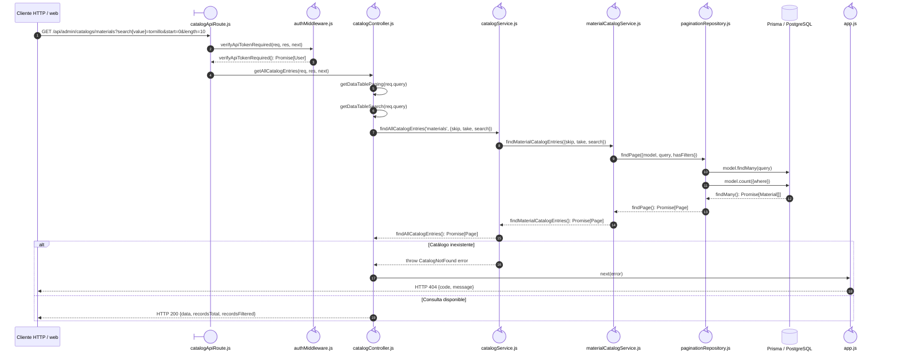

# `CU-ALM-25` — Consultar artículos

**Patrones:** `[BE-P01](../../../development/design-and-construction-patterns/03-patterns-in-code.md#pipeline-dto-y-políticas-declarativas)`, `[BE-P06](../../../development/design-and-construction-patterns/03-patterns-in-code.md#estructura-por-dominio-capas-y-fronteras)`.

## Participantes y trazabilidad

| Alias | Rol visual | Archivo de implementación |
| --- | --- | --- |
| `Route` | boundary | [catalogApiRoute.js](../../../../../../src/routes/api/admin/catalogApiRoute.js) |
| `Auth` | control | [authMiddleware.js](../../../../../../src/middleware/authMiddleware.js) |
| `Controller` | control | [catalogController.js](../../../../../../src/controllers/api/admin/catalogController.js) |
| `Domain` | control | [catalogService.js](../../../../../../src/services/admin/catalogService.js) |
| `Materials` | control | [materialCatalogService.js](../../../../../../src/services/warehouse/materials/materialCatalogService.js) |
| `Page` | control | [paginationRepository.js](../../../../../../src/repository/paginationRepository.js) |
| `ErrorHandler` | control | [app.js](../../../../../../src/app.js) |
