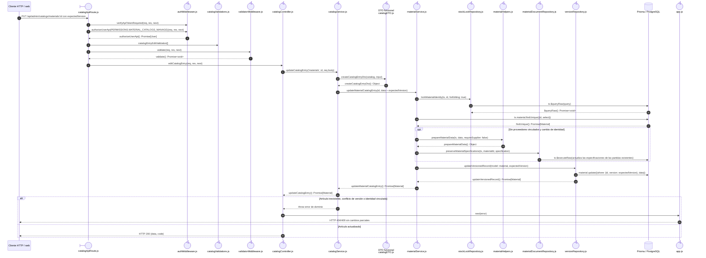

# `CU-ALM-27` — Editar artículo

**Patrones:** `[BE-P01](../../../development/design-and-construction-patterns/03-patterns-in-code.md#pipeline-dto-y-políticas-declarativas)`, `[BE-P03](../../../development/design-and-construction-patterns/03-patterns-in-code.md#transacción-eventos-y-auditoría)`, `[BE-P04](../../../development/design-and-construction-patterns/03-patterns-in-code.md#transacción-eventos-y-auditoría)`.

## Participantes y trazabilidad

| Alias | Rol visual | Archivo de implementación |
| --- | --- | --- |
| `Route` | boundary | [catalogApiRoute.js](../../../../../../src/routes/api/admin/catalogApiRoute.js) |
| `Auth` | control | [authMiddleware.js](../../../../../../src/middleware/authMiddleware.js) |
| `Rules` | control | [catalogValidations.js](../../../../../../src/validators/forms/catalogValidations.js) |
| `Validator` | control | [validatorMiddleware.js](../../../../../../src/middleware/validatorMiddleware.js) |
| `Controller` | control | [catalogController.js](../../../../../../src/controllers/api/admin/catalogController.js) |
| `Domain` | control | [catalogService.js](../../../../../../src/services/admin/catalogService.js) |
| `Dto` | control | [catalogDTO.js](../../../../../../src/dtos/catalogDTO.js) |
| `Materials` | control | [materialService.js](../../../../../../src/services/warehouse/materials/materialService.js) |
| `Lock` | control | [stockLockRepository.js](../../../../../../src/repository/warehouse/stockLockRepository.js) |
| `Helpers` | control | [materialHelpers.js](../../../../../../src/services/warehouse/materials/materialHelpers.js) |
| `History` | control | [materialDocumentRepository.js](../../../../../../src/repository/warehouse/materialDocumentRepository.js) |
| `Version` | control | [versionRepository.js](../../../../../../src/repository/versionRepository.js) |
| `ErrorHandler` | control | [app.js](../../../../../../src/app.js) |
