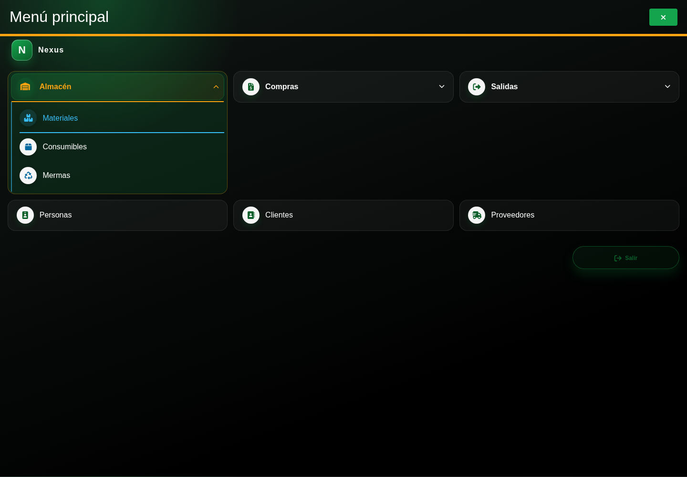

# 2. CAP-AUT-02-MENU — Menú principal

**Casos de uso:** `CU-AUT-02` — Cerrar sesión.

**Antes de empezar:** Vamos a reconocer el menú de su cuenta. Entre con su propio usuario para identificar las opciones que podrá utilizar.

**Errores posibles:** [Acceso y autorización](../../error-messages.md#errores-acceso).

**Controles que debe usar:** Botón **Menú principal**, secciones y opciones habilitadas para su cuenta, y botón **Salir**.

1. Después de iniciar sesión, seleccione **Menú principal** y compruebe que las opciones autorizadas coincidan con la captura:

   

2. Seleccione una sección para desplegar sus módulos. Nexus sólo muestra las opciones permitidas por el rol y el área de la cuenta.
3. Para terminar, use **Salir**; no cierre solamente la pestaña del navegador.

**Compruebe el resultado:** Localice una opción de su función y compruebe dónde terminar la sesión.
