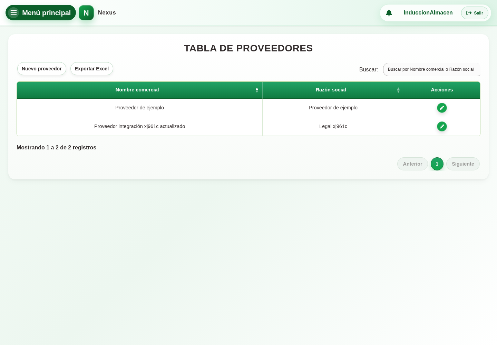
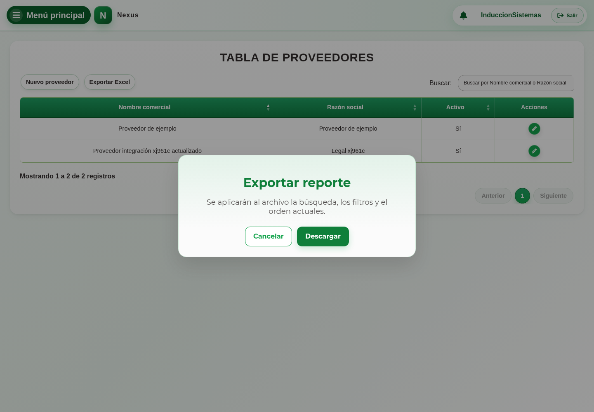

# 7. CAP-CAT-SUP-01-LIST — Consultar proveedores

**Casos de uso:** `CU-CAT-01` — Consultar proveedores.

**Antes de empezar:** Tenga el nombre del proveedor que necesita. Vamos a buscarlo antes de registrar otro, para evitar duplicados.

1. Abra **Proveedores** desde el menú principal. Observe el buscador y la tabla:

   

2. Escriba un término en **Buscar por Nombre comercial o Razón social** y compruebe los resultados.
3. Si no existe, siga la guía de alta con **Nuevo proveedor**. Consultar el listado no cambia sus datos ni el inventario.

<!-- manual:sistemas -->
## Editar o descargar información como administrador

Seleccione **Editar registro** para modificar un registro autorizado. Para descargar el resultado, pulse **Exportar Excel**. En **Exportar reporte**, revise la búsqueda, los filtros y el orden; después pulse **Descargar** o cierre el diálogo para cancelar.

<!-- /manual:sistemas -->

**Compruebe el resultado:** Confirme que el nombre corresponde a la persona o empresa de la operación. Si no encuentra el registro esperado, revise la búsqueda antes de darlo de alta.
