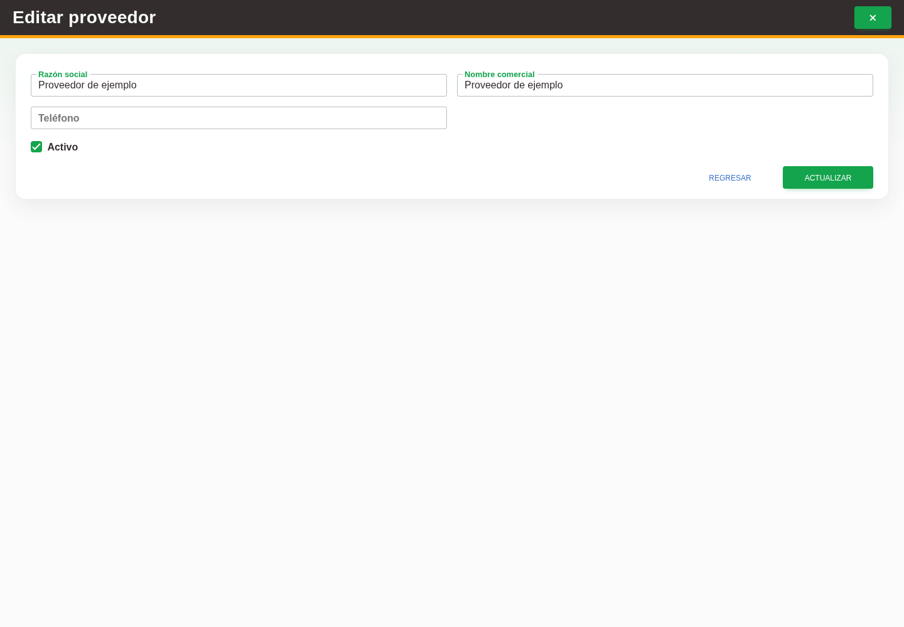

# 9. CAP-CAT-SUP-03-EDIT — Formulario de edición y estado

**Antes de empezar:** Vamos a actualizar un proveedor existente. Tenga identificado el registro correcto y los datos que necesita corregir.

**Errores posibles:** [Validación de formularios](../../error-messages.md#errores-validacion), [Catálogos e inventario](../../error-messages.md#errores-catalogos).

**Controles que debe usar:** Acción **Editar registro**; campos **Razón social**, **Nombre comercial** y **Teléfono**; casilla **Activo** y botón **Actualizar**.

1. En la fila del proveedor, seleccione la acción **Editar registro**. Observe los controles que va a usar:

   

2. Modifique los campos **Razón social**, **Nombre comercial** o **Teléfono** necesarios y revise la casilla **Activo**.
3. Seleccione el botón **Actualizar** para guardar los cambios.

**Compruebe el resultado:** Vuelva a abrir el registro y compruebe los cambios confirmados.
