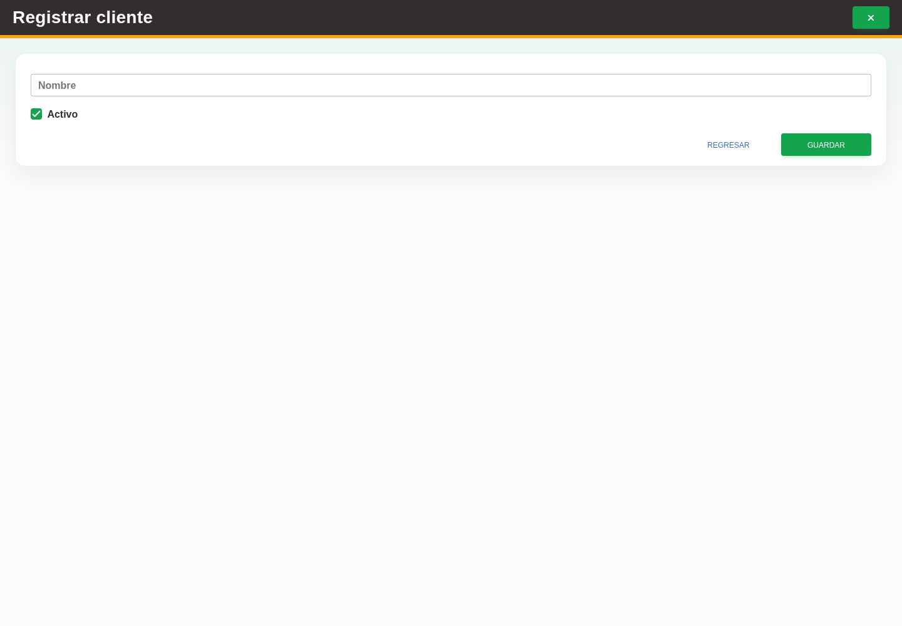

# 11. CAP-CAT-CLI-02-CREATE — Formulario de alta

**Casos de uso:** `CU-CAT-06` — Crear cliente.

**Antes de empezar:** Vamos a registrar un cliente. Tenga los datos de la operación y confirme con quien le capacita que corresponde darlo de alta; busque primero si ya existe.

**Errores posibles:** [Validación de formularios](../../error-messages.md#errores-validacion), [Catálogos e inventario](../../error-messages.md#errores-catalogos).

**Controles que debe usar:** Opción **Nuevo cliente** del selector de una salida autorizada o botón **Nuevo cliente** del listado de Sistemas; campo **Nombre**, casilla **Activo** y botón **Guardar**.

1. Abra **Clientes** y seleccione **Nuevo cliente**. Si ya está preparando una salida, también puede escribir el cliente que no existe en su selector y elegir **Nuevo cliente**, para volver después a esa operación. Observe los controles que va a usar:

   

2. Complete el campo **Nombre**, revise la casilla **Activo** y seleccione el botón **Guardar**.

**Compruebe el resultado:** Vuelva al listado y localice el registro guardado. Compruebe sus datos antes de continuar con otra operación.
