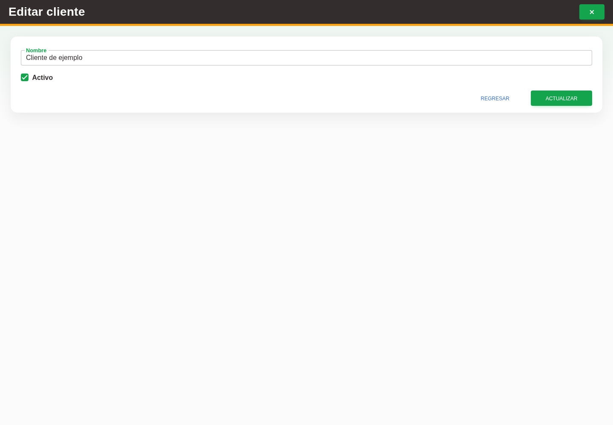

# 12. CAP-CAT-CLI-03-EDIT — Formulario de edición

**Casos de uso:** `CU-CAT-07` — Editar cliente.

**Antes de empezar:** Vamos a actualizar un cliente existente. Tenga identificado el registro correcto y los datos que necesita corregir.

**Errores posibles:** [Validación de formularios](../../error-messages.md#errores-validacion), [Catálogos e inventario](../../error-messages.md#errores-catalogos).

**Controles que debe usar:** Acción **Editar registro**, campo **Nombre**, casilla **Activo** y botón **Actualizar**.

1. En la fila del cliente, seleccione la acción **Editar registro**. Observe los controles que va a usar:

   

2. Modifique el campo **Nombre** o la casilla **Activo** y seleccione el botón **Actualizar**.

**Compruebe el resultado:** Vuelva a abrir el registro y compruebe los cambios confirmados.
