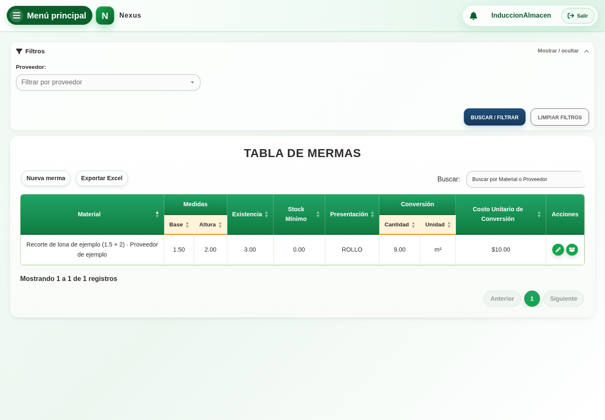

# 13. CAP-CAT-WAS-01-LIST — Listado inventario

**Casos de uso:** `CU-ALM-09` — Consultar mermas e inventario; `CU-ALM-14` — Generar reporte de mermas.

**Antes de empezar:** Vamos a localizar un merma y reconocer sus datos. Tenga el nombre, folio o período que necesita consultar.

**Errores posibles:** [Catálogos e inventario](../../error-messages.md#errores-catalogos).

**Controles que debe usar:** Buscador **Buscar por Material o Proveedor**, filtro **Proveedor**, botones **Buscar / filtrar**, **Limpiar filtros**, **Exportar Excel** y **Nueva merma**, además de las acciones por fila.

1. Abra **Filtros** y compruebe que los controles desplegados coincidan con la captura:

   

2. Escriba un término en el buscador **Buscar por Material o Proveedor** o elija una opción en el filtro **Proveedor**.
3. Seleccione el botón **Buscar / filtrar** para actualizar la tabla; use **Limpiar filtros** para restablecerla.
4. En la tabla, seleccione **Nueva merma**, **Exportar Excel**, **Editar registro**, **Agregar stock** o **Ajustar stock**, según la operación requerida.

La columna **Activo**, ubicada antes de **Acciones**, se muestra en la tabla únicamente al
administrador del sistema; **Ajustar stock** también es exclusivo de ese actor. Personal de almacén usa **Agregar stock**, que suma una cantidad sin reemplazar el saldo.

**Compruebe el resultado:** Confirme que la fila corresponde al nombre o folio buscado. Consultar no modifica datos ni existencias.

Para los Rollos, consulte **Pesos por unidad (kg)** antes de **Acciones**: cono,
total con cono y neto. Un guion indica un peso desconocido o una presentación
distinta de Rollo. Al abrir el registro, los pesos se agrupan en su propia
sección y quedan para consulta después del alta.

La captura del listado y del modal debe renovarse en una sesión del entorno de
prueba con registros existentes para reflejar esta organización.
