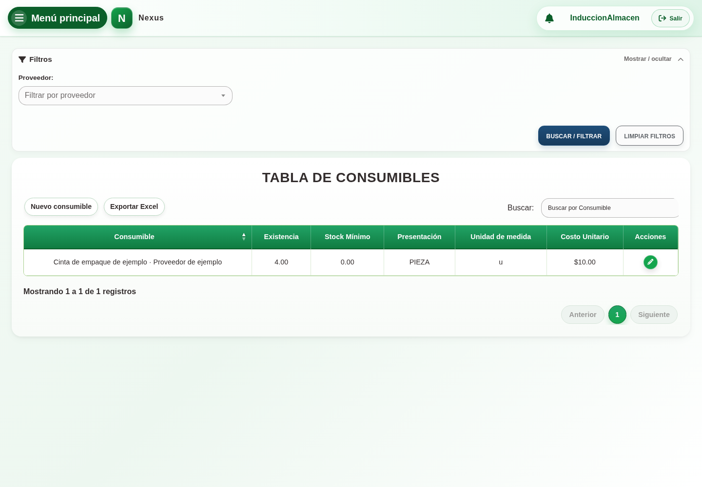

# 19. CAP-CAT-CON-01-LIST — Listado de consumibles

**Casos de uso:** `CU-ALM-17` — Consultar consumibles.

**Antes de empezar:** Vamos a localizar un consumible y reconocer sus datos. Tenga el nombre, folio o período que necesita consultar.

**Errores posibles:** [Catálogos e inventario](../../error-messages.md#errores-catalogos).

**Controles que debe usar:** buscador **Buscar por Consumible**, filtro **Proveedor**,
**Buscar / filtrar**, **Limpiar filtros**, **Exportar Excel**, **Nuevo consumible** y las
acciones permitidas de cada fila.

1. Abra **Almacén → Consumibles** y despliegue **Filtros**. Compruebe que la pantalla
   coincida con la captura:

   

2. Escriba un nombre, seleccione un proveedor o combine ambos criterios.
3. Seleccione **Buscar / filtrar** para actualizar la tabla; use **Limpiar filtros** para
   recuperar el listado completo de consumibles.
4. Compruebe nombre, proveedor, existencia, stock mínimo, presentación y unidad antes de
   iniciar otra acción.

La tabla sólo muestra consumibles. Para una compra o salida de material use el selector
del módulo correspondiente, que continúa mostrando únicamente materiales.

**Compruebe el resultado:** Confirme que la fila corresponde al nombre o folio buscado. Consultar no modifica datos ni existencias.
