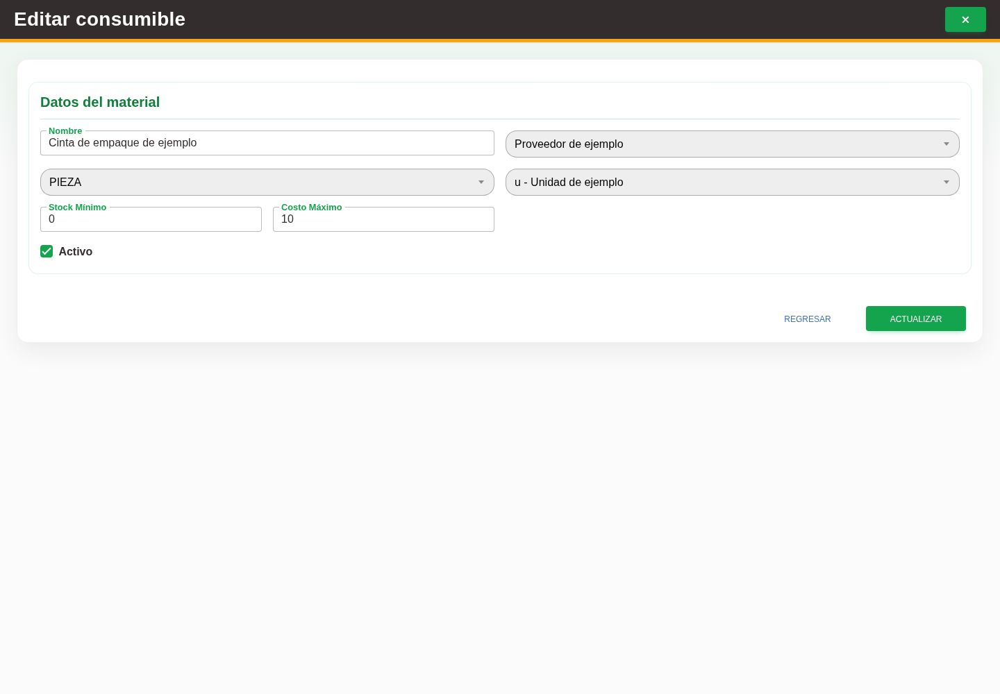

# 21. CAP-CAT-CON-03-EDIT — Formulario de edición

**Casos de uso:** `CU-ALM-19` — Editar consumible.

**Antes de empezar:** Vamos a actualizar un consumible existente. Tenga identificado el registro correcto y los datos que necesita corregir.

**Errores posibles:** [Validación de formularios](../../error-messages.md#errores-validacion),
[Catálogos e inventario](../../error-messages.md#errores-catalogos).

1. En la fila correspondiente seleccione **Editar registro** y compruebe el formulario:

   

2. Modifique **Nombre**, **Stock Mínimo**, **Costo Máximo** o **Activo**.
3. Revise como referencia proveedor, presentación y unidad; no cambie existencia desde
   este modo.
4. Seleccione **Actualizar**.

La edición no cambia el tipo del registro ni lo traslada al inventario de materiales.

**Compruebe el resultado:** Vuelva a abrir el registro y compruebe los cambios confirmados.
