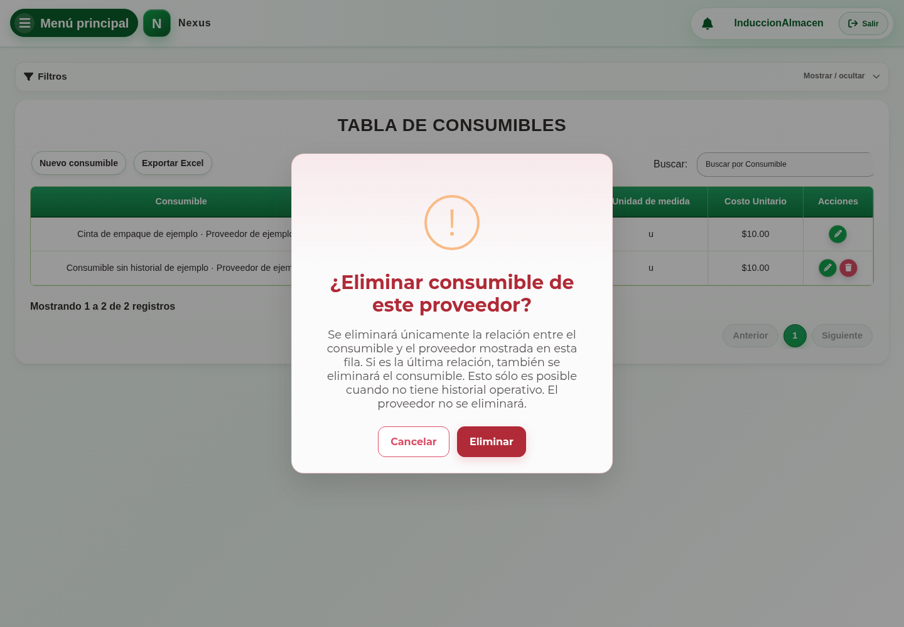

# 22. CAP-CAT-CON-04-REMOVE — Retirar oferta

**Casos de uso:** `CU-ALM-20` — Retirar consumible.

**Antes de empezar:** Vamos a revisar el consumible antes de confirmar la operación. Tenga identificados el registro y los datos que necesita.

**Errores posibles:** [Catálogos e inventario](../../error-messages.md#errores-catalogos).

1. En la fila del proveedor seleccione **Eliminar registro**.
2. Lea la confirmación y compruebe que corresponda a la oferta elegida:

   

3. Cancele si eligió una fila incorrecta. Para continuar, confirme el retiro.

Nexus elimina la relación con ese proveedor; sólo elimina también la identidad cuando
era la última oferta y no existe historia protegida. Un rechazo conserva oferta,
existencia e historial.

**Compruebe el resultado:** Confirme el mensaje y vuelva a consultar el registro antes de repetir la operación.
