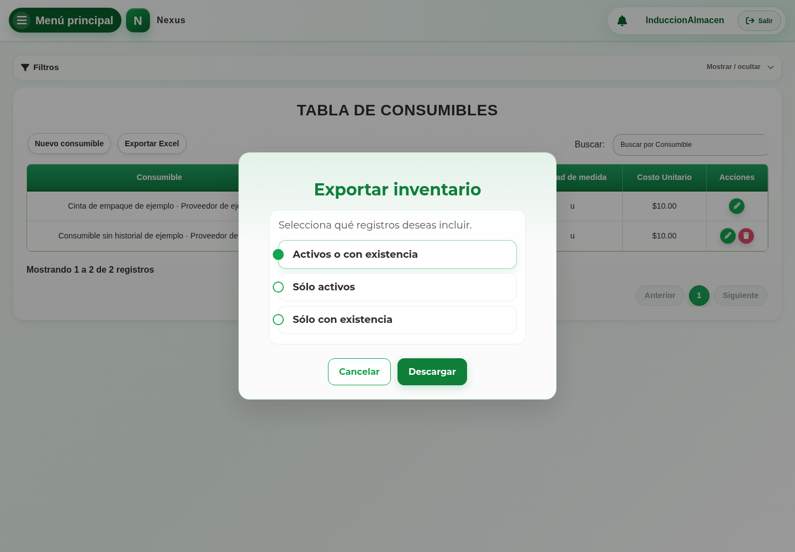

# 24. CAP-REP-CON-06-EXPORT — Exportar inventario de consumibles

**Casos de uso:** `CU-ALM-22` — Generar reporte de inventario de consumibles.

**Antes de empezar:** Vamos a obtener un reporte. Defina qué información y período necesita antes de elegir el alcance de la descarga.

1. Aplique en el listado la búsqueda y el proveedor que necesite conservar.
2. Seleccione **Exportar Excel** y compruebe el diálogo:

   

3. Elija el alcance:
   - **Activos o con existencia:** incluye toda oferta activa y también una oferta
     inactiva cuando aún conserva existencias.
   - **Sólo activos:** incluye únicamente ofertas activas, aunque su existencia sea cero.
   - **Sólo con existencia:** incluye ofertas activas o inactivas cuyo saldo sea mayor
     que cero.
4. Seleccione **Descargar**. El archivo conserva los filtros y contiene únicamente
   consumibles; esta operación no modifica existencias.

**Compruebe el resultado:** Abra el archivo descargado y compruebe su módulo y alcance. Exportar no cambia existencias.
