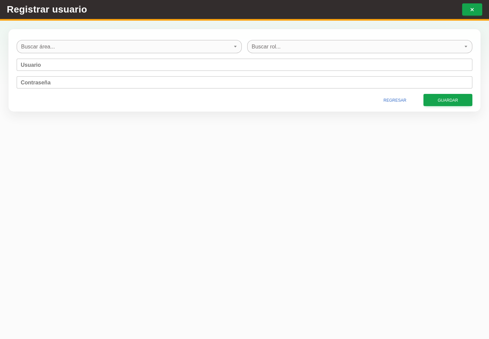

# 5. CAP-IDA-USR-02-CREATE — Formulario de alta

**Casos de uso:** `CU-IDA-06` — Crear usuario y asignar acceso.

**Antes de empezar:** Vamos a registrar un usuario. Tenga los datos de la operación y confirme con quien le capacita que corresponde darlo de alta; busque primero si ya existe.

**Errores posibles:** [Validación de formularios](../../error-messages.md#errores-validacion), [Acceso y autorización](../../error-messages.md#errores-acceso), [Catálogos e inventario](../../error-messages.md#errores-catalogos).

**Controles que debe usar:** Botón **Nuevo usuario**; selectores **Buscar área...** y **Buscar rol...**; campos **Usuario** y **Contraseña**; botón **Guardar**.

1. Seleccione el botón **Nuevo usuario** para abrir el formulario. Observe los controles que va a usar:

   

2. Elija opciones en **Buscar área...** y **Buscar rol...**, y complete los campos **Usuario** y **Contraseña**.
3. Seleccione el botón **Guardar** para crear la cuenta.

**Compruebe el resultado:** Vuelva al listado y localice el registro guardado. Compruebe sus datos antes de continuar con otra operación.
