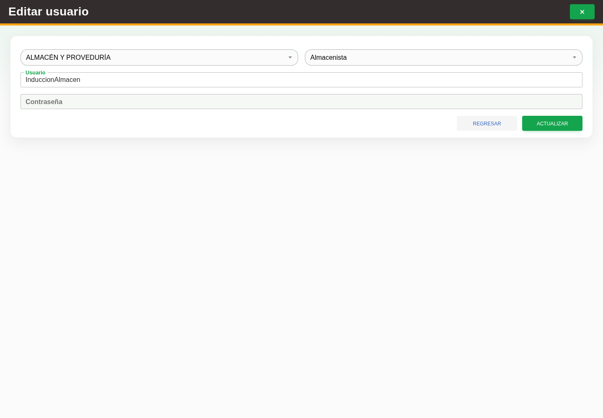

# 6. CAP-IDA-USR-03-EDIT — Formulario de edición

**Casos de uso:** `CU-IDA-07` — Editar usuario y acceso.

**Antes de empezar:** Vamos a actualizar un usuario existente. Tenga identificado el registro correcto y los datos que necesita corregir.

**Errores posibles:** [Validación de formularios](../../error-messages.md#errores-validacion), [Acceso y autorización](../../error-messages.md#errores-acceso), [Catálogos e inventario](../../error-messages.md#errores-catalogos).

**Controles que debe usar:** Acción **Editar registro**; selectores **Buscar área...** y **Buscar rol...**; campo **Usuario** y botón **Actualizar**.

1. En la fila de la cuenta, seleccione la acción **Editar registro**. Observe los controles que va a usar:

   

2. Revise los selectores **Buscar área...** y **Buscar rol...**, y modifique el campo **Usuario** si
   corresponde. La **Contraseña** permanece deshabilitada y sólo se modifica mediante **Cambiar
   contraseña**.
3. Seleccione el botón **Actualizar** para guardar los cambios.

**Compruebe el resultado:** Vuelva a abrir el registro y compruebe los cambios confirmados.
