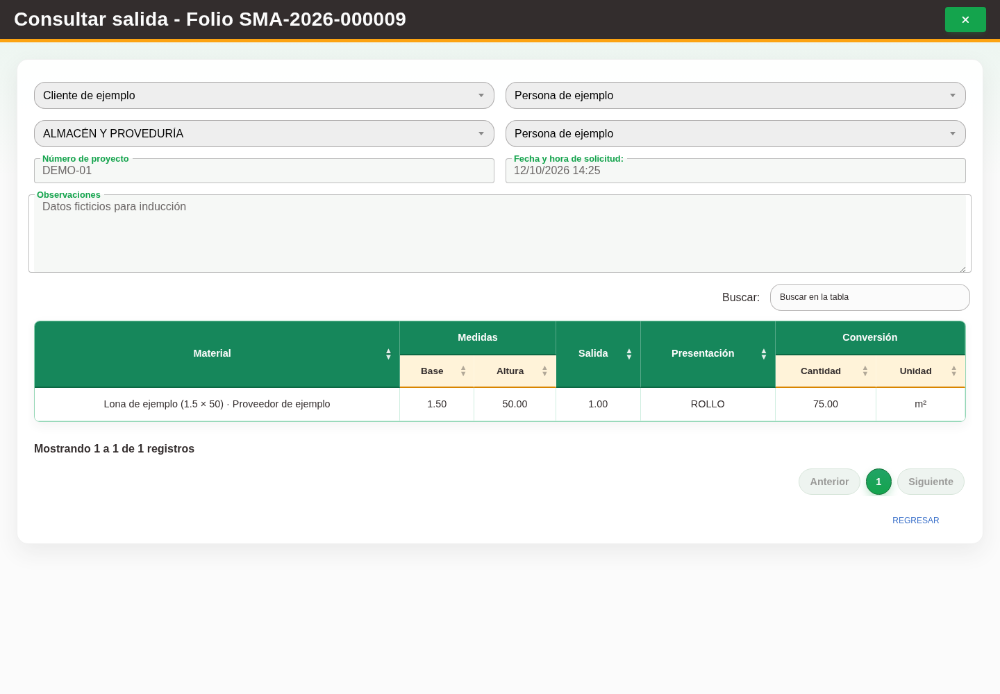

# 7. CAP-SAL-MAT-08-VIEW — Consultar salida cancelada

**Caso de uso:** `CU-SAL-01` — Consultar salidas de material.

**Antes de empezar:** Vamos a consultar un documento cancelado. Tenga el folio; observe sus datos sin intentar modificarlo.

1. Seleccione **Cancelado** en **Estado de surtido:**, aplique el filtro y abra **Editar registro**.
2. Compruebe que el encabezado, los detalles y las acciones permanezcan deshabilitados, como en la
   captura:

   

3. Use **Regresar** para cerrar el formulario sin cambios.

**Compruebe el resultado:** Confirme el folio y el estado cancelado; los datos deben permanecer en consulta.
