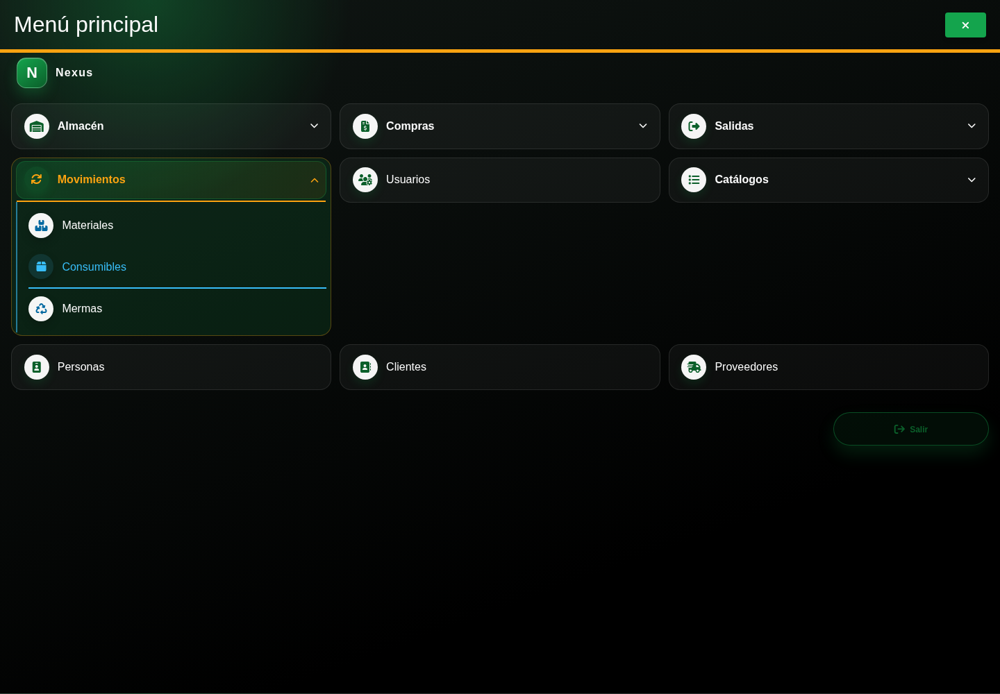
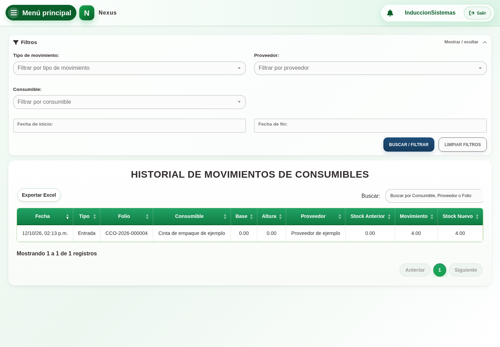

# 5. CAP-REP-MOV-CON-01-LIST — Historial de consumibles

**Caso de uso:** `CU-ALM-23`. **Actor:** Administrador del sistema de Sistemas.

**Antes de empezar:** Tenga el folio o nombre del consumible y el proveedor.
Vamos a abrir **Menú principal → Movimientos → Consumibles**:

1. Abra **Filtros**. Observe fecha, **Tipo de movimiento**, **Proveedor** y **Consumible**:

   

2. Elija primero el proveedor y después el consumible. Si cambia de proveedor,
   vuelva a seleccionar el artículo; la selección anterior se limpia.
3. Complete el periodo o use **Buscar por Consumible, Proveedor o Folio**.
   Seleccione **Buscar / filtrar** y revise fecha, tipo, folio y saldos.
4. Use **Limpiar filtros** para volver a la consulta completa de consumibles.

**Compruebe el resultado:** Las filas y los totales corresponden sólo a consumibles.
Consultar no modifica la existencia. Las entradas y salidas muestran los folios
`CCO` y `SCO` de sus documentos; ajustes conservan su propia serie.
