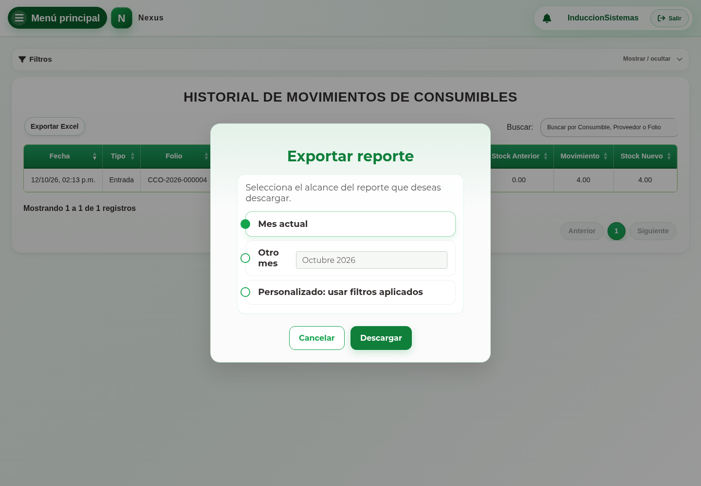

# 6. CAP-REP-MOV-CON-02-EXPORT — Exportar movimientos de consumibles

**Caso de uso:** `CU-ALM-24`. **Actor:** Administrador del sistema de Sistemas.

**Antes de empezar:** Vamos a descargar el historial desde **Movimientos → Consumibles**.
Revise los filtros que quiere conservar.

1. Seleccione **Exportar Excel** para abrir **Exportar reporte**:

   

2. Elija el informe personalizado con los filtros aplicados o el informe mensual
   y seleccione el mes correspondiente.
3. Seleccione **Descargar** y abra el archivo.

**Compruebe el resultado:** El archivo identifica consumibles en su nombre y en la
hoja **Movimientos de consumibles**. Revise periodo, folios y saldos: ambos tipos
de informe contienen sólo consumibles. Descargar no modifica datos.
