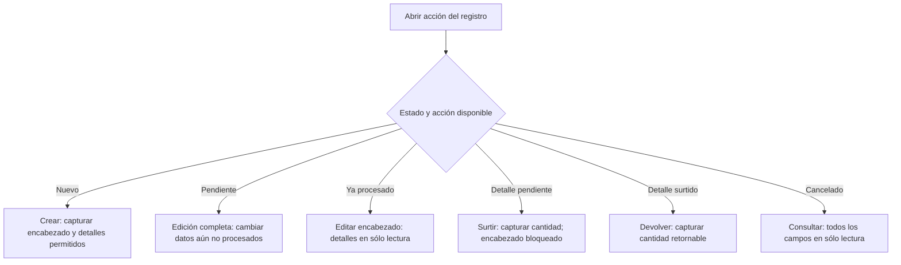

# Matriz de validación y modos de formulario

## Cómo leer esta matriz

Esta referencia reúne las validaciones que el operador puede comprobar en pantalla. No sustituye
las reglas del servidor ni convierte todos los formularios en un flujo idéntico. Consulte también
el [catálogo de mensajes](error-messages.md#errores-validacion) cuando Nexus rechace un dato.

Los avisos se distinguen mediante una marca y una etiqueta textual:

- 🟨 **ADVERTENCIA:** una condición que debe comprobarse antes de continuar;
- 🟥 **DATO SENSIBLE:** información que no debe copiarse a capturas, archivos ni soporte;
- 🟦 **EXCEPCIÓN DEL PROCESO:** un comportamiento que aparece sólo en cierto módulo, estado o
  después de una acción.

## Matriz operativa

| Formulario o familia | Campos y controles que se validan | Cuándo se comprueba | Recuperación visible |
| --- | --- | --- | --- |
| Inicio de sesión | Usuario y contraseña requeridos; coincidencia con una cuenta habilitada | Al seleccionar **Iniciar sesión** | Corrija el campo indicado o solicite restablecimiento; no pruebe cuentas ajenas. |
| Personas, clientes y proveedores | Nombre requerido: hasta 255 caracteres para personas/clientes, 200 para razón social y 100 para nombre comercial. Personas requieren al menos un acceso con área y rol, sin repetir área | En alta y edición | Conserve el formulario abierto y corrija sólo los campos marcados. |
| Usuarios y acceso | Usuario sin espacios, rol y departamento requeridos; al crear o cambiar contraseña: de 6 a 50 caracteres, mayúscula, número y caracteres admitidos. El carácter especial no es obligatorio; iniciar sesión conserva la contraseña exacta | En alta, edición de acceso o cambio de contraseña | No comparta la contraseña ni la incluya en evidencia; corrija la regla indicada. |
| Catálogos auxiliares | **Nombre** requerido y sin caracteres no admitidos; máximo 50 para Áreas, Roles, Presentaciones y Estados de cumplimiento, 20 para Unidades de medida y 100 para Motivos de ajuste; **Símbolo** requerido y máximo 10 sólo en Unidades de medida; **Activo** booleano requerido en todos los catálogos auxiliares | Al seleccionar **Guardar** o **Actualizar** | El formulario permanece abierto y señala el campo; una solicitud rechazada no modifica el catálogo. |
| Material / alta directa | Identidad, proveedor, unidad y presentación válidos; medidas sólo en metros o litros, ambas o ninguna; pieza sin medidas; estado requerido; stock mínimo opcional numérico; existencia inicial y costo máximo obligatorios y numéricos | Al seleccionar **Guardar** desde **Almacén → Materiales** | Una identidad repetida no suma existencia: confirme el aviso para revisar la cantidad en Agregar stock y guarde ese modal. |
| Material / alta desde compra | Identidad, proveedor, unidad y presentación válidos; medidas sólo en metros o litros, ambas o ninguna; pieza sin medidas; stock mínimo y estado admitidos. No se solicitan costo máximo, existencia inicial, razón ni observaciones de ajuste; costo máximo y existencia inicial dejan de ser obligatorios | Al seleccionar **Guardar** en **Nuevo material** abierto desde una compra | El material vuelve seleccionado con existencia cero y sin costo máximo; capture **Cantidad** y **Costo por Presentación** en el detalle y confirme la compra para afectar inventario. |
| Consumible / alta directa | Nombre, proveedor, presentación y unidad explícita válidos; sin dimensiones; estado requerido; stock mínimo opcional numérico; existencia inicial, costo máximo, motivo y observaciones según las reglas del ajuste inicial | Al seleccionar **Guardar** desde **Almacén → Consumibles** | Una oferta repetida no suma existencia ni se convierte en material: abra el consumible vigente y use **Ajustar stock** si cuenta con permiso. |
| Merma / alta directa | Nombre, proveedor, material de referencia, dimensiones positivas, estado, **Cantidad inicial** no negativa (`initialQuantity`) y costo máximo válidos; stock mínimo opcional numérico; sin motivo de ajuste. Cantidad positiva genera entrada EME; cero no genera documento ni movimiento | Al seleccionar **Guardar** desde **Almacén → Mermas** | Una identidad repetida no suma existencia: confirme el aviso para revisar la cantidad en Agregar stock y guarde ese modal. |
| Material, consumible o merma / edición | Identidad y datos secundarios admitidos para el recurso; sólo se validan los campos habilitados y la existencia no cambia | Al seleccionar **Actualizar** | Conserve el formulario y corrija el campo señalado; use **Agregar stock** para incrementar una merma o, si es Administrador, **Ajustar stock** para reemplazar la existencia del recurso abierto. |
| Agregar existencia de merma | Modal específico con identidad, **Stock actual** y **Nuevo stock** calculado como datos informativos; **Cantidad a agregar** positiva y observaciones opcionales de hasta 500 caracteres | Al confirmar **Agregar** | La cantidad es incremental; genera un registro en el historial de movimientos y no captura un nuevo total ni un motivo de ajuste. |
| Ajuste de existencia (administrador) | El proveedor asociado se conserva automáticamente como contexto requerido; motivo vigente, nueva existencia numérica y observaciones admitidas | Al confirmar **Ajustar stock** | No seleccione otro proveedor: ajuste la oferta abierta desde el listado. La nueva cantidad es el total resultante, no una cantidad que se agrega. |
| Compra | Comprobante, factura cuando aplica, proveedor, receptor, fecha y al menos un detalle con material, cantidad y costo | En alta o actualización; la corrección valida además estado, motivo y límites | Una partida persistida se corrige con su acción especializada; no se sobrescribe como detalle nuevo. |
| Salida de material, consumible o merma | Participantes y relaciones vigentes, fecha, número de proyecto de hasta 10 caracteres sin caracteres de control internos y al menos un detalle con cantidad positiva | En alta o edición permitida por el estado | Corrija el proyecto si se indica un formato inválido; no se eliminan caracteres para guardar otra referencia. Actualice el registro si cambió su estado y use solamente la acción que continúe visible. |
| Surtimiento | Detalle pendiente, selección de surtido, cantidad de proyecto admitida y existencia suficiente para lo solicitado | Después de elegir **Surtir detalle** | Confirme disponibilidad; en materiales y consumibles se surte toda la cantidad pendiente de cada renglón seleccionado. No modifique el encabezado desde este modo. |
| Devolución | Salida completamente surtida, detalle con saldo retornable y cantidad positiva no mayor a ese saldo y observaciones admitidas | Después de elegir **Devolver detalle** | Capture como máximo la cantidad retornable mostrada; los datos originales permanecen bloqueados. |
| Exportación | Alcance, filtros o periodo admitidos | Antes de generar el archivo | Conserve filtros; si la conexión falla, compruebe el listado antes de repetir. |

🟥 **DATO SENSIBLE:** no copie usuarios, contraseñas, cookies, tokens ni datos personales en
archivos o solicitudes de soporte.

## Modos de edición

El siguiente diagrama aclara por qué **editar** no siempre habilita los mismos campos. El estado
del registro y la acción elegida determinan el modo; el operador no selecciona el modo como un
campo adicional.

🟦 **EXCEPCIÓN DEL PROCESO:** en compras, un detalle ya persistido se modifica mediante
**Corregir detalle**; en salidas, un detalle procesado cambia mediante **Surtir** o **Devolver**.
Estas acciones conservan historia y efectos de inventario, por lo que no siguen la edición general.

En salidas de materiales y consumibles, **Surtir** selecciona renglones para entregar
toda su cantidad pendiente; **Cantidad de proyecto** no determina una entrega parcial.
**Devolver** sólo está disponible cuando la salida completa está **Surtida**.

## Conceptos necesarios para el manual

| Concepto | Significado para el operador |
| --- | --- |
| Modo de formulario | Configuración de controles habilitados según la acción y el estado; no es un estado guardado. |
| Encabezado | Datos contextuales del documento, como participantes, fecha, proyecto u observaciones. |
| Detalle | Renglón de material, consumible o merma con su cantidad y datos operativos. |
| Cantidad retornable | Parte surtida que todavía puede devolverse; limita el valor aceptado en una devolución. |
| Nueva existencia total | Resultado que debe quedar después de un ajuste; no representa un incremento. |
| Sólo lectura | Modo de consulta en el que la información se muestra pero no puede confirmarse como cambio. |

### Peso unitario de merma

La captura de cantidades, medidas y stock admite hasta dos decimales; los costos
permiten hasta seis. Una cantidad con un tercer decimal se señala para corregirla.
El stock inicial, mínimo y saldo de ajuste pueden ser cero; las cantidades a agregar
o devolver y las medidas deben ser mayores que cero. En compras y salidas de material,
la cantidad por presentación conserva su mínimo de uno. Dejar vacío el stock mínimo
opcional no equivale a capturar cero.

| Campo y modo | Validación |
| --- | --- |
| Pesos de Rollo (kg por unidad) | Al crear Rollo se requieren cono, total del sobrante y total del rollo completo; cono ≥ 0, ambos totales > cono y ≤ 999.99. Dos decimales y netos calculados. Los históricos pueden conservar pesos desconocidos. |
| Formato del peso | Decimal con punto, por ejemplo 0.75; sin letras, espacios, separadores de miles ni notación científica. |
| Pesos en edición | Sólo consulta; el servidor rechaza cambios de pesos y referencias. |
| Otras presentaciones | Campos de peso deshabilitados; su envío se rechaza. |

Véase el [recorrido del peso](../requirements/requirements-specification/04-unified-catalog-by-scope/04-queries-reports-and-modeled-functions.md#recorrido-del-peso-de-merma).

| Referencia y longitud de Rollo | Validación |
| --- | --- |
| Origen de merma | Material en m²; no se admiten consumibles ni otras unidades. |
| Muestra de Rollo | Peso total del rollo completo con cono, mayor que el cono y hasta 999.99 kg, con dos decimales. El largo procede del material. Se usa el mismo cono para ambos netos. |
| Dimensiones de merma de Rollo | Ambos campos están deshabilitados. La dimensión menor procede del material y la otra se calcula por peso; los valores incorporados al formulario se expresan con hasta dos decimales. Si faltan datos, complete el peso del rollo completo y los pesos del sobrante antes de guardar. |

### Capturas pendientes y versiones

Alta/entrada de merma conserva una clave de operación hasta confirmar su resultado.
Durante el envío se bloquea submit; ante un fallo ambiguo se habilita Recuperar con la
captura anterior, incluso tras recargar. Un rechazo confirmado sin escritura permite
corregir la captura. Las ediciones y ajustes versionados rechazan datos desactualizados
con `RECORD_VERSION_CONFLICT`; actualizar el listado y revisar antes de volver a enviar.
