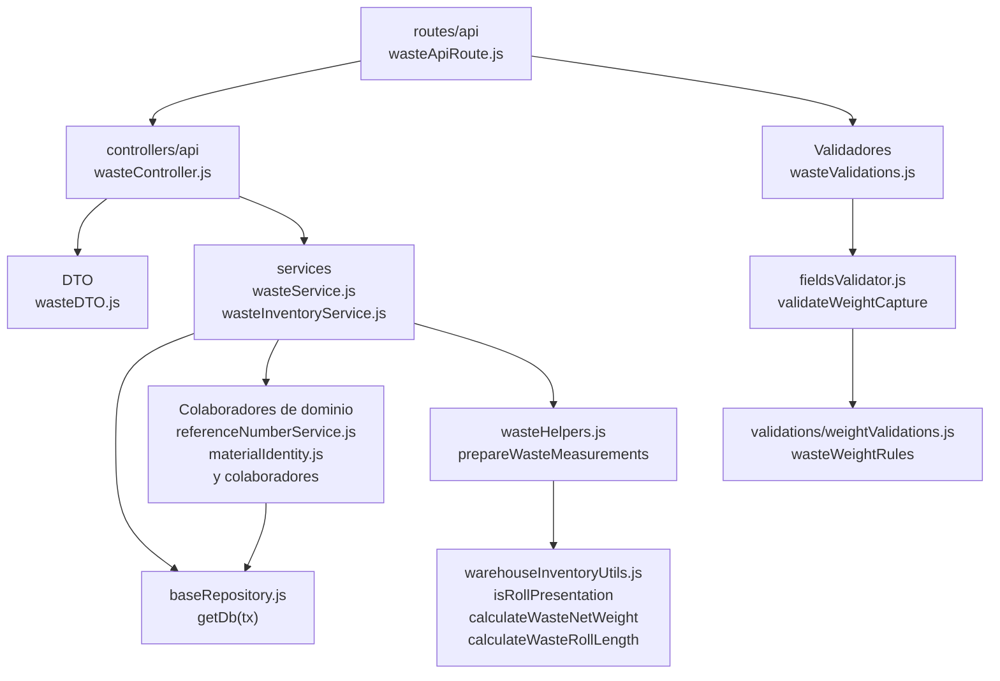

# 11. Mermas: estructura de código

**Identificador:** `DIA-BE-MOD-WAS-001`.
**Alcance:** grupos de implementación del módulo y sus dependencias directas.
**Fuente:** imports de los archivos de la tabla.

| Grupo del mapa | Archivos que lo componen |
| --- | --- |
| routes/api · wasteApiRoute.js | `src/routes/api/warehouse/wasteApiRoute.js` |
| controllers/api · wasteController.js | `src/controllers/api/warehouse/` `wasteController.js` |
| services · wasteInventoryService.js · wasteMaterialService.js · y colaboradores | `src/services/warehouse/wastes/` `wasteInventoryService.js` `src/services/warehouse/wastes/` `wasteMaterialService.js` `src/services/warehouse/wastes/` `wasteMovementService.js` `src/services/warehouse/wastes/` `wasteService.js` `src/services/warehouse/wastes/` `wasteStockAdjustmentService.js` `src/services/warehouse/wastes/` `wasteStockEntryService.js` |
| DTO · wasteDTO.js | `src/dtos/wasteDTO.js` |
| Colaboradores de dominio · referenceNumberService.js · materialIdentity.js · y colaboradores | `src/services/document/` `referenceNumberService.js` `src/services/inventory/materialIdentity.js` `src/services/inventory/stockHelpers.js` `src/services/warehouse/reasonService.js` `src/services/warehouse/supplierService.js` |
| Validadores · wasteValidations.js | `src/validators/forms/wasteValidations.js` |
| baseRepository.js · getDb(tx) | `src/repository/baseRepository.js` |
| Preparación de medidas | `src/services/warehouse/wastes/wasteHelpers.js` |
| Validación de campos | `src/validators/fields/fieldsValidator.js` |
| Regla de presentación · warehouseInventoryUtils.js | `src/public/js/utils/warehouseInventoryUtils.js` |

## Contratos de implementación

### Datos, resultados y efectos del módulo

| Capacidad | Entrada y retorno | Reglas, errores y persistencia |
| --- | --- | --- |
| Mermas: `wasteController.js`, `wastes/wasteService.js`, `wasteMaterialService.js`, `wasteInventoryService.js`, `wasteMovementService.js`, `wasteStockAdjustmentService.js` | Lista, plantillas, alta, edición y ajuste reciben identificadores/DTO y retornan merma. | Coordina material origen, cantidades, inventario y movimientos; valida existencia y suficiencia antes de escrituras atómicas. |

| Archivo bajo `src/` | Símbolos públicos y puntos de configuración |
| --- | --- |
| `controllers/api/warehouse/` `wasteController.js` | `getWasteMaterialTemplates` `getAllWastes` `registerWaste` `editWaste` `editWasteStock` `registerWasteStockAddition` |

### Normalización de datos

| Archivo bajo `src/` | Símbolos públicos y puntos de configuración |
| --- | --- |
| `dtos/wasteDTO.js` | `createWasteDtoForRegister` `createWasteDtoForEdit` `createWasteDtoForStockUpdate` `createWasteDtoForStockAddition` |

## Variantes y límites de reutilización

wasteService reutiliza findSupplierMaterialByIds para consultar el material y su oferta por proveedor, conversión y servicios de ajuste/entrada de stock de merma. wasteInventoryService y wasteMovementService mantienen su persistencia propia.

Los reportes y la infraestructura transversal se localizan en el
[capítulo 3](03-shared-code-and-coverage.md); el orden de llamadas está en
[procesos](../../processes/backend-code-sequences/index.md).

La captura, protección de la edición y cálculo de reportes se describen en
[datos de merma](../../logical/data-and-persistence/index.md#peso-unitario-de-merma-de-rollo).

El origen de una merma debe ser un `Material` de tipo `MATERIAL` con unidad m²,
reconocida por símbolo o nombre «metro cuadrado». El selector filtra en SQL y el alta
comprueba la oferta consultada dentro de su transacción; forzar otro origen devuelve
`WASTE_MATERIAL_INVALID`. No se añaden consultas para esa comprobación.

Para Rollo, la muestra se captura desde merma: `sampleLengthM` y `sampleNetWeightKg`,
sin cono y del mismo ancho. Se persiste junto con el cono, total del sobrante y neto,
sin actualizar `SupplierMaterial`. Los pesos antiguos del rollo completo permanecen
históricos y sus intentos de captura o cambio reciben `MATERIAL_ROLL_REFERENCE_READ_ONLY`.

`prepareWasteMeasurements` recibe el DTO y la oferta ya consultada, fija la menor
dimensión y calcula el largo como `netoMerma × largoMuestra / netoMuestra`. Ignora los
resultados enviados por el cliente y rechaza un cálculo sin muestra completa. No hace
consultas ni escrituras; el servicio conserva identidad, transacción e inventario.
Los validators verifican forma y precisión una vez por campo; `withMessage` entrega
códigos declarados en `errorMap`. Muestra y pesos se protegen en edición.

La muestra usa `Decimal(18,6)`, lo que permite capturar, por ejemplo, 0.057 kg; los
pesos del sobrante conservan el límite y precisión vigentes. La migración incremental
agrega campos nulos para históricos y un CHECK de pareja positiva. No estima valores
antiguos ni altera dimensiones, pesos o saldos existentes.
