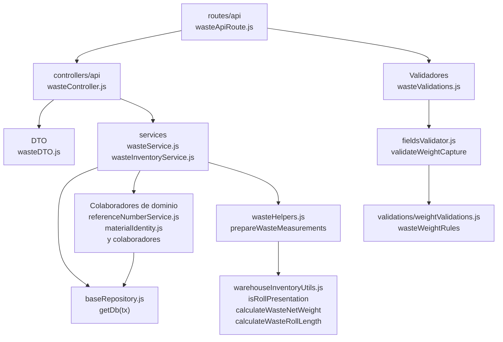

# 11. Mermas: estructura de código

**Identificador:** `DIA-BE-MOD-WAS-001`.
**Alcance:** grupos de implementación del módulo y sus dependencias directas.
**Fuente:** imports de los archivos de la tabla.

| Grupo del mapa | Archivos que lo componen |
| --- | --- |
| routes/api · wasteApiRoute.js | `src/routes/api/warehouse/wasteApiRoute.js` |
| controllers/api · wasteController.js | `src/controllers/api/warehouse/` `wasteController.js` |
| services · wasteInventoryService.js · wasteMaterialService.js · y colaboradores | `src/services/warehouse/wastes/` `wasteInventoryService.js` `src/services/warehouse/wastes/` `wasteMaterialService.js` `src/services/warehouse/wastes/` `wasteMovementService.js` `src/services/warehouse/wastes/` `wasteService.js` `src/services/warehouse/wastes/` `wasteStockAdjustmentService.js` `src/services/warehouse/wastes/` `wasteStockEntryService.js` |
| DTO · wasteDTO.js | `src/dtos/wasteDTO.js` |
| Colaboradores de dominio · referenceNumberService.js · materialIdentity.js · y colaboradores | `src/services/document/` `referenceNumberService.js` `src/services/inventory/materialIdentity.js` `src/services/inventory/stockHelpers.js` `src/services/warehouse/reasonService.js` `src/services/warehouse/supplierService.js` |
| Validadores · wasteValidations.js | `src/validators/forms/wasteValidations.js` |
| baseRepository.js · getDb(tx) | `src/repository/baseRepository.js` |
| Preparación de medidas | `src/services/warehouse/wastes/wasteHelpers.js` |
| Validación de campos | `src/validators/fields/fieldsValidator.js` |
| Regla de presentación · warehouseInventoryUtils.js | `src/public/js/utils/warehouseInventoryUtils.js` |

## Contratos de implementación

### Datos, resultados y efectos del módulo

| Capacidad | Entrada y retorno | Reglas, errores y persistencia |
| --- | --- | --- |
| Mermas: `wasteController.js`, `wastes/wasteService.js`, `wasteMaterialService.js`, `wasteInventoryService.js`, `wasteMovementService.js`, `wasteStockAdjustmentService.js` | Lista, plantillas, alta, edición y ajuste reciben identificadores/DTO y retornan merma. | Coordina material origen, cantidades, inventario y movimientos; valida existencia y suficiencia antes de escrituras atómicas. |

| Archivo bajo `src/` | Símbolos públicos y puntos de configuración |
| --- | --- |
| `controllers/api/warehouse/` `wasteController.js` | `getWasteMaterialTemplates` `getAllWastes` `registerWaste` `editWaste` `editWasteStock` `registerWasteStockAddition` |

### Normalización de datos

| Archivo bajo `src/` | Símbolos públicos y puntos de configuración |
| --- | --- |
| `dtos/wasteDTO.js` | `createWasteDtoForRegister` `createWasteDtoForEdit` `createWasteDtoForStockUpdate` `createWasteDtoForStockAddition` |

## Variantes y límites de reutilización

wasteService reutiliza findSupplierMaterialByIds para consultar el material y sus pesos por proveedor, conversión y servicios de ajuste/entrada de stock de merma. wasteInventoryService y wasteMovementService mantienen su persistencia propia.

Los reportes y la infraestructura transversal se localizan en el
[capítulo 3](03-shared-code-and-coverage.md); el orden de llamadas está en
[procesos](../../processes/backend-code-sequences/index.md).

La captura, protección de la edición y cálculo de reportes se describen en
[datos de merma](../../logical/data-and-persistence/index.md#peso-unitario-de-merma-de-rollo).

Los pesos de referencia se capturan mediante el CRUD de material. Una vez registrados,
no se cambian ni eliminan; se permite completar sólo valores todavía nulos.
`assertMaterialRollReference` comprueba esta regla antes de escribir y la actualización
de la oferta incluye los valores consultados como condición para proteger capturas
simultáneas. Un conflicto devuelve `MATERIAL_ROLL_REFERENCE_READ_ONLY` y revierte la
transacción. El DTO no convierte en nulo un campo omitido. La merma
reutiliza `findSupplierMaterialByIds` dentro de su transacción, prepara el neto de
referencia al registrar y persiste el vínculo, el cono utilizado y los resultados.
Los validators verifican formato y relaciones numéricas antes del servicio;
la transacción comprueba presentación, oferta activa y referencia necesaria.

Las condiciones de negocio de esta captura corresponden a `RF-MER-012` y sus criterios
de aceptación. Los controles de existencia y concurrencia hacen cumplir ese contrato:

| Condición | Propósito |
| --- | --- |
| Hay pesos y el recurso no es material Rollo | Rechazar referencias que no aplican. Ambos pesos pueden omitirse. |
| Falta una referencia guardada | Permitir su captura inicial. |
| El campo no viene en la solicitud | Conservar el valor almacenado. |
| Se borra o cambia un valor registrado | Rechazar con `MATERIAL_ROLL_REFERENCE_READ_ONLY`; cero cuenta como registrado. |
| Falta la oferta del proveedor | Rechazar con `MATERIAL_NOT_FOUND`. |
| La actualización condicionada afecta cero filas | Revertir la transacción: las referencias ya no coinciden o la oferta dejó de existir desde la consulta. |

`supplierMaterials` se filtra por `supplierId`; la restricción única de material y
proveedor garantiza como máximo una oferta. El servicio obtiene esa oferta una vez y
pasa `savedReference` explícitamente al helper. El conteo de la escritura es un control
de concurrencia, no una segunda validación numérica ni un requisito de captura.

`prepareWasteMeasurements` es un helper de dominio sin consultas ni escrituras.
Recibe el DTO y la oferta consultada, resuelve la orientación, calcula neto y largo
y comprueba las dimensiones finales. El servicio conserva consultas, identidad,
transacción y registro de inventario. Los formularios Express de material y merma
reutilizan `validateWeightCapture`: cada predicado compartido se evalúa una vez,
`withMessage` asigna el código declarado en `errorMap` y `bail` detiene la cadena
en el primer fallo. El adaptador Express no lanza códigos como excepciones ni
vuelve a validar para resolver el mensaje.

La selección conserva los pesos en la oferta de `supplierMaterials`, sin aplanarlos
en el material ni devolver resultados precalculados. `prepareWasteRollReference`
comparte la preparación de orientación y referencias entre servidor y navegador;
la dimensión menor conserva su campo y la mayor recibe la longitud calculada. Las reglas Express reutilizan
`public/js/utils/validations/weightValidations.js`; la utilidad de inventario sólo
conserva acceso a datos, normalización y cálculos sin mensajes de validación.
