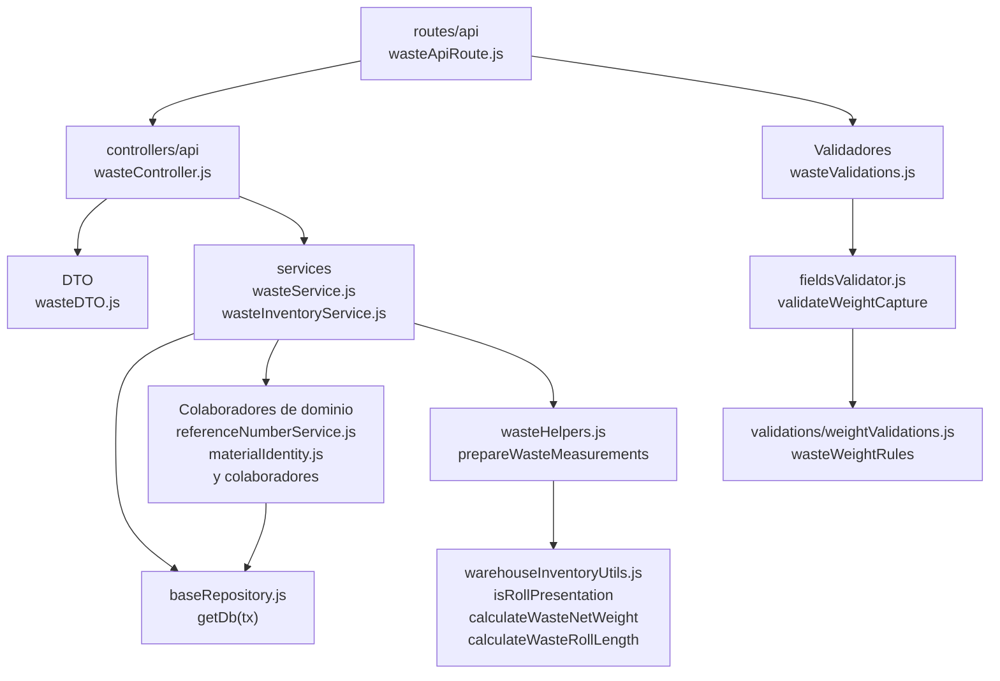

# 11. Mermas: estructura de código

**Identificador:** `DIA-BE-MOD-WAS-001`.
**Alcance:** grupos de implementación del módulo y sus dependencias directas.
**Fuente:** imports de los archivos de la tabla.

| Grupo del mapa | Archivos que lo componen |
| --- | --- |
| routes/api · wasteApiRoute.js | `src/routes/api/warehouse/wasteApiRoute.js` |
| controllers/api · wasteController.js | `src/controllers/api/warehouse/` `wasteController.js` |
| services · wasteInventoryService.js · wasteMaterialService.js · y colaboradores | `src/services/warehouse/wastes/` `wasteInventoryService.js` `src/services/warehouse/wastes/` `wasteMaterialService.js` `src/services/warehouse/wastes/` `wasteMovementService.js` `src/services/warehouse/wastes/` `wasteService.js` `src/services/warehouse/wastes/` `wasteStockAdjustmentService.js` `src/services/warehouse/wastes/` `wasteStockEntryService.js` |
| DTO · wasteDTO.js | `src/dtos/wasteDTO.js` |
| Colaboradores de dominio · referenceNumberService.js · materialIdentity.js · y colaboradores | `src/services/document/` `referenceNumberService.js` `src/services/inventory/materialIdentity.js` `src/services/inventory/stockHelpers.js` `src/services/warehouse/reasonService.js` `src/services/warehouse/supplierService.js` |
| Validadores · wasteValidations.js | `src/validators/forms/wasteValidations.js` |
| baseRepository.js · getDb(tx) | `src/repository/baseRepository.js` |
| Preparación de medidas | `src/services/warehouse/wastes/wasteHelpers.js` |
| Validación de campos | `src/validators/fields/fieldsValidator.js` |
| Regla de presentación · warehouseInventoryUtils.js | `src/public/js/utils/warehouseInventoryUtils.js` |

## Contratos de implementación

### Datos, resultados y efectos del módulo

| Capacidad | Entrada y retorno | Reglas, errores y persistencia |
| --- | --- | --- |
| Mermas: `wasteController.js`, `wastes/wasteService.js`, `wasteMaterialService.js`, `wasteInventoryService.js`, `wasteMovementService.js`, `wasteStockAdjustmentService.js` | Lista, plantillas, alta, edición y ajuste reciben identificadores/DTO y retornan merma. | Coordina material origen, cantidades, inventario y movimientos; valida existencia y suficiencia antes de escrituras atómicas. |

| Archivo bajo `src/` | Símbolos públicos y puntos de configuración |
| --- | --- |
| `controllers/api/warehouse/` `wasteController.js` | `getWasteMaterialTemplates` `getAllWastes` `registerWaste` `editWaste` `editWasteStock` `registerWasteStockAddition` |

### Normalización de datos

| Archivo bajo `src/` | Símbolos públicos y puntos de configuración |
| --- | --- |
| `dtos/wasteDTO.js` | `createWasteDtoForRegister` `createWasteDtoForEdit` `createWasteDtoForStockAdjustment` `createWasteDtoForStockAddition` |

### Nombres del formulario, API y persistencia

El formulario, las validaciones y el DTO usan el mismo nombre para cada entrada.
El alta requiere `initialQuantity`; `newStock` pertenece exclusivamente al ajuste.
No hay un alias del nombre anterior en el alta. El frontend y el servidor se
actualizan juntos. La cantidad inicial es una instrucción de entrada, no una
columna adicional de `Waste`.

| Campo del contrato | Destino o significado en la base de datos |
| --- | --- |
| `initialQuantity` en el alta | Con valor positivo genera `WasteStockEntry.quantity`, desde saldo cero, y actualiza `Waste.currentStock` una sola vez. Cero no genera documento. |
| `quantity` al agregar stock | `WasteStockEntry.quantity`: unidades que se suman al saldo existente. |
| `newStock` al ajustar | `WasteStockAdjustmentDetail.newStock`: saldo final, también aplicado a `Waste.currentStock`. |
| `currentStock`, `previousStock`, `newStock` en respuestas/documentos | Etiquetas Stock actual, Stock anterior y Nuevo stock; conservan los nombres del esquema. |
| `name`, `supplierId`, `minStock`, `maxUnitCost`, `isActive` | Campos homónimos de `Waste`; el alta respeta también stock mínimo y estado capturados. |
| `materialId` | Junto con `supplierId` identifica la oferta consultada; el material se conserva como `Waste.sourceMaterialId`. |
| `base`, `height` | Campos homónimos de `Waste`; el servidor determina las medidas finales del rollo. |
| `coneWeightKg`, `totalWeightKg`, `referenceRollTotalWeightKg` | Campos homónimos de `Waste`: cono, total del sobrante con cono y total del rollo completo con cono. |
| `weightKg` | Neto de la merma calculado por el servidor y guardado en `Waste.weightKg`; el cliente sólo lo muestra. |
| `convertedQuantity` | Superficie calculada según medidas y existencias; el cliente no la fija. |
| `observations` | Observaciones de la entrada inicial, entrada adicional o ajuste correspondiente. |
| `reasonId` | Motivo de `WasteStockAdjustment`; sólo lo admite el DTO del ajuste. |

Presentación y unidad se obtienen del material seleccionado. Los campos visuales
`presentationDisplay` y `unitMeasureDisplay` no se envían ni crean columnas. Las
referencias históricas `sampleLengthM` y `sampleNetWeightKg` siguen siendo de consulta.
El DTO de ajuste y su colección de campos se denominan
`createWasteDtoForStockAdjustment` y `wasteStockAdjustmentFields`. Un fallo de
persistencia al agregar stock usa `WASTE_STOCK_ENTRY_DB_ERROR`.

## Variantes y límites de reutilización

wasteService reutiliza findSupplierMaterialByIds para consultar el material y su oferta por proveedor, conversión y servicios de ajuste/entrada de stock de merma. wasteInventoryService y wasteMovementService mantienen su persistencia propia.

Los reportes y la infraestructura transversal se localizan en el
[capítulo 3](03-shared-code-and-coverage.md); el orden de llamadas está en
[procesos](../../processes/backend-code-sequences/index.md).

La captura, protección de la edición y cálculo de reportes se describen en
[datos de merma](../../logical/data-and-persistence/index.md#peso-unitario-de-merma-de-rollo).

El origen de una merma debe ser un `Material` de tipo `MATERIAL` con unidad m²,
reconocida por símbolo o nombre «metro cuadrado». El selector filtra en SQL y el alta
comprueba la oferta consultada dentro de su transacción; forzar otro origen devuelve
`WASTE_MATERIAL_INVALID`. No se añaden consultas para esa comprobación.

Para Rollo, la muestra es un rollo completo: el alta recibe únicamente su peso total
con cono en `referenceRollTotalWeightKg`, además del cono y el total del sobrante.
`prepareWasteMeasurements` reutiliza la oferta consultada, fija el ancho menor y toma
el largo de la otra dimensión nominal. Descuenta el mismo cono de ambos totales y
calcula `netoMerma × largoRollo / netoRollo`. No consulta ni guarda datos.

El servicio guarda el total del rollo completo, el cono, el total y neto del sobrante,
las medidas finales y `sourceMaterialId`. El largo y neto de muestra sólo son valores
intermedios; `sampleLengthM` y `sampleNetWeightKg` quedan nulos en altas nuevas y se
conservan exclusivamente para consultar históricos. El DTO no acepta estos campos. No actualiza `SupplierMaterial`; sus referencias previas
siguen históricas. Los validators comprueban cada peso con las reglas compartidas y
entregan códigos de `errorMap` mediante `withMessage`. El servicio comprueba la
presentación persistida y rechaza con `WASTE_WEIGHT_INVALID` un alta de Rollo sin
pesos, aunque se intenten enviar medidas manuales. Se reutiliza la oferta ya consultada;
esta regla no agrega consultas. Los históricos sin pesos permanecen de consulta.

La migración `20261015210000_add_waste_full_roll_reference` agrega un campo nullable
y exige que el neto de referencia corresponda al total menos el mismo cono. No cambia
las muestras anteriores ni sus resultados. Los tres pesos capturados admiten hasta
999.99 kg y dos decimales; referencia, medidas y pesos siguen protegidos en edición.

`20261015230000_stop_persisting_waste_sample_values` permite omitir esos valores
derivados sin borrar referencias anteriores. Las medidas del material son inmutables
y el neto de la muestra se obtiene del total guardado menos el cono. La migración se
aplica antes de iniciar el backend actualizado con `npm run db:migrate`.
