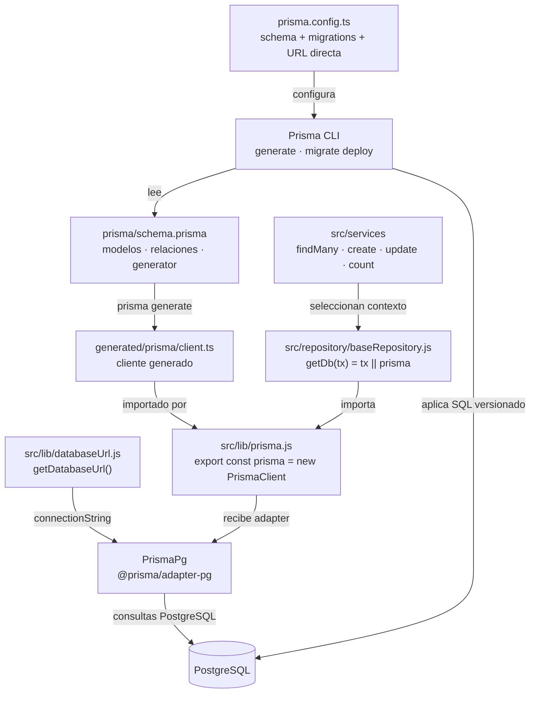

# 6. Prisma: cliente, consultas, transacciones y migraciones

Prisma es el ORM y generador de cliente usado por el backend para consultar PostgreSQL.
Nexus usa Prisma 7 (`package.json`), el generador `prisma-client` y el adaptador
`@prisma/adapter-pg`. Sus modelos describen datos y relaciones; las reglas de negocio,
los permisos y los DTO siguen en servicios, middleware y controllers.

## Preparar Prisma al incorporarse al proyecto

Use Node.js 24, compatible con el rango del proyecto, y ejecute los comandos desde
la raíz del repositorio. Los ejemplos de variables temporales de esta guía usan
Bash. `npm ci` instala las versiones de `package-lock.json`; se utiliza el CLI
local del proyecto, sin instalar un Prisma global ni actualizar sus paquetes
por separado durante la preparación.

1. Ejecute `npm ci`.
2. Configure las [variables locales del README](../../../../../README.md#variables-de-entorno).
   `DATABASE_URL` corresponde a la aplicación y `DIRECT_URL` a la conexión que
   aplicará migraciones; ambas deben llegar a la misma base de desarrollo.
3. Compruebe el modelo con `npx prisma validate` y el historial con
   `npx prisma migrate status`.
4. Ejecute `npm run db:migrate`: aplica las migraciones pendientes y genera el
   cliente. Una instalación nueva también recorre la cadena completa.
5. Inicie Nexus con `npm run dev`, con las variables de autenticación del README.
   La importación de `src/lib/prisma.js` requiere el cliente generado y una URL.

Si falta el cliente o cambió la instalación, use `npm run db:generate`. Generar
el cliente no aplica migraciones ni transforma registros. Después de cambiar
de rama, compruebe el historial y regenere el cliente para esa revisión.

`generated/prisma/` está excluido de Git. El generador `prisma-client` produce
TypeScript que la aplicación importa desde `generated/prisma/client.ts`; esos
archivos se regeneran y no se editan manualmente. El proyecto no configura un
comando de seed en `prisma.config.ts`: aplicar migraciones no garantiza que existan
usuarios, permisos o datos de inducción. Las integraciones crean sus fixtures.

## Construcción del cliente y conexión

**Identificador:** `DIA-COD-PRISMA-001`. **Pregunta:** ¿cómo llega el modelo Prisma a las
consultas de los servicios? **Fuente:** `prisma/schema.prisma`, `prisma.config.ts`,
`src/lib/{prisma,databaseUrl}.js` y `src/repository/baseRepository.js`.
**Leyenda:** flechas rotuladas por generación, import o uso; no son pasos de una petición.



`src/lib/prisma.js` construye una instancia compartida al cargar el módulo y la exporta.
Los servicios importan `getDb`; cuando no reciben `tx`, usan esa misma instancia. El
adaptador proporciona el acceso PostgreSQL; el cliente generado expone los modelos y
operaciones. No se crea un cliente por controller o por petición.

`baseRepository.js` contiene sólo el selector `getDb(tx)`. Las consultas se implementan
en servicios; no hay un repository por tabla ni un Unit of Work propio. Por ejemplo,
`findAllGoodsReceipts` usa `goodsReceipt.findMany` con `where`, `include`, orden y
paginación, y `count` para los totales. Prisma construye las consultas y devuelve datos;
la forma HTTP/DataTable la define el código que lo consume.

## Selección de URL y responsabilidades

| Ejecución | Configuración que utiliza el código |
| --- | --- |
| Aplicación Node | `getDatabaseUrl()` elige `DATABASE_URL`; con `NODE_ENV=test` elige `DATABASE_TEST_URL`. Si falta la URL seleccionada, falla la construcción del cliente. |
| Prisma CLI | `prisma.config.ts` llama a `resolveDatabaseUrl({ preferDirectUrl: true })`: prefiere `DIRECT_URL`, o `DIRECT_TEST_URL` en pruebas; si no existe, usa la URL del entorno correspondiente. |
| Integración con base | Los scripts verifican una base aislada y después ejecutan migraciones/generación antes de Vitest. La separación se comprueba en `scripts/verifyTestDatabaseEnv.js`. |

Las credenciales y privilegios de aplicación/migración se explican en
[roles PostgreSQL](../../physical/02-postgresql-runtime-and-migration-roles.md).
Aquí se describe cómo el código selecciona y utiliza esa conexión.

## Consultar y escribir desde un servicio

Prisma expone una propiedad por modelo, como `goodsIssue`, `wasteIssue` o
`referenceNumberCounter`. Dentro de un servicio de
`src/services/warehouse/goodsIssues`, una lectura puede seleccionar los campos
necesarios y conservar el filtro de contexto que Nexus ya implementa:

```js
import { getDb } from '../../../repository/baseRepository.js';
import { buildGoodsIssueContextWhere } from './goodsIssueHelpers.js';

// Fragmento de un servicio: type y tx pertenecen a su contexto autorizado.
const rows = await getDb(tx).goodsIssue.findMany({
    where: buildGoodsIssueContextWhere(type),
    select: { id: true, referenceNumber: true, requestDate: true },
    orderBy: { requestDate: 'desc' },
    skip: 0,
    take: 20
});
```

`where` expresa condiciones, `select` limita campos e `include` carga relaciones.
`skip` y `take` paginan; `count` obtiene el total del filtro correspondiente.
`findUnique` busca una clave única y puede devolver `null`; el servicio determina
el error de dominio. `Decimal` y `Date` conservan su representación de
Prisma/JavaScript, que las funciones existentes de normalización y presentación
adaptan a cada consumidor.

`create`, `update`, `delete`, `createMany` y `upsert` son operaciones de persistencia.
Los servicios validan existencia, estado y reglas del dominio antes de usarlas.
`connect` identifica una relación existente; una escritura anidada, como los
detalles de una salida, se conserva junto con la operación del documento.

Para agregar una operación, siga un servicio equivalente y sus DTO, validators,
errores y contrato HTTP. Las transformaciones de datos históricos pertenecen
al SQL de una migración. Si una consulta raw necesita entrada variable, use
parámetros; no concatene esa entrada en `$queryRawUnsafe` o `$executeRawUnsafe`.
Las pruebas de migración ejecutan SQL estático versionado sobre una base aislada.

## Transacción y propagación del contexto

La dependencia entre el coordinador, `tx` y sus colaboradores se explica en
[contexto transaccional](../design-and-construction-patterns/09-context-transactional-and-consistency-atomic.md).
El orden de generación de folio, documento, movimiento, commit y costo pertenece a la
[secuencia backend de creación de entrada](../../processes/backend-code-sequences/purchases/cu-ent-02.md).
El código concreto está en `goodsReceiptService.js#createGoodsReceipt`.

Los colaboradores reciben explícitamente `tx` y usan `getDb(tx)` o sus métodos.
Prisma confirma o revierte las escrituras del callback; usar `getDb()` sin `tx` dentro
de esa colaboración escaparía del límite transaccional. Las lecturas previas y la
actualización de costo posterior no quedan cubiertas por ese rollback. Un error del
costo después del commit no deshace documento, movimiento y stock ya confirmados.
La publicación de eventos y la auditoría también tienen fronteras propias, descritas
en [contexto transaccional](../design-and-construction-patterns/09-context-transactional-and-consistency-atomic.md).

El callback de `$transaction` debe retornar el resultado que recibirá el servicio.
Un callback que sólo hace `await` y no retorna confirma las escrituras pero
resuelve `undefined`. `createGoodsIssue` retorna `{ goodsIssue }` desde su callback
y devuelve ese resultado. El folio y el documento usan el mismo `tx`, por lo
que un fallo posterior al incremento revierte también el contador. El retorno
de una consulta pertenece al modelo consultado y no a otra entidad del dominio.

## Modelo, generación y evolución de la base

| Artefacto/comando | Qué cambia y qué no resuelve por sí solo |
| --- | --- |
| `prisma/schema.prisma` | Define modelos, campos, relaciones, índices y generador. Su edición no altera por sí sola una base existente. |
| `prisma/migrations/*/migration.sql` | SQL versionado que evoluciona la base. Una migración nueva conserva las ya aplicadas. |
| `npm run db:generate` | Ejecuta `prisma generate` para regenerar `generated/prisma`. No aplica las migraciones a PostgreSQL. |
| `npm run db:migrate` | Ejecuta `prisma migrate deploy` y luego `prisma generate`. Aplica migraciones pendientes; no crea una migración nueva a partir del esquema. |
| `npm run docs:architecture` | Genera evidencia documental desde código/esquema. No genera el cliente ni migra la base. |

El [modelo persistente](../../logical/data-and-persistence/index.md) conserva el ER y
el diccionario; esta sección conserva la integración de Prisma con la implementación.
Si cambian modelos, se revisan migración, cliente, servicios, DTO, contrato HTTP y
pruebas de persistencia. No basta con regenerar una de esas piezas.

## Crear y revisar una migración

`migrate dev` prepara cambios en desarrollo; `migrate deploy` aplica SQL que ya
está versionado. `migrate dev` necesita una base sombra para reproducir el
historial. La configuración actual no define `shadowDatabaseUrl`, por lo que
necesita una cuenta de desarrollo capaz de crear esa base temporal. La cuenta
de producción recomendada en la vista física no tiene `CREATEDB` y no se usa
para esta preparación de desarrollo.

1. Parta de una rama y una base local de desarrollo con las migraciones actuales.
2. Modifique `prisma/schema.prisma` y ejecute `npx prisma validate`.
3. Prepare el borrador SQL sin aplicarlo:

   ```bash
   npx prisma migrate dev --name describir_cambio --create-only
   ```

4. Revise el nuevo `migration.sql`: tipos, valores iniciales, nulabilidad,
   índices, relaciones y conservación de registros. Antes de imponer una columna
   obligatoria, resuelva los datos existentes que deberán ocuparla.
5. Aplique el borrador revisado en desarrollo con `npm run db:migrate` y
   compruebe `npx prisma migrate status`.
6. Pruebe datos existentes y una instalación desde cero. Ejecute
   `npm run docs:architecture` y `npm run docs:check`.
7. Versione juntos esquema, migración, servicios, contratos, documentación y pruebas.

Un cambio sólo de datos puede no producir un diff del esquema. Agregue entonces
un directorio nuevo `prisma/migrations/<marca_temporal>_<nombre>/` con SQL revisado.
La conversión de folios es un ejemplo: utiliza columnas e índices existentes,
pero necesita una migración para los registros históricos. El orden de la
cadena conserva primero la clasificación y después la normalización de series.

Prisma registra intentos y checksums en `_prisma_migrations`. Un cambio nuevo
se incorpora mediante otra migración; editar SQL ya aplicado altera el historial.
`db push` no sustituye el flujo versionado de Nexus. `migrate reset` elimina los
datos de la base seleccionada y se reserva para bases locales desechables.
`migrate resolve` corresponde a la recuperación de un intento fallido después
de revisar su estado, según la [vista física](../../physical/02-postgresql-runtime-and-migration-roles.md).

## Ejemplo del proyecto: tres series de salidas

| Contexto | Modelo | Prefijo | Migración que establece su distinción |
| --- | --- | --- | --- |
| Materiales | `GoodsIssue`, `type = MATERIAL` | `SAL-MAT` | `20261012120000_split_goods_issue_reference_prefixes` |
| Consumibles | `GoodsIssue`, `type = CONSUMABLE` | `SAL-CON` | `20261012120000_split_goods_issue_reference_prefixes` |
| Merma | `WasteIssue` | `SAL-MER` | `20260814150000_align_waste_reference_prefixes`, desde `SM` |

La migración de octubre selecciona exactamente `^SAL-[0-9]{4}-[0-9]+$` en
`GoodsIssue`. `SAL-MER-2026-000007` no coincide con ese patrón; tampoco se
actualizan los documentos de `WasteIssue`. El contador de merma es otra fila de
`ReferenceNumberCounter`, identificada por `SAL-MER` y año; sus valores no se
incorporan a los máximos de materiales y consumibles.

La [guía de despliegue de folios](../../physical/02-postgresql-runtime-and-migration-roles.md#migración-de-folios-de-salidas-por-contexto)
explica el orden operativo. La integración de
`tests/integration/controllers/goodsIssueControllerDbTest.js` comprueba que se
conserven documentos y contador de merma, también cuando se ejecuta primero
la migración histórica de `SM` a `SAL-MER`.

## Probar y explorar el modelo

Configure `DATABASE_TEST_URL` para una base física distinta de desarrollo y
producción. `DIRECT_TEST_URL`, cuando se use, debe llegar a esa misma base de
pruebas. `verifyTestDatabaseEnv.js` exige la URL de prueba y rechaza la igualdad
textual con `DATABASE_URL`; compruebe también el destino físico si utiliza
usuarios, alias o conexiones directas diferentes.

```bash
npm run test:db:verify
npm run test:db:migrate
npm run test:integration
```

La integración ya verifica variables, aplica migraciones y genera el cliente;
`test:db:migrate` permite preparar la base sin ejecutar la suite. Las integraciones
consultan después de escribir y comprueban rechazo, rollback y relaciones.
`npm run test:unit` usa la configuración unitaria y no demuestra los efectos
del SQL en PostgreSQL.

Para una revisión visual local, ejecute `npx prisma studio` con la base de
desarrollo configurada y abra la dirección que indique el CLI. Studio permite
consultar y modificar datos; utiliza la conexión del CLI y no reproduce los
permisos ni reglas de los servicios de Nexus. Cierre el proceso con `Ctrl+C`
y use los recorridos de la aplicación para verificar una operación de negocio.

## Errores y verificación

Prisma no traduce automáticamente sus errores a respuestas de Nexus. Los servicios
conservan sus errores de dominio y el middleware final de `src/app.js` aplica
`normalizeDatabaseError` (`src/errors/databaseError.js`): `P2021` y `P2022` identifican
tabla/columna faltante; ciertos errores de validación por miembros desconocidos
identifican un cliente desactualizado. Se convierten a errores de aplicación 503.
Otros errores siguen la traducción definida por su servicio o el manejador final.

Las pruebas unitarias con mocks verifican contratos y delegación; no demuestran que
una migración se aplique ni que PostgreSQL haga rollback. Eso se comprueba con
[integración en base aislada](../../../../testing/test-plan.md) y los scripts de prueba.

| Síntoma | Qué revisar | Acción en el proyecto |
| --- | --- | --- |
| Falta `generated/prisma/client.ts` | Generación para la rama actual. | Ejecutar `npm run db:generate`. |
| Falta la URL | `NODE_ENV` y configuración local del proceso. | Configurar la variable seleccionada antes de importar el cliente. |
| Tabla o columna inexistente (`P2021`/`P2022`) | Historial aplicado, esquema y cliente. | Revisar `npx prisma migrate status`, aplicar migraciones pendientes y regenerar el cliente. |
| Prisma rechaza un campo desconocido | Diferencias entre esquema, cliente y paquetes instalados. | Ejecutar `npm ci` y `npm run db:generate`, y revisar la migración requerida. |
| No puede conectarse | Destino, puerto, permisos y acceso de red. | Diagnosticar la conexión seleccionada sin publicar credenciales. |
| Migración fallida o duplicado único | SQL e identificadores en conflicto. | Revisar el intento antes de conciliar datos y seguir el procedimiento de recuperación. |
