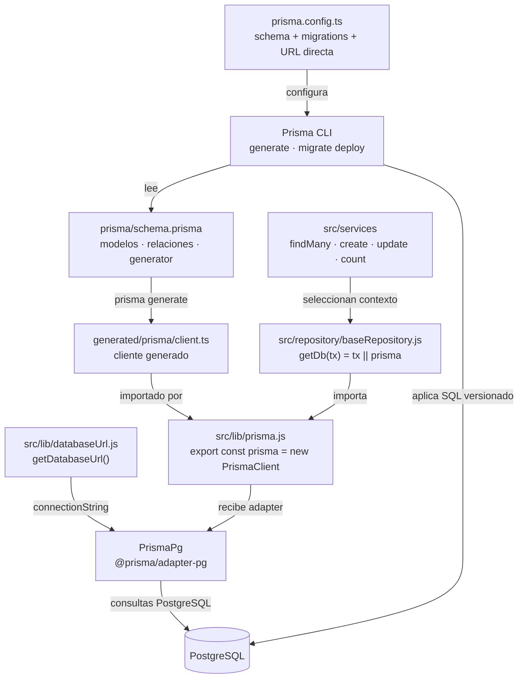

# 6. Prisma: cliente, consultas, transacciones y migraciones

Prisma es el ORM que Nexus utiliza para consultar PostgreSQL y mantener su
historial de migraciones. El proyecto usa **Prisma 7**, el generador `prisma-client`
y el adaptador `@prisma/adapter-pg`. Las reglas de negocio y los permisos se
implementan en los servicios y middleware de Nexus.

## Cómo se implementa en Nexus

| Pieza | Responsabilidad |
| --- | --- |
| `prisma/schema.prisma` | Define modelos, campos, relaciones e índices. |
| `prisma/migrations/*/migration.sql` | Conserva el SQL versionado que modifica estructura o datos históricos. |
| `prisma.config.ts` | Configura el esquema, las migraciones y la conexión del CLI. |
| `generated/prisma/client.ts` | Cliente generado desde el esquema; está excluido de Git y no se edita. |
| `src/lib/prisma.js` | Construye el cliente compartido con `PrismaPg`. |
| `src/repository/baseRepository.js` | `getDb(tx)` selecciona el cliente transaccional o el compartido. |

**Identificador:** `DIA-COD-PRISMA-001`. **Pregunta:** ¿cómo llega el modelo Prisma a las
consultas de los servicios? **Fuente:** `prisma/schema.prisma`, `prisma.config.ts`,
`src/lib/{prisma,databaseUrl}.js` y `src/repository/baseRepository.js`.
**Leyenda:** flechas rotuladas por generación, import o uso; no son pasos de una petición.

Los servicios reutilizan `getDb(tx)` para consultar y escribir; no crean un
cliente por petición. En una operación compuesta, el coordinador abre
`$transaction`, propaga `tx` a sus colaboradores y retorna el resultado del
callback. Un fallo dentro del callback revierte sus escrituras, incluido el
contador del folio; una operación posterior al commit tiene otra frontera.
Los detalles se explican en [contexto transaccional](../design-and-construction-patterns/09-context-transactional-and-consistency-atomic.md).

## Comandos habituales

Desde la raíz, use Node.js 24 y `npm ci` para instalar las versiones del lockfile.
Configure las [variables del README](../../../../../README.md#variables-de-entorno):
la aplicación usa `DATABASE_URL`; el CLI prefiere `DIRECT_URL`. Ambas deben
apuntar a la misma base del entorno. En pruebas se seleccionan
`DATABASE_TEST_URL` y, si existe, `DIRECT_TEST_URL`, para una base aislada.

| Necesidad | Comando |
| --- | --- |
| Validar el esquema e inspeccionar migraciones aplicadas | `npx prisma validate` y `npx prisma migrate status` |
| Aplicar migraciones pendientes y generar el cliente | `npm run db:migrate` |
| Regenerar sólo el cliente, por ejemplo tras cambiar de rama | `npm run db:generate` |
| Preparar SQL de un cambio de esquema en desarrollo | `npx prisma migrate dev --name describir_cambio --create-only` |
| Comprobar persistencia con la base de pruebas | `npm run test:integration` |
| Actualizar y comprobar documentación generada | `npm run docs:architecture` y `npm run docs:check` |

Revise el SQL nuevo antes de aplicarlo. Un cambio sólo de datos, como convertir
folios, también se versiona en una **migración incremental**; no se modifica SQL
ya aplicado. `migrate dev` requiere una base sombra y una cuenta de desarrollo
con capacidad para crearla en la configuración actual. Los roles, el despliegue
y la conversión de folios pertenecen a la [vista física de PostgreSQL](../../physical/02-postgresql-runtime-and-migration-roles.md).

Generar el cliente no migra la base. Si faltan tablas o columnas, compruebe el
historial antes de regenerarlo. El proyecto no configura un comando de seed;
las integraciones preparan sus propios datos. El modelo y las series anuales
`SMA`, `SCO`, `SME`, `CMA` y `CCO` se describen en la
[vista de datos](../../logical/data-and-persistence/index.md).

## Documentación oficial

Consulte las páginas de **Prisma ORM 7**, correspondientes a la versión del
proyecto. Mantenga las dependencias del repositorio al seguir sus ejemplos.

- [Resumen de Prisma ORM 7](https://www.prisma.io/docs/orm/v7).
- [Prisma Client: consultas y relaciones](https://www.prisma.io/docs/orm/v7/prisma-client).
- [Prisma Migrate: historial y evolución de la base](https://www.prisma.io/docs/orm/v7/prisma-migrate).
- [Transacciones](https://www.prisma.io/docs/orm/v7/prisma-client/queries/transactions).
