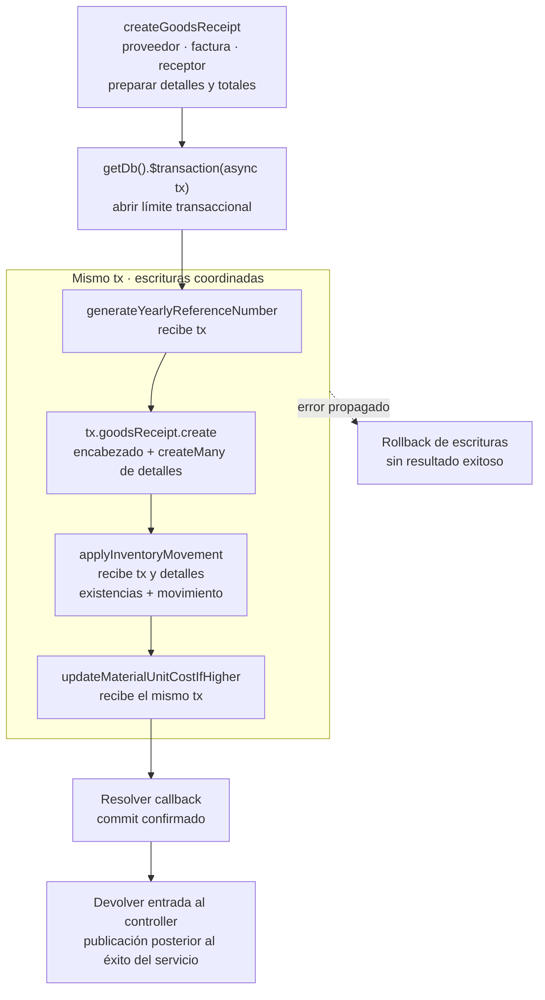

# 9. Contexto transaccional y consistencia atómica

`src/repository/baseRepository.js` expone únicamente `getDb(tx)`: propaga el cliente de
transacción cuando el caso de uso ya está dentro de `$transaction`, o usa Prisma cuando
no lo está. Esto permite que servicios auxiliares participen en la misma operación
atómica sin abrir transacciones anidadas ni depender de una variable global de
transacción.

El archivo **no implementa actualmente el patrón Repository completo**: no encapsula
colecciones ni ofrece repositorios por agregado. Tampoco se declara una implementación
propia de *Unit of Work*; Prisma administra el commit/rollback. La estrategia real es
**Transaction Script con propagación explícita de contexto**, coordinado por servicios
de caso de uso.

**Regla de construcción:** una operación que modifica documento, detalle, existencia y
movimiento abre un solo límite `$transaction` y pasa `tx` a las funciones participantes.
La prueba de integración debe demostrar tanto el efecto completo como el rollback.

## Aplicación del contexto en una entrada

**Identificador:** `DIA-PAT-TX-001`. **Pregunta:** ¿qué operaciones comparten `tx` y
qué efecto queda después del commit? **Fuente:** `goodsReceiptService.createGoodsReceipt`,
`referenceNumberService`, `inventory/movementService` y `supplierMaterialService`.
Las flechas dentro de la transacción expresan coordinación en orden; su contorno indica
el límite de atomicidad, no un proceso independiente.

Las comprobaciones y la preparación anteriores a `$transaction` no quedan protegidas
por su rollback. Las escrituras de costos de la compra sí participan en el mismo
callback que documento, existencias y movimiento. Si fallan, se revierte la operación.
Dentro del callback se usa `tx` directamente o se propaga a sus colaboradores.

## Protección de escrituras concurrentes

`repository/warehouse/documentLockRepository.js` concentra los bloqueos de fila de
salidas y compras. Edición, surtido y devolución adquieren el bloqueo del documento
antes de consultar sus cantidades y estados. Las operaciones de documentos distintos
pueden continuar independientemente; si comparten artículos, sus actualizaciones de
stock se ordenan por identidad para reducir bloqueos cruzados.

`supplierMaterialStockService.js` y `wasteInventoryService.js` preparan cambios por
identidad. `stockUpdateRepository.js` bloquea las existencias en orden común y las
actualiza por lote con SQL parametrizado, condición de saldo y `RETURNING`.
El historial obtiene el saldo anterior desde el saldo
resultante y la cantidad aplicada, evitando que una lectura previa produzca dos
movimientos con el mismo saldo inicial. Los detalles de un movimiento se conservan
aunque la escritura de existencia agrupe varias líneas del mismo artículo.

Los ajustes absolutos usan `stockLockRepository.js` antes de consultar la existencia.
La diferencia se calcula desde ese saldo protegido. Las correcciones de compras
reutilizan el movimiento por diferencia y mantienen costos y auditoría en el mismo
`tx`. Los conflictos de estado y cantidad conservan sus errores de dominio y HTTP 409.

La separación mantiene una transacción por caso de uso: surtido en servicios de
detalle, consultas de estados en servicios de cumplimiento, cálculos de compras en
`goodsReceiptHelpers.js` y escrituras de totales
en `goodsReceiptTotalsService.js`. No se reserva un documento durante la captura en
pantalla ni se deduplican entradas independientes; esos contratos necesitarían una
versión de formulario o una clave de idempotencia adicional.

Los servicios de detalle validan pertenencia y duplicados en un recorrido del lote;
`issueDetailRepository.js` ejecuta una actualización parametrizada para sus distintos
valores. Conserva el filtro por documento y actualiza `updatedAt`, ya que SQL directo
no ejecuta `@updatedAt` de Prisma. La consulta no calcula reglas ni abre transacciones.

`updateManyAndReturn` está soportado para PostgreSQL en Prisma 7 y se conserva al
modificar una partida de compra condicionada a estado activo. En stock, cada identidad
requiere una cantidad distinta: se envían todas en `VALUES`, una CTE materializada
bloquea las filas en orden y `UPDATE ... RETURNING` devuelve sus saldos reales. El
servicio verifica el conjunto completo y lanza el error de dominio si falta una fila;
el rollback revierte también las filas del lote que sí pudieron modificarse. No se
depende del orden del resultado ni se repite una consulta por existencia.

Para reducir latencia se leen únicamente campos necesarios, se escriben detalles por
lote y se mantiene una instancia de Prisma. Las operaciones dentro de una transacción
usan una conexión y no se aceleran con `Promise.all`. Los descuentos por existencia
conservan su condición de saldo y orden de adquisición de bloqueos. La
[medición del backend](../../../../testing/backend-performance.md) distingue
consultas, recorridos de memoria, red, espera de conexión y contención.

Referencias: [API de Prisma 7](https://www.prisma.io/docs/orm/v7/reference/prisma-client-reference#updatemanyandreturn),
[transacciones](https://www.prisma.io/docs/orm/v7/prisma-client/queries/transactions#using-transaction-within-promiseall),
[optimización](https://www.prisma.io/docs/orm/v7/prisma-client/queries/advanced/query-optimization-performance)
y [discusión de la comunidad sobre valores distintos por fila](https://github.com/prisma/prisma/discussions/12389).

La [secuencia del caso de entrada](../../processes/backend-code-sequences/purchases/cu-ent-02.md)
completa el recorrido HTTP. [`DIA-PAT-DIN-001`](03-patterns-in-code.md#transacción-eventos-y-auditoría)
resume la posición de eventos y auditoría respecto del commit.
