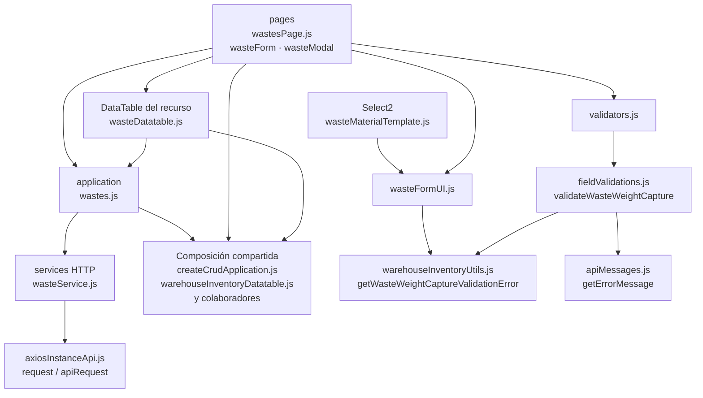

# 11. Mermas: estructura de código

**Identificador:** `DIA-FE-MOD-WAS-001`.
**Alcance:** grupos de implementación del módulo y sus dependencias directas.
**Fuente:** imports de los archivos de la tabla.

| Grupo del mapa | Archivos que lo componen |
| --- | --- |
| pages · wasteFields.js · wasteForm.js · y colaboradores | `src/public/js/pages/warehouse/wastes/` `wasteFields.js` `src/public/js/pages/warehouse/wastes/` `wasteForm.js` `src/public/js/pages/warehouse/wastes/` `wasteModal.js` `src/public/js/pages/warehouse/wastes/` `wasteStockAdditionForm.js` `src/public/js/pages/warehouse/wastes/` `wasteStockAdditionModal.js` `src/public/js/pages/warehouse/wastes/` `wastesPage.js` |
| application · wastes.js | `src/public/js/application/warehouse/` `wastes/wastes.js` |
| services HTTP · wasteService.js | `src/public/js/services/warehouse/` `wasteService.js` |
| DataTable del recurso · wasteDatatable.js | `src/public/js/plugins/datatable/warehouse/` `wastes/wasteDatatable.js` |
| Composición compartida · createCrudApplication.js · warehouseInventoryDatatable.js · y colaboradores | `src/public/js/application/` `createCrudApplication.js` `src/public/js/plugins/datatable/shared/` `inventory/warehouseInventoryDatatable.js` `src/public/js/ui/forms/formStateUI.js` `src/public/js/ui/forms/formUI.js` `src/public/js/ui/inventory/` `inventoryCrudModalUI.js` `src/public/js/ui/inventory/` `inventorySelectUI.js` `src/public/js/ui/modalUI.js` `src/public/js/ui/tableUI.js` |
| Validación y mensajes del peso | `src/public/js/utils/validations/validators.js` `src/public/js/utils/validations/fieldValidations.js` `src/public/js/utils/warehouseInventoryUtils.js` `src/public/js/constants/apiMessages.js` |
| Selección y pesos de merma | `src/public/js/ui/inventory/wasteFormUI.js` y `src/public/js/plugins/select2/domains/wasteMaterialTemplate.js` |

El formulario existente de material administra los dos pesos de referencia con
sus listas de campos, `setFormDisabled` y `setFormSectionVisibility`. La merma consulta
los valores en la selección de material, mantiene el cono editable y calcula neto
y largo automático sin administrar referencias en otro modal. El servidor calcula
los resultados con la referencia vigente y conserva los resultados registrados.

Ante `WASTE_ALREADY_EXISTS`, `wasteForm.js` ofrece **Agregar stock** si el usuario tiene
`wastes:addStock`. Abre el modal existente con el registro devuelto y la cantidad
precargada; el usuario revisa y confirma esa operación por separado.

Las referencias se leen directamente con `select2('data')`; se normalizan los
objetos o cadenas JSON con el helper existente. No se copia `rollReference` al
dataset del formulario. El cálculo sólo se ejecuta al crear un Rollo; en los
demás modos se muestran los valores persistidos. La tabla agrupa Cono, Total con
cono y Neto por unidad inmediatamente antes de Acciones. El modal reutiliza una
sección propia y el parcial de pesos para ordenar esos campos.

`openWasteStockAdditionModal` recibe cantidad y observaciones opcionales y
actualiza la existencia resultante al abrirse, sin emitir un evento sintético.
