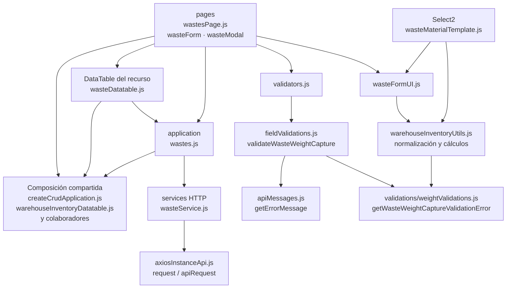

# 11. Mermas: estructura de código

**Identificador:** `DIA-FE-MOD-WAS-001`.
**Alcance:** grupos de implementación del módulo y sus dependencias directas.
**Fuente:** imports de los archivos de la tabla.

| Grupo del mapa | Archivos que lo componen |
| --- | --- |
| pages · wasteFields.js · wasteForm.js · y colaboradores | `src/public/js/pages/warehouse/wastes/` `wasteFields.js` `src/public/js/pages/warehouse/wastes/` `wasteForm.js` `src/public/js/pages/warehouse/wastes/` `wasteModal.js` `src/public/js/pages/warehouse/wastes/` `wasteStockAdditionForm.js` `src/public/js/pages/warehouse/wastes/` `wasteStockAdditionModal.js` `src/public/js/pages/warehouse/wastes/` `wastesPage.js` |
| application · wastes.js | `src/public/js/application/warehouse/` `wastes/wastes.js` |
| services HTTP · wasteService.js | `src/public/js/services/warehouse/` `wasteService.js` |
| DataTable del recurso · wasteDatatable.js | `src/public/js/plugins/datatable/warehouse/` `wastes/wasteDatatable.js` |
| Composición compartida · createCrudApplication.js · warehouseInventoryDatatable.js · y colaboradores | `src/public/js/application/` `createCrudApplication.js` `src/public/js/plugins/datatable/shared/` `inventory/warehouseInventoryDatatable.js` `src/public/js/ui/forms/formStateUI.js` `src/public/js/ui/forms/formUI.js` `src/public/js/ui/inventory/` `inventoryCrudModalUI.js` `src/public/js/ui/inventory/` `inventorySelectUI.js` `src/public/js/ui/modalUI.js` `src/public/js/ui/tableUI.js` |
| Validación y mensajes del peso | `src/public/js/utils/validations/validators.js` `src/public/js/utils/validations/fieldValidations.js` `src/public/js/utils/validations/weightValidations.js` `src/public/js/constants/apiMessages.js` |
| Selección y pesos de merma | `src/public/js/ui/inventory/wasteFormUI.js` y `src/public/js/plugins/select2/domains/wasteMaterialTemplate.js` |

El formulario existente de material administra los dos pesos de referencia con
sus listas de campos, `setFormDisabled` y `setFormSectionVisibility`. La merma consulta
los valores en la selección de material, mantiene el cono editable y calcula neto
y largo automático sin administrar referencias en otro modal. El servidor calcula
los resultados con la referencia vigente y conserva los resultados registrados.

Ante `WASTE_ALREADY_EXISTS`, el alta ofrece **Abrir Agregar stock** si el usuario
tiene `wastes:add-stock`. Confirmar el Swal cierra el alta y abre el modal existente
con la merma devuelta por el servidor, la cantidad y las observaciones capturadas;
cancelar conserva el alta. Una cantidad inicial de cero deja vacío el campo del modal
para capturar una cantidad positiva. El Swal no registra entradas ni recarga la tabla.
Sólo guardar el modal ejecuta `wasteStockAdditionForm`, que reutiliza `useForm`,
su validación y `handleSubmit` con `addWasteStock`. El listado usa el mismo modal.

Select2 entrega los datos del evento a `applyWasteMaterialTemplate`. La normalización
reconstruye únicamente las relaciones JSON que requiere el selector; no convierte
pesos ni traslada campos de proveedor a material. La respuesta conserva
`supplierMaterials`, con la oferta activa y sus referencias. Cada rollo sigue siendo
una opción independiente, aunque comparta el costo máximo de su familia.

Al seleccionar, la UI conserva el objeto y prepara una vez la referencia mediante
`prepareWasteRollReference`: orientación, dimensión menor fija, longitud nominal y
neto del rollo completo. `displayWasteMaterialTemplate` sólo muestra información;
`configureWasteWeightFields` configura los controles según presentación y modo.
La limpieza del proveedor se registra en la dependencia compartida, por lo que
funciona también con cambios programáticos. La primera limpieza descarta la
selección y sus cálculos; las notificaciones posteriores del estado del selector
no repiten esa preparación. Al abrir el formulario se restablece `readOnly` de
las dimensiones. Abrir el selector no borra la selección.

Sólo los eventos `input` de cono y total actualizan neto y longitud. La UI consume
las fórmulas compartidas y la referencia preparada sin reconstruir la selección ni
llamar a validadores del formulario. Al borrar o invalidar un peso se limpia la
longitud calculada; si faltan referencias se permite captura manual. Las dimensiones
fijas y calculadas usan `readOnly` durante el alta y se incluyen en `FormData`;
`wasteCreateFields` excluye el neto y las referencias del payload. La validación del
envío comprueba las dimensiones finales con los validadores positivos existentes.

La apertura de edición, ajuste o consulta configura los pesos y muestra los datos
persistidos sin recalcular. Las reglas de entrada permanecen en
`validations/weightValidations.js` y `fieldValidations.js`; el servidor comprueba
la oferta y obtiene sus propios resultados dentro de la transacción.
