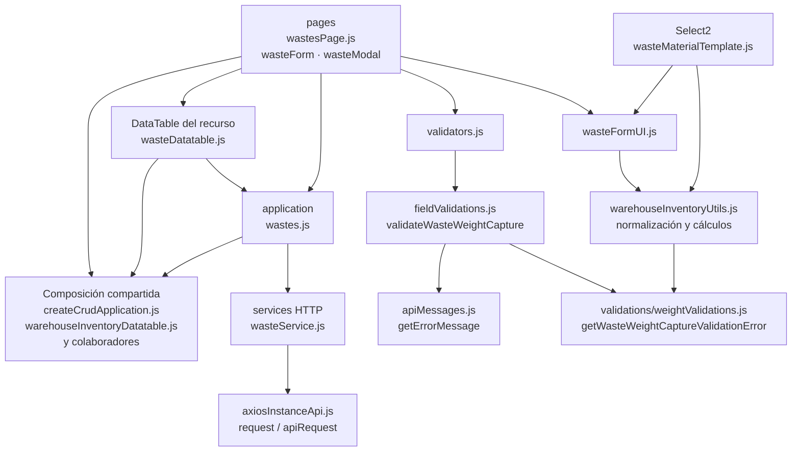

# 11. Mermas: estructura de código

**Identificador:** `DIA-FE-MOD-WAS-001`.
**Alcance:** grupos de implementación del módulo y sus dependencias directas.
**Fuente:** imports de los archivos de la tabla.

| Grupo del mapa | Archivos que lo componen |
| --- | --- |
| pages · wasteFields.js · wasteForm.js · y colaboradores | `src/public/js/pages/warehouse/wastes/` `wasteFields.js` `src/public/js/pages/warehouse/wastes/` `wasteForm.js` `src/public/js/pages/warehouse/wastes/` `wasteModal.js` `src/public/js/pages/warehouse/wastes/` `wasteStockAdditionForm.js` `src/public/js/pages/warehouse/wastes/` `wasteStockAdditionModal.js` `src/public/js/pages/warehouse/wastes/` `wastesPage.js` |
| application · wastes.js | `src/public/js/application/warehouse/` `wastes/wastes.js` |
| services HTTP · wasteService.js | `src/public/js/services/warehouse/` `wasteService.js` |
| DataTable del recurso · wasteDatatable.js | `src/public/js/plugins/datatable/warehouse/` `wastes/wasteDatatable.js` |
| Composición compartida · createCrudApplication.js · warehouseInventoryDatatable.js · y colaboradores | `src/public/js/application/` `createCrudApplication.js` `src/public/js/plugins/datatable/shared/` `inventory/warehouseInventoryDatatable.js` `src/public/js/ui/forms/formStateUI.js` `src/public/js/ui/forms/formUI.js` `src/public/js/ui/inventory/` `inventoryCrudModalUI.js` `src/public/js/ui/inventory/` `inventorySelectUI.js` `src/public/js/ui/modalUI.js` `src/public/js/ui/tableUI.js` |
| Validación y mensajes del peso | `src/public/js/utils/validations/validators.js` `src/public/js/utils/validations/fieldValidations.js` `src/public/js/utils/validations/weightValidations.js` `src/public/js/constants/apiMessages.js` |
| Selección y pesos de merma | `src/public/js/ui/inventory/wasteFormUI.js` y `src/public/js/plugins/select2/domains/wasteMaterialTemplate.js` |

La muestra es el rollo completo. El formulario pide **Peso del rollo completo con
cono (kg)**, además del cono y el total del sobrante. No pide largo ni peso neto de
muestra; el largo ya existe en el material seleccionado y el mismo cono se resta de
ambos totales. Los datos anteriores de material/proveedor no se modifican.

Select2 entrega el objeto a `applyWasteMaterialTemplate`. La UI prepara una vez ancho,
orientación y largo nominal con `prepareWasteRollReference`, precarga identificación
y limpia los pesos. Los eventos `input` de los tres pesos actualizan neto y largo con
las utilidades compartidas, sin consultas ni reconstrucciones de la selección.
El neto del sobrante funciona aunque falte el peso del rollo completo.

Ambas medidas de Rollo siguen deshabilitadas; el normalizador las incorpora al payload
junto a los tres pesos capturados. El servidor calcula sus resultados y conserva las
referencias. Las muestras de registros anteriores se muestran en **Referencia histórica**,
sólo para consulta; no se recalculan ni se convierten en pesos de rollo completo.
En otras presentaciones en m² se capturan medidas manuales y se ocultan los pesos.

Ante `WASTE_ALREADY_EXISTS`, confirmar el Swal abre Agregar stock con cantidad y
observaciones, sujeto a `wastes:add-stock`. Sólo guardar ese modal registra la entrada;
cancelar conserva el alta. Este recorrido no se modifica.

El orden visible es origen, datos de merma, rollo completo, pesos del sobrante,
medidas, inventario y existencias/observaciones. Material y consumible mantienen su
comportamiento de dimensiones por unidad.
