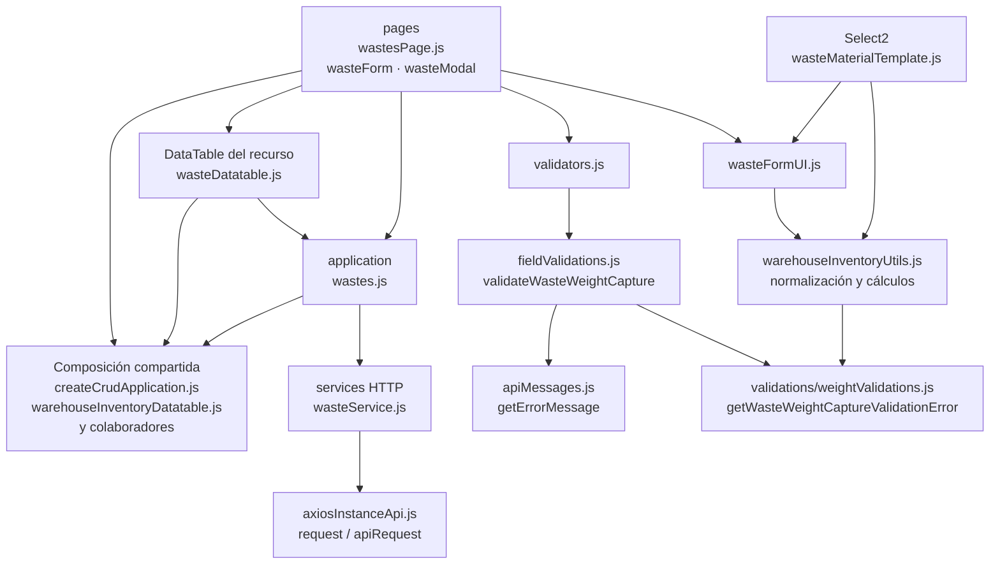

# 11. Mermas: estructura de código

**Identificador:** `DIA-FE-MOD-WAS-001`.
**Alcance:** grupos de implementación del módulo y sus dependencias directas.
**Fuente:** imports de los archivos de la tabla.

| Grupo del mapa | Archivos que lo componen |
| --- | --- |
| pages · wasteFields.js · wasteForm.js · y colaboradores | `src/public/js/pages/warehouse/wastes/` `wasteFields.js` `src/public/js/pages/warehouse/wastes/` `wasteForm.js` `src/public/js/pages/warehouse/wastes/` `wasteModal.js` `src/public/js/pages/warehouse/wastes/` `wasteStockAdditionForm.js` `src/public/js/pages/warehouse/wastes/` `wasteStockAdditionModal.js` `src/public/js/pages/warehouse/wastes/` `wastesPage.js` |
| application · wastes.js | `src/public/js/application/warehouse/` `wastes/wastes.js` |
| services HTTP · wasteService.js | `src/public/js/services/warehouse/` `wasteService.js` |
| DataTable del recurso · wasteDatatable.js | `src/public/js/plugins/datatable/warehouse/` `wastes/wasteDatatable.js` |
| Composición compartida · createCrudApplication.js · warehouseInventoryDatatable.js · y colaboradores | `src/public/js/application/` `createCrudApplication.js` `src/public/js/plugins/datatable/shared/` `inventory/warehouseInventoryDatatable.js` `src/public/js/ui/forms/formStateUI.js` `src/public/js/ui/forms/formUI.js` `src/public/js/ui/inventory/` `inventoryCrudModalUI.js` `src/public/js/ui/inventory/` `inventorySelectUI.js` `src/public/js/ui/modalUI.js` `src/public/js/ui/tableUI.js` |
| Validación y mensajes del peso | `src/public/js/utils/validations/validators.js` `src/public/js/utils/validations/fieldValidations.js` `src/public/js/utils/validations/weightValidations.js` `src/public/js/constants/apiMessages.js` |
| Selección y pesos de merma | `src/public/js/ui/inventory/wasteFormUI.js` y `src/public/js/plugins/select2/domains/wasteMaterialTemplate.js` |

La muestra se captura desde merma de Rollo: **Largo de muestra (m)** y **Peso neto de
muestra (kg)**, sin cono y del mismo ancho. La sección del rollo completo se retira de
material; sus valores anteriores permanecen históricos y no intervienen en cálculos nuevos.

Select2 entrega el objeto recibido a `applyWasteMaterialTemplate`. La UI prepara una
vez la orientación y el ancho menor con `prepareWasteRollReference`, precarga nombre,
presentación y unidad y limpia pesos y muestra. El selector ofrece sólo materiales en
m² con oferta activa; excluye consumibles y las demás unidades.

Los eventos `input` de cono, total, largo de muestra y peso neto de muestra actualizan
neto y longitud con las utilidades compartidas. No reconstruyen la selección, consultan
la BD ni invocan la validación del envío. El neto puede mostrarse aunque falte la muestra;
el largo queda vacío hasta completar los datos. El servidor calcula sus propios resultados.

Ambas medidas de Rollo permanecen deshabilitadas; el normalizador incorpora sus valores
al payload. La muestra sí se envía y persiste. En otras presentaciones en m² se capturan
medidas manuales y se ocultan muestra y pesos. Edición, ajuste y consulta no recalculan
la identidad. Los históricos sin muestra no reciben valores inventados.

Ante `WASTE_ALREADY_EXISTS`, confirmar el Swal abre Agregar stock con cantidad y
observaciones, sujeto a `wastes:add-stock`. Sólo guardar ese modal registra la entrada;
cancelar conserva el alta. Este recorrido no se modifica.

El orden visible es origen, datos de merma, muestra, pesos del sobrante, medidas,
inventario y existencias/observaciones. Material conserva identificación, medidas según
unidad e inventario; consumible mantiene las medidas ocultas con cualquier unidad.
