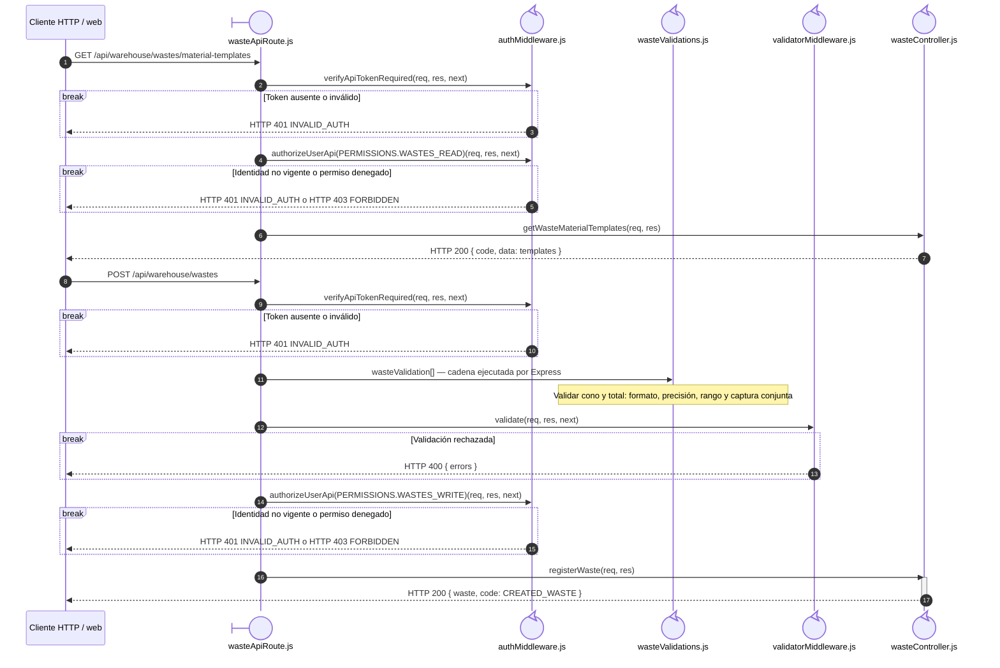
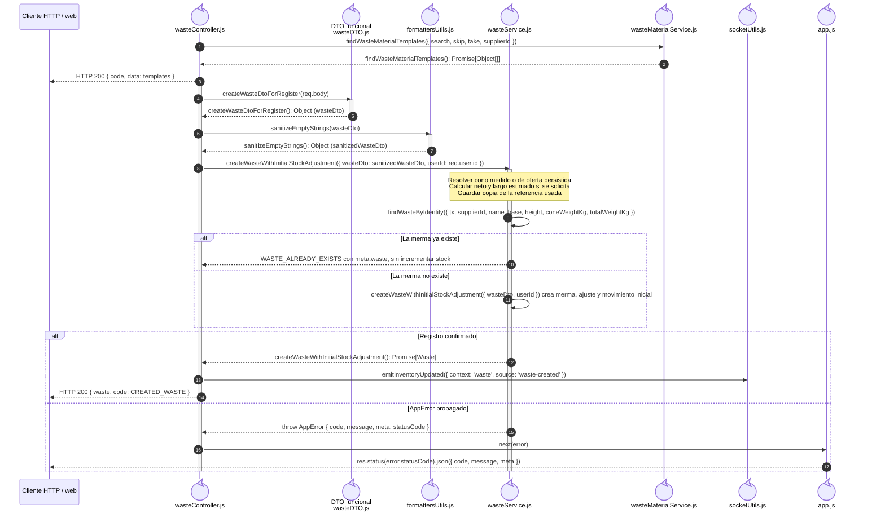
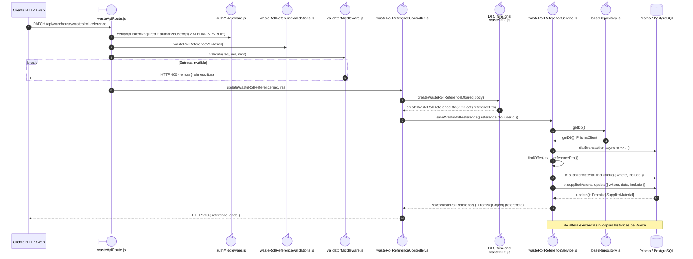

# `CU-ALM-10` — Registrar merma

**Patrones:** `BE-P01`, `BE-P03`, `BE-P04`, `BE-P05`.

## Participantes y trazabilidad

Cada línea de vida técnica corresponde a un único archivo de implementación, indicado
por su alias en la tabla. Dos archivos distintos usan participantes distintos. Los actores,
el navegador y la frontera de persistencia son elementos externos, no archivos del proyecto.
Los retornos representan el resultado o error de la función ejecutada en el archivo indicado.
La composición incluye también los archivos de configuración, construcción y reexport: cada
uno tiene un nodo propio, aunque no ejecute una delegación durante la petición.

| Alias | Rol visual | Archivo de implementación |
| --- | --- | --- |
| `Route` | boundary | [`wasteApiRoute.js`](../../../../../../src/routes/api/warehouse/wasteApiRoute.js) |
| `Auth` | control | [`authMiddleware.js`](../../../../../../src/middleware/authMiddleware.js) |
| `Validator` | control | [`validatorMiddleware.js`](../../../../../../src/middleware/validatorMiddleware.js) |
| `Controller` | control | [`wasteController.js`](../../../../../../src/controllers/api/warehouse/wasteController.js) |
| `WasteDto` | control | [`wasteDTO.js`](../../../../../../src/dtos/wasteDTO.js) |
| `Formatter` | control | [`formattersUtils.js`](../../../../../../src/utils/formattersUtils.js) |
| `Domain` | control | [`wasteService.js`](../../../../../../src/services/warehouse/wastes/wasteService.js) |
| `Socket` | control | [`socketUtils.js`](../../../../../../src/utils/socketUtils.js) |
| `ErrorHandler` | control | [`app.js`](../../../../../../src/app.js) |
| `ValidationRules` | control | [`wasteValidations.js`](../../../../../../src/validators/forms/wasteValidations.js) |
| `ReferenceController` | control | [`wasteRollReferenceController.js`](../../../../../../src/controllers/api/warehouse/wasteRollReferenceController.js) |
| `ReferenceRules` | control | [`wasteRollReferenceValidations.js`](../../../../../../src/validators/forms/wasteRollReferenceValidations.js) |
| `ReferenceService` | control | [`wasteRollReferenceService.js`](../../../../../../src/services/warehouse/wastes/wasteRollReferenceService.js) |
| `Repository` | control | [`baseRepository.js`](../../../../../../src/repository/baseRepository.js) |
| `Templates` | control | [`wasteMaterialService.js`](../../../../../../src/services/warehouse/wastes/wasteMaterialService.js) |

## Secuencia de implementación

## Detalle de coordinación del controller

Continúa la colaboración anterior. Conserva el orden de los mensajes del código y
separa los archivos que ejecutan esta parte del recorrido; los otros detalles del caso
completan las llamadas a helpers y la propagación del resultado.

## Detalle de configuración de la muestra del rollo

Los participantes adicionales corresponden a `wasteRollReferenceController.js`,
`wasteRollReferenceService.js` y `wasteRollReferenceValidations.js`.

