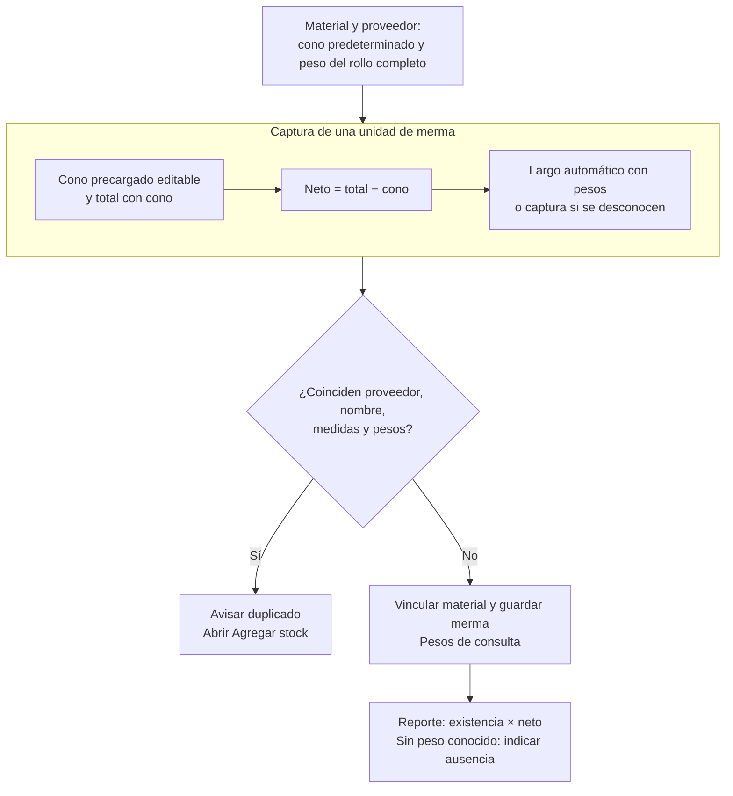

# 4.4 Consulta, reportes y funciones modeladas

| ID | Requisito y criterio de aceptación | Estado | Evidencia principal |
| --- | --- | --- | --- |
| RF-REP-001 | El Administrador del sistema debe poder consultar movimientos de artículos o mermas con filtros, sin modificar inventario; elegir un recurso exige seleccionar primero su proveedor y cambiarlo limpia la selección anterior. | Implementado | `src/routes/api/admin/movementApiRoute.js`, `src/routes/web/admin/movementWebRoute.js`, `src/constants/permissions.js` |
| RF-REP-002 | Un usuario autorizado debe poder exportar los reportes registrados para su ámbito con los filtros aplicables. | Implementado | routers `reportApiRoute.js` de los dominios administrativo, comercial y de almacén |
| RF-REP-003 | El reporte de mermas debe consolidar por nombre, proveedor y base; la altura también debe separar grupos excepto para la presentación `ROLLO`. | Implementado | `src/controllers/api/warehouse/reportController.js`, `src/services/warehouse/reportService.js` |
| RF-REP-004 | Los archivos Excel deben conservar resultados calculados y fórmulas para las celdas derivadas definidas por cada reporte, sin alterar datos de origen. | Implementado | `src/utils/reportExcelUtils.js`, `src/controllers/api/warehouse/reportController.js`, `src/controllers/api/admin/reportController.js` |
| RF-REP-005 | El Administrador del sistema del área Sistemas debe poder exportar los movimientos ofrecidos por la consulta conservando su ámbito y filtros aplicables. | Implementado | `src/routes/api/admin/reportApiRoute.js`, `src/routes/web/admin/movementWebRoute.js`, `src/constants/permissions.js` |
| RF-REP-006 | El reporte de mermas debe presentar como total de cada grupo la suma del stock de sus existencias. | Implementado | `src/services/warehouse/reportService.js` |
| RF-REP-007 | La exportación de mermas debe incluir todos los grupos y el total general en una sola hoja denominada `Mermas`. | Implementado | `src/controllers/api/warehouse/reportController.js` |
| RF-REP-008 | Antes de exportar inventario de materiales o mermas, el usuario debe poder incluir registros activos o con existencia, sólo activos o sólo registros con existencia; la opción elegida debe combinarse con los filtros visibles. | Implementado | `src/public/js/ui/reportExportDialog.js`, `src/services/warehouse/reportService.js` |
| RF-REP-009 | El reporte de mermas debe calcular el área total de cada grupo sumando existencia × base × altura por recurso; una dimensión ausente aporta cero. | Implementado | `src/services/warehouse/reportService.js` |
| RF-REP-010 | Un usuario autorizado debe poder exportar el inventario de consumibles con los filtros y alcance seleccionados, excluyendo ofertas de materiales. | Implementado | `src/controllers/api/warehouse/reportController.js`, `src/services/warehouse/reportService.js`, `src/public/js/plugins/datatable/warehouse/consumables/consumableDatatable.js` |
| RF-REP-011 | El Administrador del sistema de Sistemas debe disponer de Materiales, Consumibles y Mermas dentro de Movimientos. Cada consulta, total y Excel debe incluir exclusivamente su contexto; el informe mensual debe conservar esa separación y los filtros no deben permitir cambiarla. | Implementado | rutas administrativas de movimientos y reportes, `movementContextDbTest.js` |
| RF-REP-012 | El reporte de mermas debe mostrar el peso total disponible de los rollos, sumando existencia × peso neto unitario de cada medida antes de consolidar el grupo. Si un rollo con existencia carece de peso, debe indicar «Sin peso capturado» en su grupo y en el total, sin presentar una suma parcial como completa. Otras presentaciones no aportan peso. La tabla general presenta cono, total con cono y neto por unidad, agrupados antes de Acciones; el formulario presenta los pesos en una sección propia y sólo permite capturarlos al crear un Rollo. | Implementado | `reportService.js`, `reportController.js`, `wasteWeightDbTest.js` |
| RF-MER-001 | Durante el alta de una merma, almacén debe elegir un proveedor antes del material usado como plantilla; cambiar el proveedor debe limpiar la plantilla anterior. | Implementado | `src/views/pages/warehouse/wastes/wastesPage.ejs`, `src/services/warehouse/wastes/wasteMaterialService.js` |
| RF-MER-002 | Al seleccionar una plantilla, el sistema debe proponer el mayor costo unitario máximo aplicable; el actor puede corregirlo y el valor guardado se conserva como dato histórico propio de la merma. | Implementado | `src/services/inventory/materialIdentity.js`, `src/services/warehouse/wastes/wasteMaterialService.js` |
| RF-MER-003 | Personal de almacén o el Administrador del sistema deben poder actualizar el nombre, stock mínimo, costo unitario máximo y estado de una merma sin usar la edición general para cambiar existencias. | Implementado | `src/dtos/wasteDTO.js`, `src/services/warehouse/wastes/wasteService.js` |
| RF-MER-004 | El sistema debe rechazar un alta de merma con material de referencia, proveedor, nombre o estado inválidos, existencia negativa o dimensiones no positivas; los avisos del formulario no sustituyen la validación antes de registrar. | Implementado | `src/routes/api/warehouse/wasteApiRoute.js`, `src/validators/forms/wasteValidations.js`, `src/public/js/utils/validations/validators.js` |
| RF-MER-005 | Una edición de merma debe conservar proveedor, presentación, unidad y dimensiones como identidad física inmutable. | Implementado | `src/dtos/wasteDTO.js`, `src/services/warehouse/wastes/wasteService.js` |
| RF-MER-006 | El sistema debe impedir dos mermas con la misma combinación normalizada de nombre, proveedor, ancho, largo, peso del cono y peso total. Dos rollos de iguales medidas con pesos distintos deben poder registrarse por separado; una coincidencia completa debe ofrecer Agregar stock sin sumar automáticamente la cantidad. | Implementado | `prisma/schema.prisma`, `src/services/warehouse/wastes/wasteService.js` |
| RF-MER-007 | Para presentación ROLLO, el sistema debe proponer como base la menor dimensión nominal positiva; para otras presentaciones, el actor debe capturar las dimensiones requeridas. | Implementado | `src/services/inventory/materialIdentity.js`, `src/public/js/pages/warehouse/wastes/wasteModal.js` |
| RF-MER-008 | El sistema debe calcular la cantidad convertida de una merma como existencia × base × altura en altas, ajustes y salidas, sin solicitar su captura manual. | Implementado | `src/services/inventory/stockHelpers.js`, `src/services/warehouse/wastes/wasteService.js` |
| RF-MER-009 | La merma debe vincularse al material de origen, consultar sus referencias por proveedor y conservar dimensiones, pesos y costo propios sin recalcularlos cuando cambien las referencias. | Implementado | `prisma/schema.prisma`, `wasteService.js` |
| RF-MER-010 | Personal de almacén o el Administrador del sistema deben poder sumar una cantidad positiva a una merma mediante **Agregar stock**, conservando un documento individual con folio, actor, observaciones opcionales, cantidad y saldos, vinculado a un movimiento de entrada. | Implementado | `src/routes/api/warehouse/wasteApiRoute.js`, `src/services/warehouse/wastes/wasteStockEntryService.js`, `src/services/warehouse/wastes/wasteMovementService.js`, `src/constants/permissions.js` |
| RF-MER-011 | Al registrar una merma de Rollo, almacén debe poder capturar en kg el peso del cono y el peso total con cono de una unidad. El sistema debe calcular el peso neto como total menos cono. Los tres pesos quedan para consulta después del alta y se conservan al mover existencias de la misma identidad. Si se desconoce el peso, ambos campos pueden quedar vacíos. | Implementado | formulario de merma, `wasteDTO.js`, `wasteService.js`, `wasteWeightDbTest.js` |
| RF-MER-012 | Almacén debe registrar o editar en el formulario de material el peso predeterminado del cono y el peso total del rollo completo por proveedor. Al seleccionar material en merma, el sistema precarga el cono y permite corregirlo en el mismo campo, sin selector fijo/variable ni opción de uso de referencia. | Implementado | formulario de material, `materialService.js`, `wasteWeightDbTest.js` |
| RF-MER-013 | Al completar los pesos de una merma de Rollo, el sistema debe calcular y actualizar en vivo el largo al editar los campos, con las referencias vigentes del material/proveedor y guardar el resultado en base o altura según su orientación. La dimensión transversal procede del material. Si faltan pesos o referencias para el cálculo, se permite capturar manualmente el largo. Al borrar o invalidar pesos se limpian los resultados calculados. No se solicita ni persiste un selector de método. | Implementado | `wasteService.js`, `warehouseInventoryUtils.js`, `materialIdentity.js`, `wasteWeightDbTest.js` |
| RF-REQ-001 | Una reimplementación de requisiciones debe permanecer fuera del alcance vigente hasta definir y aprobar nuevamente su comportamiento, autorización, persistencia y pruebas. | Fuera del alcance actual | `prisma/migrations/20260827000000_remove_purchase_requisitions/migration.sql` |
| RF-PRJ-001 | El Administrador del sistema deberá poder mantener proyectos si se incorpora y aprueba esa capacidad; sus datos, operaciones y criterios permanecen pendientes de definición. | Modelado | modelo `Project` |
| RF-PRJ-002 | El personal de almacén deberá poder seleccionar un proyecto registrado como contexto de salida si se define y aprueba ese flujo; capturar el número de proyecto no demuestra esta capacidad. | Modelado | modelo `Project` |

`RF-REP-001` y `RF-REP-005` están implementados para su alcance vigente: la consulta y la exportación de movimientos sólo están disponibles para el **Administrador del sistema** del área Sistemas. El Personal de almacén no puede iniciar `CU-ALM-07`, `CU-ALM-08`, `CU-ALM-15`, `CU-ALM-16`, `CU-ALM-23` ni `CU-ALM-24`.

### Condiciones de consulta y reporte

- `RF-REP-003`, `RF-REP-006`, `RF-REP-007`, `RF-REP-009` y `RF-REP-012` son condiciones del
  reporte de mermas de `RF-REP-002`, no objetivos adicionales del actor.
- **CA-RF-REP-008-1:** «Activos o con existencia» aplica la unión de ambas condiciones;
  «Sólo activos» exige estado activo y «Sólo con existencia» exige saldo positivo.
  La condición elegida se combina con los filtros de consulta aplicables.
- **CA-RF-MER-011-1:** el peso del cono admite cero; el total con cono debe ser
  mayor que el cono y no superar 999.99 kg. Ambos admiten tres enteros y dos decimales.
  Capturar un peso requiere el otro. El sistema calcula el neto por unidad y rechaza
  entradas inválidas antes del alta.
- **CA-RF-MER-010-1:** agregar una cantidad incrementa el saldo; no sustituye un ajuste
  administrativo. Establecer el saldo final requiere **Ajustar stock**, motivo y permiso
  exclusivo del Administrador conforme a `RF-CAT-018` y `RF-ADJ-001`.

Las capacidades modeladas o excluidas no son promesas de acceso vigente. Sus criterios
futuros requieren un acuerdo de alcance; no se presentan como implementadas por la mera
existencia de una entidad de datos.

### Recorrido del peso de merma

**Identificador:** `DIA-REQ-MER-PESO-001`. Reglas `RF-MER-011` y `RF-REP-012`.
El peso de referencia se consulta desde material; la merma guarda el cono utilizado y los resultados.
La proporcionalidad supone una muestra representativa del mismo material.

Para otras presentaciones no se capturan pesos. Un rollo con largo medido puede
registrarse sin pesos; los registros históricos conservan sus datos conocidos.
