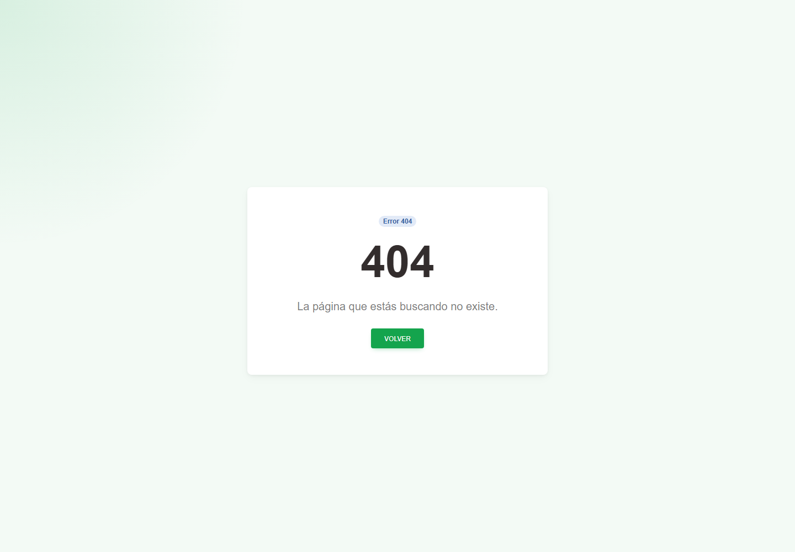

# 3. CAP-ERR-404-NOT-FOUND — Página no encontrada

**Caso de uso:** transversal — Recuperarse de una ruta inexistente.

**Antes de empezar:** Vamos a volver a una pantalla conocida después de una dirección inexistente. No necesita registrar datos.

**Errores posibles:** [Error 404](../../error-messages.md#error-404).

**Controles que debe usar:** Botón **Volver**; no capture datos ni modifique manualmente la dirección para buscar una opción restringida.

1. Observe la pantalla y ubique los controles:

   

2. En la página de error, seleccione el botón **Volver** para regresar mediante la navegación de Nexus.

**Compruebe el resultado:** Confirme el mensaje y vuelva a consultar el registro antes de repetir la operación.
