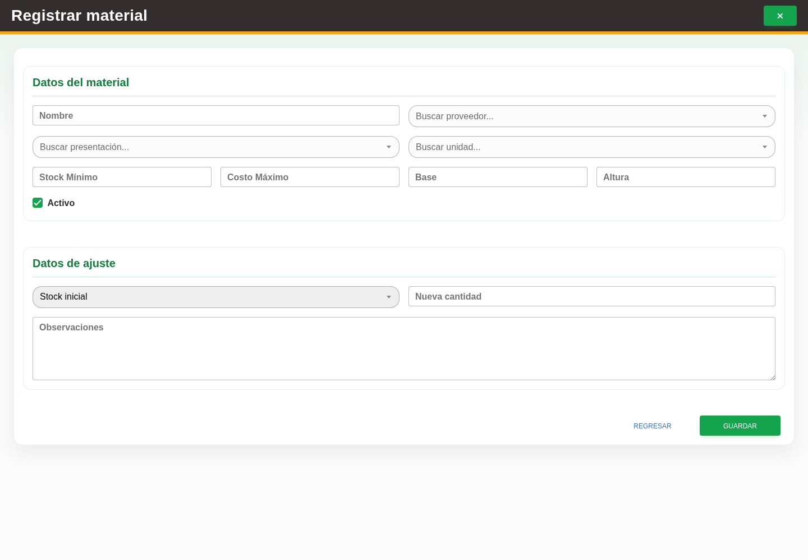

# 3. CAP-CAT-MAT-02-CREATE — Formulario de alta

**Casos de uso:** `CU-ALM-02` — Crear material.

**Antes de empezar:** Vamos a registrar un material. Tenga los datos de la operación y confirme con quien le capacita que corresponde darlo de alta; busque primero si ya existe.

**Errores posibles:** [Validación de formularios](../../error-messages.md#errores-validacion), [Catálogos e inventario](../../error-messages.md#errores-catalogos).

**Campos editables en el alta directa desde Materiales:** **Nombre**, **Buscar proveedor...**, **Buscar presentación...**,
**Buscar unidad...**, **Stock Mínimo**, **Costo Máximo**, **Base**, **Altura**, **Nueva cantidad**,
**Observaciones** y **Activo**. La razón **Stock inicial** es automática. Use **Nuevo material** para
abrir el formulario y **Guardar** para confirmarlo.

1. Seleccione el botón **Nuevo material** para abrir el formulario de alta. Observe los controles que va a usar:

   

   La captura debe renovarse para reflejar el orden actual de identificación,
   medidas, pesos del rollo completo e inventario en una sesión del entorno de prueba.

2. Complete **Datos del material** en orden: nombre, proveedor, presentación y unidad. Capture **Medidas del material**. Para Rollo, continúe en **Pesos del rollo completo** con los pesos del cono y del rollo nuevo con cono; después complete **Inventario del material** y **Existencias y observaciones**.
3. Seleccione el botón **Guardar** para registrar el material.

Si ya existe la misma combinación de nombre, presentación, unidad, dimensiones y proveedor, Nexus
rechaza el alta: localice el material existente y use **Ajustar stock**; **Nueva cantidad** representa
la existencia total que debe quedar, no una cantidad que se sume. Si la identidad ya existe para
otro proveedor, Nexus reutiliza el material y crea la relación de inventario con el proveedor
seleccionado.

🟦 **EXCEPCIÓN DEL PROCESO:** si abre **Nuevo material** desde el selector de una
**Nueva compra**, Nexus conserva **Nombre**, proveedor, presentación, unidad, dimensiones,
**Stock Mínimo** y **Activo**, pero oculta **Costo Máximo**, **Nueva cantidad**, la razón de stock
inicial y **Observaciones**. El alta deja la oferta con existencia cero y sin costo máximo; no
genera un ajuste. Capture la **Cantidad** y el **Costo por Presentación** en el detalle de la compra:
esos valores se aplican al inventario sólo cuando guarde la compra. Consulte el
[registro de una compra](../purchases/02-cap-ent-02-create.md) para continuar ese recorrido.

Para **Rollo**, la sección **Pesos del rollo completo** permite registrar el peso
del cono y el peso total del rollo completo con cono antes de calcular mermas. Estos datos son
propios del material y proveedor; se consultan al registrar merma. El cono admite
cero, el total debe ser mayor y ambos admiten hasta dos decimales y 999.99 kg. Puede
registrar sólo el cono si desconoce el total, o dejar ambos vacíos y completar los
datos faltantes posteriormente desde edición. Un peso ya guardado no se puede cambiar
ni borrar. La copia del cono usada en una merma sí puede corregirse al registrar esa merma.

Estos campos son opcionales. La sección se muestra al elegir **Rollo**; permanece
oculta en otras presentaciones y consumibles. En un ajuste de stock no se muestra.

**Compruebe el resultado:** Vuelva al listado y localice el registro guardado. Compruebe sus datos antes de continuar con otra operación.
