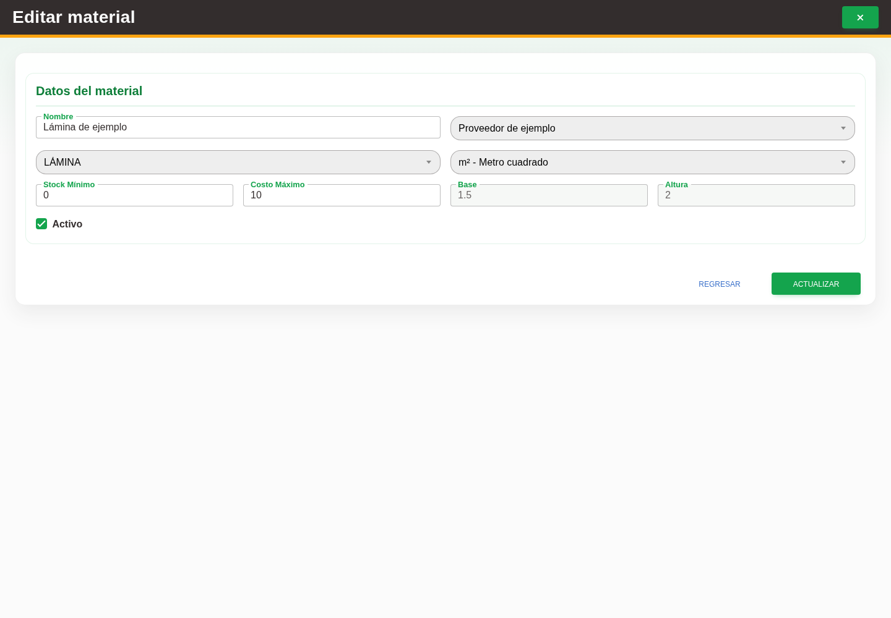

# 4. CAP-CAT-MAT-03-EDIT — Formulario de edición

**Casos de uso:** `CU-ALM-03` — Editar material; `CU-ALM-04` — Retirar material.

**Antes de empezar:** Vamos a actualizar un material existente. Tenga identificado el registro correcto y los datos que necesita corregir.

**Errores posibles:** [Validación de formularios](../../error-messages.md#errores-validacion), [Catálogos e inventario](../../error-messages.md#errores-catalogos).

**Campos editables en modo edición:** **Nombre**, **Stock Mínimo**, **Costo Máximo** y **Activo**.
**Proveedor**, **Presentación**, **Unidad**, **Base**, **Altura** y la existencia no se pueden editar en
este modo. Use la acción **Editar registro** y el botón **Actualizar**.

1. En la fila del material, seleccione la acción **Editar registro** para abrir el formulario. Observe los controles que va a usar:

   

2. Modifique **Nombre**, **Stock Mínimo**, **Costo Máximo** o **Activo** según corresponda. Revise los
   demás datos sólo como referencia.
3. Seleccione el botón **Actualizar** para guardar los cambios.

Para **Rollo**, la sección **Pesos del rollo completo** permite completar únicamente
el peso del cono o el peso total que todavía no estén registrados. Los pesos guardados
permanecen deshabilitados y el servidor rechaza cambios o borrados. Estos datos son
propios del material y proveedor; se consultan al registrar merma. El cono admite
cero, el total debe ser mayor y ambos admiten hasta dos decimales y 999.99 kg. Puede
registrar sólo el cono si desconoce el total. Completar referencias no cambia
existencias ni las mermas ya registradas.

**Compruebe el resultado:** Vuelva a abrir el registro y compruebe los cambios confirmados.
