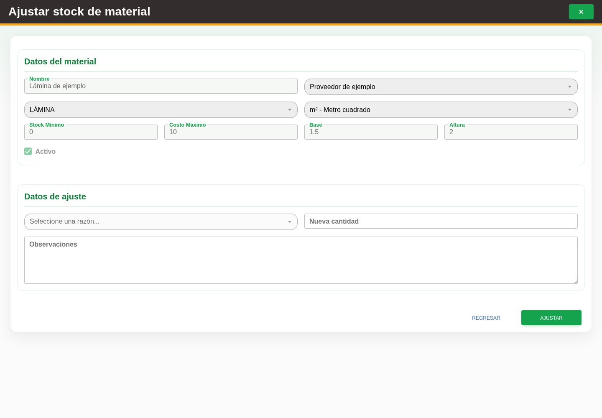

# 5. CAP-CAT-MAT-04-STOCK — Ajustar existencia

**Casos de uso:** `CU-ALM-05` — Ajustar existencia de material.

**Antes de empezar:** Vamos a ajustar una existencia como administrador. Tenga autorizados el conteo final y su motivo. La cantidad capturada reemplaza el total actual.

**Errores posibles:** [Validación de formularios](../../error-messages.md#errores-validacion), [Catálogos e inventario](../../error-messages.md#errores-catalogos).

**Campos editables en modo ajuste:** **Seleccione una razón...**, **Nueva cantidad** y
**Observaciones**. Los datos de identidad y catálogo quedan sólo para consulta. Use la acción
**Ajustar stock** y el botón **Ajustar**.

El proveedor no se captura de nuevo: Nexus conserva y envía automáticamente el proveedor de la
fila seleccionada porque la existencia corresponde a esa oferta de material.

1. En la fila del material, seleccione la acción **Ajustar stock**. Observe los controles que va a usar:

   

2. Elija una opción en **Seleccione una razón...** y complete los campos **Nueva cantidad** y **Observaciones**.

   🟨 **ADVERTENCIA:** **Nueva cantidad** sustituye la existencia actual; no es una cantidad que
   Nexus agregará al inventario.

3. Revise el efecto sobre la existencia y seleccione el botón **Ajustar**.

Al finalizar, vuelva al listado y confirme que la existencia mostrada sea exactamente la cantidad
capturada. Si no puede confirmarlo, actualice el listado antes de intentar otro ajuste.

**Compruebe el resultado:** Actualice el inventario y confirme que la existencia corresponde al conteo final autorizado.
