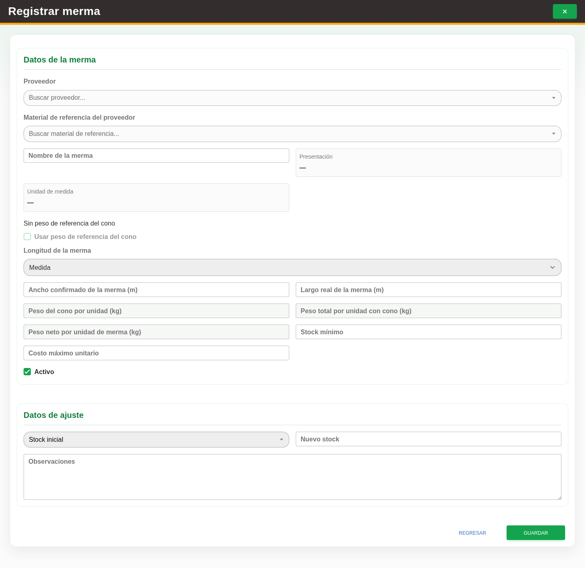

# 14. CAP-CAT-WAS-02-CREATE — Formulario de registro

**Casos de uso:** `CU-ALM-10` — Registrar merma.

**Antes de empezar:** Vamos a registrar una merma. Tenga los datos de la operación y confirme con quien le capacita que corresponde darlo de alta; busque primero si ya existe.

**Errores posibles:** [Validación de formularios](../../error-messages.md#errores-validacion), [Catálogos e inventario](../../error-messages.md#errores-catalogos).

**Campos editables en modo alta:** **Buscar proveedor...**, **Buscar material de referencia...**,
**Stock mínimo**, **Costo máximo unitario**, **Nuevo stock**, **Observaciones**,
**Activo** y, para Rollo, **Peso del cono de la merma (kg)** y **Peso de la merma con cono (kg)**, **Peso del rollo completo con cono (kg)**. El nombre, presentación y unidad
provienen del material de referencia y la razón **Stock inicial** es automática. Use **Nueva merma**
para abrir el formulario y **Guardar** para confirmarlo.

1. Seleccione el botón **Nueva merma** para abrir el formulario de registro. Observe los controles que va a usar:

   

   La captura debe renovarse para mostrar el orden actual y las medidas bloqueadas
   de Rollo, junto con el peso del rollo completo capturado desde merma, en una sesión del entorno de prueba.

2. En **Material de origen**, elija proveedor y un material en **m²**; los consumibles y las demás unidades no aparecen. Revise nombre, presentación y unidad precargados.
   Para **Rollo**, complete **Rollo completo (muestra)** con su peso total incluyendo el cono. Capture el peso del cono una sola vez (cero si no tiene) y el peso del sobrante con cono. El sistema descuenta el mismo cono de ambos totales y obtiene el largo original del material; no necesita capturar metros ni un neto de muestra.
   Ambas medidas permanecen deshabilitadas: el ancho menor procede del material y la otra medida se calcula con la proporción de la muestra. Para **Hoja** u otras presentaciones en m², capture las dos medidas manualmente.
   Complete inventario, existencia y observaciones. Borrar un peso o el peso del rollo completo limpia el largo calculado. Después del alta, muestra, medidas y pesos quedan para consulta.
3. Seleccione el botón **Guardar** para registrar la merma.

Si el aviso indica que coinciden proveedor, nombre, medidas y pesos, seleccione
**Abrir Agregar stock** en el aviso para revisar el formulario de entrada. Se
precargan la merma existente, la cantidad y las observaciones; si la cantidad inicial
era cero, capture una cantidad positiva. Revise el saldo actual y el resultante,
y seleccione **Agregar** para guardar. El intento de alta y la confirmación del
aviso no suman existencias. Cancelar el aviso conserva el formulario de alta;
un error al guardar la entrada conserva los datos del modal de Agregar stock.
Con pesos distintos puede registrar otra merma. **Ajustar stock** se usa para corregir
el saldo total con autorización del Administrador del sistema.

### Rollo completo como muestra

Por ejemplo: rollo de **20 m**, peso completo **2.25 kg**, cono **0.25 kg** y sobrante
con cono **1.25 kg**. El neto del rollo es **2 kg**, el de la merma **1 kg** y su largo
calculado **10 m**. El ancho se conserva del material. Estos pesos no se guardan en
Materiales ni se cambian después del alta de la merma.

La captura de muestra debe renovarse con una merma de Rollo que ya tenga esos datos
en el entorno de prueba. La automatización abre esa merma y no crea registros.

**Compruebe el resultado:** Vuelva al listado y localice el registro guardado. Compruebe sus datos antes de continuar con otra operación.
