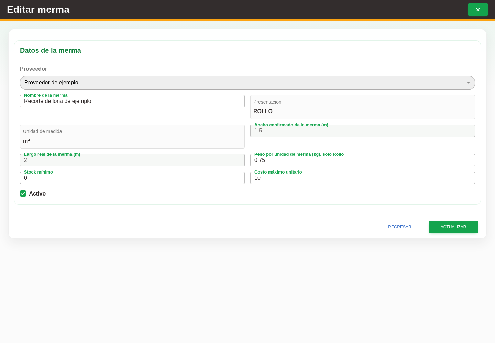

# 15. CAP-CAT-WAS-03-EDIT — Formulario de edición

**Casos de uso:** `CU-ALM-11` — Editar merma.

**Antes de empezar:** Vamos a actualizar un merma existente. Tenga identificado el registro correcto y los datos que necesita corregir.

**Errores posibles:** [Validación de formularios](../../error-messages.md#errores-validacion), [Catálogos e inventario](../../error-messages.md#errores-catalogos).

**Campos editables en modo edición:** **Nombre**, **Stock mínimo**, **Costo máximo unitario** y
**Activo**. **Proveedor**, material de referencia, presentación, unidad, ancho, largo y existencia
quedan sólo para consulta. Use la acción **Editar registro** y el botón **Actualizar**.

1. En la fila de la merma, seleccione la acción **Editar registro**. Observe los controles que va a usar:

   

2. Modifique **Nombre**, **Stock mínimo**, **Costo máximo unitario** o **Activo** según corresponda.
   Revise los demás datos sólo como referencia.
3. Seleccione el botón **Actualizar** para guardar los cambios.

**Compruebe el resultado:** Vuelva a abrir el registro y compruebe los cambios confirmados.

**Peso de la merma:** Si la presentación mostrada es **Rollo**, puede capturar
**Peso por unidad de merma (kg), sólo Rollo** con un valor mayor que cero.
Es el peso de una unidad con ese ancho y largo, no el peso total del stock.
La presentación proviene del material de referencia; otras presentaciones
mantienen el campo deshabilitado. Una merma con el mismo nombre, proveedor y
medidas ya tiene una identidad: actualícela o agregue stock, sin crear otra por
cambiar el peso. Un valor vacío significa que el peso no se ha capturado.

