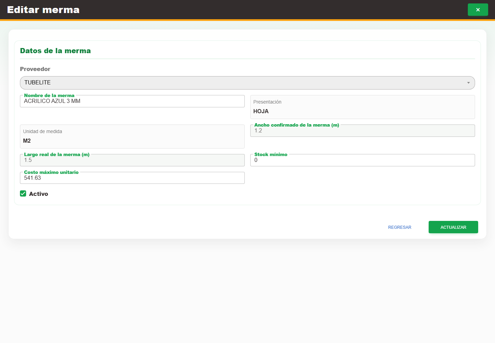

# 15. CAP-CAT-WAS-03-EDIT — Formulario de edición

**Casos de uso:** `CU-ALM-11` — Editar merma.

**Antes de empezar:** Vamos a actualizar un merma existente. Tenga identificado el registro correcto y los datos que necesita corregir.

**Errores posibles:** [Validación de formularios](../../error-messages.md#errores-validacion), [Catálogos e inventario](../../error-messages.md#errores-catalogos).

**Campos editables en modo edición:** **Nombre**, **Stock mínimo**, **Costo máximo unitario** y
**Activo**. **Proveedor**, material de referencia, presentación, unidad, ancho, largo y existencia
quedan sólo para consulta. Use la acción **Editar registro** y el botón **Actualizar**.

1. En la fila de la merma, seleccione la acción **Editar registro**. Observe los controles que va a usar:

   

2. Modifique **Nombre**, **Stock mínimo**, **Costo máximo unitario** o **Activo** según corresponda.
   Revise los demás datos sólo como referencia.
3. Seleccione el botón **Actualizar** para guardar los cambios.

**Compruebe el resultado:** Vuelva a abrir el registro y compruebe los cambios confirmados.
