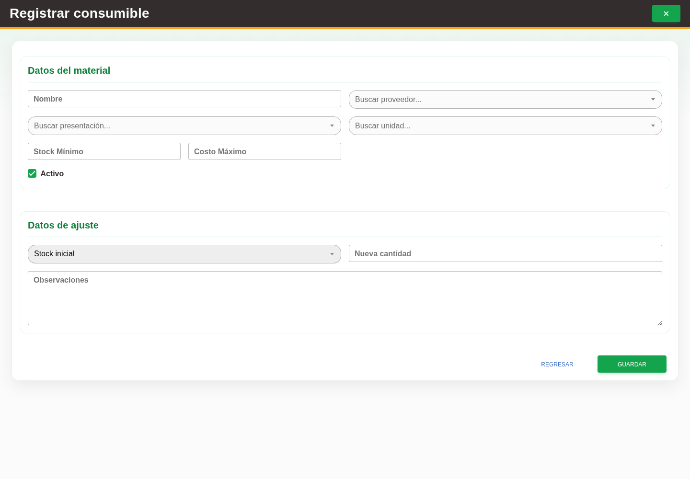

# 20. CAP-CAT-CON-02-CREATE — Formulario de alta

**Casos de uso:** `CU-ALM-18` — Crear consumible.

**Antes de empezar:** Vamos a registrar un consumible. Tenga los datos de la operación y confirme con quien le capacita que corresponde darlo de alta; busque primero si ya existe.

**Errores posibles:** [Validación de formularios](../../error-messages.md#errores-validacion),
[Catálogos e inventario](../../error-messages.md#errores-catalogos).

**Campos editables:** **Nombre**, proveedor, presentación, unidad, **Stock Mínimo**,
**Costo Máximo**, **Nueva cantidad**, **Observaciones** y **Activo**. El formulario no
muestra dimensiones y conserva **Stock inicial** como razón automática.

1. Seleccione **Nuevo consumible** y compruebe el formulario:

   

2. Capture el nombre; seleccione proveedor, presentación y unidad; complete mínimo,
   costo, existencia inicial y observaciones, y revise **Activo**.
3. Seleccione **Guardar**.

Si ya existe la misma oferta, Nexus rechaza el duplicado y no suma existencia. Si la
identidad existe con otro proveedor, reutiliza el consumible y crea sólo la nueva oferta.

**Compruebe el resultado:** Vuelva al listado y localice el registro guardado. Compruebe sus datos antes de continuar con otra operación.
