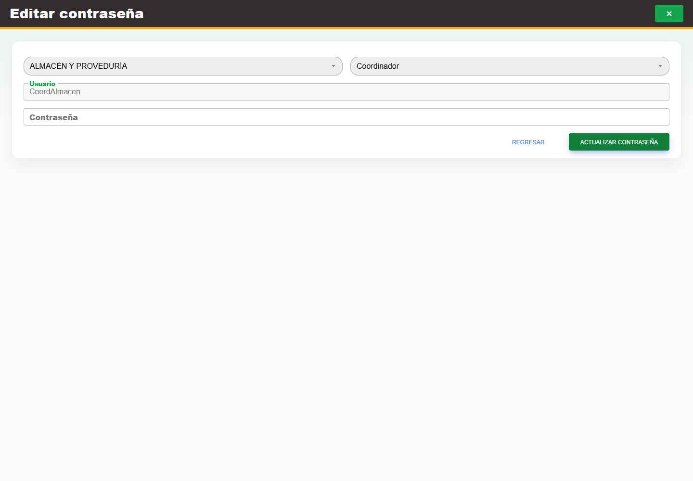

# 7. CAP-IDA-USR-04-PASSWORD — Cambio de contraseña

**Casos de uso:** `CU-IDA-08` — Cambiar contraseña de usuario.

**Antes de empezar:** Vamos a cambiar una contraseña como administrador. Confirme qué cuenta necesita recuperar el acceso y siga el procedimiento autorizado.

**Errores posibles:** [Validación de formularios](../../error-messages.md#errores-validacion), [Acceso y autorización](../../error-messages.md#errores-acceso), [Catálogos e inventario](../../error-messages.md#errores-catalogos).

**Controles que debe usar:** Acción **Cambiar contraseña**; campo **Contraseña**, botón **Actualizar contraseña** y botón **Regresar**.

1. En la fila de la cuenta, seleccione la acción **Cambiar contraseña**. Observe los controles que va a usar:

   

2. Compruebe que **Usuario**, área y rol permanezcan deshabilitados como referencia, y escriba la
   nueva clave conforme a la política en **Contraseña**.
3. Seleccione **Actualizar contraseña** para confirmar o **Regresar** para salir sin cambios.

**Compruebe el resultado:** Confirme el mensaje de cambio de contraseña sin publicar ni capturar la nueva clave.
